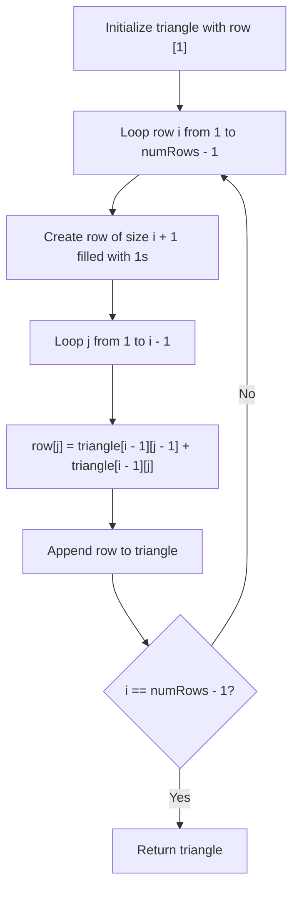

# 118. Pascal's Triangle

## Problem Statement

Given an integer `numRows`, return the first `numRows` of **Pascal's triangle**.

In **Pascal's triangle**, each number is the sum of the two numbers directly above it:

```
      [1]
     [1,1]
    [1,2,1]
   [1,3,3,1]
  [1,4,6,4,1]
```

### Example 1:
```
Input: numRows = 5
Output: [[1],[1,1],[1,2,1],[1,3,3,1],[1,4,6,4,1]]
```

### Example 2:
```
Input: numRows = 1
Output: [[1]]
```

### Constraints:
- $1 \le \text{numRows} \le 30$

---

## Approach

1. **Row Initialization:**
   - The first row is always `[1]`.
   - Each row $i$ (0-indexed) has exactly $i + 1$ elements.
   - The boundary elements at index $0$ and index $i$ are always `1`.

2. **Dynamic Generation:**
   - For row $i$ from $1$ to $\text{numRows} - 1$:
     - Initialize a row vector of length $i + 1$ with all values set to `1`.
     - Compute every internal element ($1 \le j < i$) by summing the two adjacent elements from the previous row:
       $$\text{row}[j] = \text{triangle}[i - 1][j - 1] + \text{triangle}[i - 1][j]$$
     - Append the completed row to `triangle`.



---

## Code Implementation

### C++

```cpp
class Solution {
public:
    vector<vector<int>> generate(int numRows) {
        vector<vector<int>> triangle;
        triangle.reserve(numRows);

        for (int i = 0; i < numRows; ++i) {
            vector<int> row(i + 1, 1);
            for (int j = 1; j < i; ++j) {
                row[j] = triangle[i - 1][j - 1] + triangle[i - 1][j];
            }
            triangle.push_back(move(row));
        }

        return triangle;
    }
};
```

### Python3

```python
class Solution:
    def generate(self, numRows: int) -> list[list[int]]:
        triangle = []

        for i in range(numRows):
            row = [1] * (i + 1)
            for j in range(1, i):
                row[j] = triangle[i - 1][j - 1] + triangle[i - 1][j]
            triangle.append(row)

        return triangle
```

---

## Complexity Analysis

- **Time Complexity**: $O(\text{numRows}^2)$ — Generating $N$ rows requires computing $\sum_{i=1}^{N} i = \frac{N(N + 1)}{2}$ values, each doing a constant-time addition.
- **Space Complexity**: $O(\text{numRows}^2)$ — To store the generated 2D triangle. Auxiliary space complexity is $O(1)$ beyond the return data structure.

---
