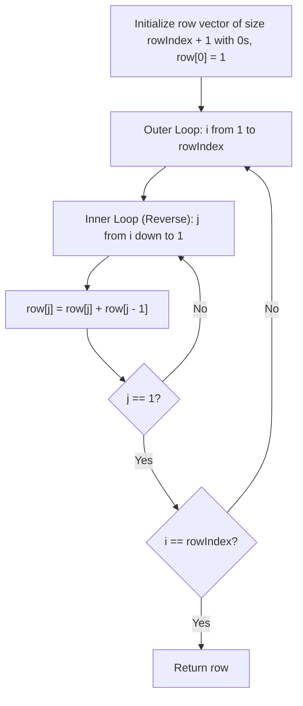

# 119. Pascal's Triangle II

## Problem Statement

Given an integer `rowIndex`, return the `rowIndex`$^{\text{th}}$ (**0-indexed**) row of the **Pascal's triangle**.

In **Pascal's triangle**, each number is the sum of the two numbers directly above it:

```
      [1]
     [1,1]
    [1,2,1]
   [1,3,3,1]
  [1,4,6,4,1]
```

### Example 1:
```
Input: rowIndex = 3
Output: [1,3,3,1]
```

### Example 2:
```
Input: rowIndex = 0
Output: [1]
```

### Example 3:
```
Input: rowIndex = 1
Output: [1,1]
```

### Constraints:
- $0 \le \text{rowIndex} \le 33$

**Follow up:** Could you optimize your algorithm to use only $O(\text{rowIndex})$ extra space?

---

## Approach

### Method 1: $O(\text{rowIndex})$ Space (Right-to-Left In-Place Update)
1. Allocate a single 1D array `row` of size $\text{rowIndex} + 1$, initialized with `row[0] = 1` and all other entries set to `0`.
2. For each row iteration $i$ from $1$ to $\text{rowIndex}$:
   - Update elements in **reverse order** (from $j = i$ down to $j = 1$):
     $$\text{row}[j] = \text{row}[j] + \text{row}[j - 1]$$
   - Traversing backwards is essential: it ensures $\text{row}[j - 1]$ still holds its previous-row value, avoiding overwriting data needed by subsequent calculations in the same step.
3. This achieves strict $O(\text{rowIndex})$ extra space.

### Method 2: Combinatorial Formula $O(\text{rowIndex})$ Time
Using the binomial coefficient definition:
$$\binom{n}{k} = \binom{n}{k - 1} \times \frac{n - k + 1}{k}$$
Starting with $\text{row}[0] = 1$, each subsequent element $k$ ($1 \le k \le n$) can be derived directly in $O(1)$ arithmetic operations using 64-bit integer types (`long long`) to avoid integer overflow.



---

## Code Implementation

### C++

```cpp
class Solution {
public:
    vector<int> getRow(int rowIndex) {
        vector<int> row(rowIndex + 1, 0);
        row[0] = 1;

        for (int i = 1; i <= rowIndex; ++i) {
            for (int j = i; j >= 1; --j) {
                row[j] += row[j - 1];
            }
        }

        return row;
    }
};
```

### Python3

```python
class Solution:
    def getRow(self, rowIndex: int) -> list[int]:
        row = [0] * (rowIndex + 1)
        row[0] = 1

        for i in range(1, rowIndex + 1):
            for j in range(i, 0, -1):
                row[j] += row[j - 1]

        return row
```

---

## Complexity Analysis

- **Time Complexity**: $O(\text{rowIndex}^2)$ — Running $1 + 2 + \dots + \text{rowIndex}$ additions for Method 1 (or $O(\text{rowIndex})$ using the combinatorial formula).
- **Space Complexity**: $O(\text{rowIndex})$ — Operating strictly in-place on a single array of size $\text{rowIndex} + 1$, satisfying the follow-up constraint.

---
