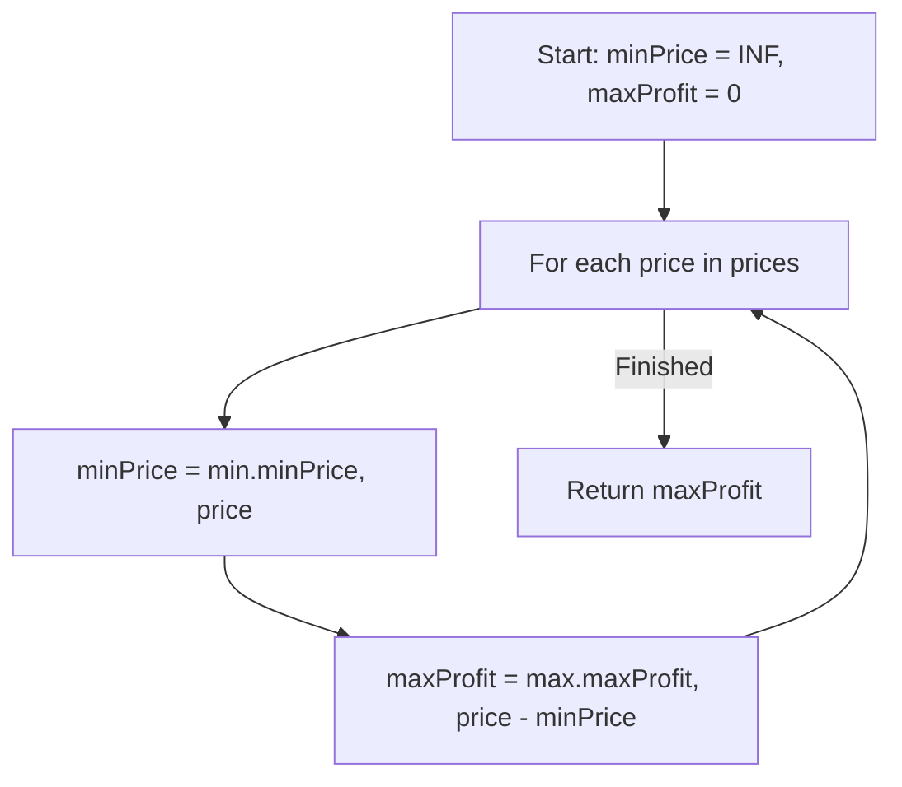

# 121. Best Time to Buy and Sell Stock

## Problem Statement

You are given an array `prices` where `prices[i]` is the price of a given stock on the $i^{\text{th}}$ day.

You want to maximize your profit by choosing a **single day** to buy one stock and choosing a **different day in the future** to sell that stock.

Return the maximum profit you can achieve from this transaction. If you cannot achieve any profit, return `0`.

### Example 1:
```
Input: prices = [7,1,5,3,6,4]
Output: 5
Explanation: Buy on day 2 (price = 1) and sell on day 5 (price = 6), profit = 6 - 1 = 5.
Note that buying on day 2 and selling on day 1 is not allowed because you must buy before you sell.
```

### Example 2:
```
Input: prices = [7,6,4,3,1]
Output: 0
Explanation: In this case, no transactions are done and the max profit = 0.
```

---

## Approach

We can solve this problem in a single pass using a **Greedy / One-Pass Running Minimum** approach:

1. Maintain `minPrice` initialized to infinity (or a large number like `1e9`) to track the lowest stock price encountered up to the current day.
2. Maintain `maxProfit` initialized to `0`.
3. For each `price` in `prices`:
   - Update `minPrice = std::min(minPrice, price)` (finding the best day to buy).
   - Calculate potential profit if sold today: `currentProfit = price - minPrice`.
   - Update `maxProfit = std::max(maxProfit, currentProfit)`.
4. Return `maxProfit`.



---

## Code Implementation

```cpp
#include <vector>
#include <algorithm>

class Solution {
public:
    int maxProfit(std::vector<int>& prices) {
        int minPrice = 1e9;
        int maxProfit = 0;
        
        for (int price : prices) {
            minPrice = std::min(minPrice, price);
            maxProfit = std::max(maxProfit, price - minPrice);
        }
        
        return maxProfit;
    }
};
```

---

## Complexity Analysis

- **Time Complexity**: $O(n)$ — We only traverse the `prices` array once.

- **Space Complexity**: $O(1)$ — Only two scalar variables (`minPrice` and `maxProfit`) are stored.

---
