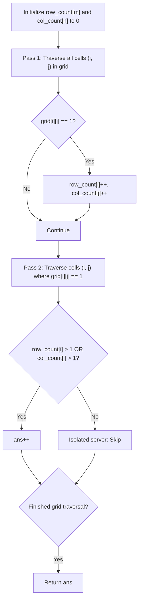

# 1267. Count Servers that Communicate

## Problem Statement

You are given a map of a server center, represented as a `m * n` integer matrix `grid`, where `1` means that on that cell there is a server and `0` means that it is no server. Two servers are said to communicate if they are on the same row or on the same column.

Return the number of servers that can communicate with at least one other server.

### Example 1:

```
Input: grid = [[1,0],[0,1]]
Output: 0
Explanation: No servers can communicate with others.
```

### Example 2:

```
Input: grid = [[1,0],[1,1]]
Output: 3
Explanation: All three servers can communicate with at least one other server.
```

### Example 3:

```
Input: grid = [[1,1,0,0],[0,0,1,0],[0,0,1,0],[0,0,0,1]]
Output: 4
Explanation: The two servers in the first row can communicate with each other. The two servers in the third column can communicate with each other. The server at right bottom corner cannot communicate with any other server.
```

### Constraints:

- `m == grid.length`
- `n == grid[i].length`
- $1 \le m, n \le 250$
- `grid[i][j] == 0` or `1`

---

## Approach

### 1. Communication Invariant
Two servers communicate if and only if they share the same row or the same column.
- Therefore, a server at position `(i, j)` can communicate with at least one other server if:
  $$\text{row\_count}[i] > 1 \quad \text{or} \quad \text{col\_count}[j] > 1$$
- If both $\text{row\_count}[i] == 1$ and $\text{col\_count}[j] == 1$, that server is completely isolated in both its row and column.

### 2. Two-Pass Counting Algorithm
1. **Pass 1 (Precomputation)**:
   - Traverse the matrix once to populate `row_count[i]` (number of servers in row $i$) and `col_count[j]` (number of servers in column $j$).
2. **Pass 2 (Validation)**:
   - Traverse the matrix a second time.
   - For every cell where `grid[i][j] == 1`, check whether `row_count[i] > 1 || col_count[j] > 1`.
   - If true, increment the answer.



---

## Code Implementation

### C++

```cpp
#include <vector>

using namespace std;

class Solution {
public:
    int countServers(vector<vector<int>>& grid) {
        int m = grid.size();
        int n = grid[0].size();
        
        vector<int> row_count(m, 0);
        vector<int> col_count(n, 0);

        // Pass 1: Count servers in each row and column
        for (int i = 0; i < m; ++i) {
            for (int j = 0; j < n; ++j) {
                if (grid[i][j] == 1) {
                    row_count[i]++;
                    col_count[j]++;
                }
            }
        }

        // Pass 2: Count servers that share a row or column with another server
        int communicable_servers = 0;
        for (int i = 0; i < m; ++i) {
            for (int j = 0; j < n; ++j) {
                if (grid[i][j] == 1 && (row_count[i] > 1 || col_count[j] > 1)) {
                    communicable_servers++;
                }
            }
        }

        return communicable_servers;
    }
};
```

### Python3

```python
class Solution:
    def countServers(self, grid: list[list[int]]) -> int:
        m, n = len(grid), len(grid[0])
        row_count = [0] * m
        col_count = [0] * n

        # Pass 1: Count servers per row and column
        for i in range(m):
            for j in range(n):
                if grid[i][j] == 1:
                    row_count[i] += 1
                    col_count[j] += 1

        # Pass 2: Tally servers capable of communication
        ans = 0
        for i in range(m):
            for j in range(n):
                if grid[i][j] == 1 and (row_count[i] > 1 or col_count[j] > 1):
                    ans += 1

        return ans
```

---

## Complexity Analysis

- **Time Complexity**: $O(m \cdot n)$ — We perform two complete linear scans of the $m \times n$ grid.
- **Space Complexity**: $O(m + n)$ — Additional space used by `row_count` of length $m$ and `col_count` of length $n$.

---