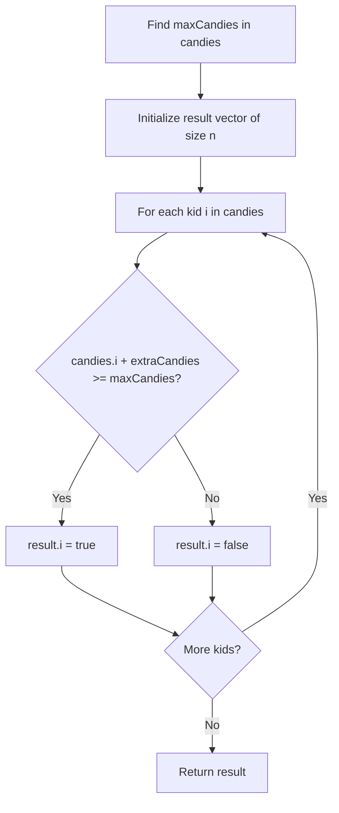

# 1431. Kids With the Greatest Number of Candies

## Problem Statement

There are `n` kids with candies. You are given an integer array `candies`, where each `candies[i]` represents the number of candies the `i`th kid has, and an integer `extraCandies`, denoting the number of extra candies that you have.

Return a boolean array `result` of length `n`, where `result[i]` is `true` if, after giving the `i`th kid all the `extraCandies`, they will have the **greatest** number of candies among all the kids, or `false` otherwise.

Note that multiple kids can have the greatest number of candies.

### Example 1:
```
Input: candies = [2,3,5,1,3], extraCandies = 3
Output: [true,true,true,false,true] 
Explanation: If you give all extraCandies to:
- Kid 1, they will have 2 + 3 = 5 candies, which is the greatest among the kids.
- Kid 2, they will have 3 + 3 = 6 candies, which is the greatest among the kids.
- Kid 3, they will have 5 + 3 = 8 candies, which is the greatest among the kids.
- Kid 4, they will have 1 + 3 = 4 candies, which is not the greatest among the kids.
- Kid 5, they will have 3 + 3 = 6 candies, which is the greatest among the kids.
```

### Example 2:
```
Input: candies = [4,2,1,1,2], extraCandies = 1
Output: [true,false,false,false,false] 
Explanation: There is only 1 extra candy. Kid 1 will always have the greatest number of candies, even if a different kid is given the extra candy.
```

### Example 3:
```
Input: candies = [12,1,12], extraCandies = 10
Output: [true,false,true]
```

### Constraints:
- `n == candies.length`
- `2 <= n <= 100`
- `1 <= candies[i] <= 100`
- `1 <= extraCandies <= 50`

---

## Approach

We can solve this in two simple linear passes:

1. **Find Maximum**: Determine the current highest number of candies any kid holds (`maxCandies`) using `std::max_element`.
2. **Evaluate Potential**: Traverse the array for each kid. If `candies[i] + extraCandies >= maxCandies`, mark `result[i] = true`, otherwise `false`.
3. Return the populated `result` vector.



---

## Code Implementation

```cpp
#include <vector>
#include <algorithm>

class Solution {
public:
    std::vector<bool> kidsWithCandies(std::vector<int>& candies, int extraCandies) {
        int maxCandies = *std::max_element(candies.begin(), candies.end());
        std::vector<bool> result(candies.size());
        
        for (size_t i = 0; i < candies.size(); ++i) {
            result[i] = (candies[i] + extraCandies >= maxCandies);
        }
        
        return result;
    }
};
```

---

## Complexity Analysis

- **Time Complexity**: $O(n)$ — We make one pass to find the maximum candies and a second pass to construct the result boolean array.

- **Space Complexity**: $O(1)$ — Auxiliary space is $O(1)$ excluding the output array.

---
