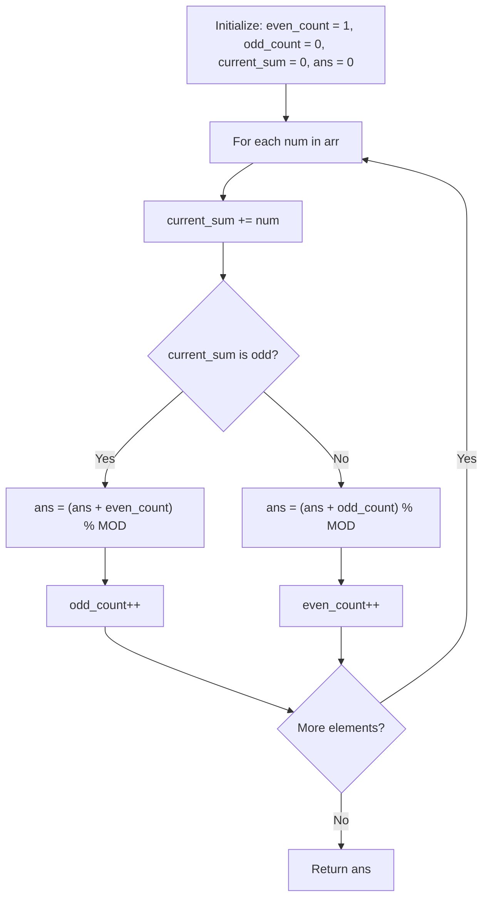

# 1524. Number of Sub-arrays With Odd Sum

## Problem Statement

Given an array of integers `arr`, return the number of subarrays with an **odd** sum.

Since the answer can be very large, return it modulo $10^9 + 7$.

### Example 1:

```
Input: arr = [1, 3, 5]
Output: 4
Explanation: All subarrays are [[1], [1, 3], [1, 3, 5], [3], [3, 5], [5]].
All subarray sums are [1, 4, 9, 3, 8, 5].
Odd sums are [1, 9, 3, 5], so the answer is 4.
```

### Example 2:

```
Input: arr = [2, 4, 6]
Output: 0
Explanation: All subarrays are [[2], [2, 4], [2, 4, 6], [4], [4, 6], [6]].
All subarray sums are [2, 6, 12, 4, 10, 6].
All subarray sums are even, so the answer is 0.
```

### Example 3:

```
Input: arr = [1, 2, 3, 4, 5, 6, 7]
Output: 16
```

### Constraints:

- $1 \le \text{arr.length} \le 10^5$
- $1 \le \text{arr}[i] \le 100$

---

## Approach

### 1. Prefix Sum Parity Property
The sum of any contiguous subarray $\text{arr}[i \dots j]$ ($0 \le i \le j < n$) can be expressed using prefix sums:
$$\text{Sum}(i, j) = \text{prefix}[j] - \text{prefix}[i - 1]$$
(where $\text{prefix}[-1] = 0$).

For $\text{Sum}(i, j)$ to be **odd**, the two prefix sums must have **different parities**:
- $\text{odd} - \text{even} = \text{odd}$
- $\text{even} - \text{odd} = \text{odd}$

Conversely:
- $\text{even} - \text{even} = \text{even}$
- $\text{odd} - \text{odd} = \text{even}$

### 2. Single-Pass Parity Counting
Instead of generating all $O(n^2)$ subarrays, we can traverse the array while maintaining running counts of how many prefix sums encountered so far have been **even** and how many have been **odd**:

1. **Initial State (Base Case)**:
   - Before processing any elements, the initial prefix sum is $0$, which is **even**.
   - `even_count = 1`, `odd_count = 0`, `ans = 0`.

2. **Iterative Transition**:
   - For each number `num` in `arr`, update the running prefix sum:
     $$\text{current\_sum} = \text{current\_sum} + \text{num}$$
   - **Case 1: `current_sum` is odd**:
     - Pairing this prefix with any previous prefix sum that is **even** yields an odd subarray sum.
     - Add `even_count` to `ans`.
     - Increment `odd_count` by 1.
   - **Case 2: `current_sum` is even**:
     - Pairing this prefix with any previous prefix sum that is **odd** yields an odd subarray sum.
     - Add `odd_count` to `ans`.
     - Increment `even_count` by 1.
   - Take `ans = ans % (10^9 + 7)` to prevent overflow.



---

## Code Implementation

### C++

```cpp
#include <vector>

using namespace std;

class Solution {
public:
    int numOfSubarrays(vector<int>& arr) {
        constexpr int MOD = 1'000'000'007;
        long long even_count = 1; // prefix sum 0 is even
        long long odd_count = 0;
        long long current_sum = 0;
        long long ans = 0;

        for (int num : arr) {
            current_sum += num;
            if (current_sum % 2 != 0) {
                ans = (ans + even_count) % MOD;
                odd_count++;
            } else {
                ans = (ans + odd_count) % MOD;
                even_count++;
            }
        }

        return static_cast<int>(ans);
    }
};
```

### Python3

```python
class Solution:
    def numOfSubarrays(self, arr: list[int]) -> int:
        MOD = 10**9 + 7
        even_count = 1  # Base case: prefix sum of 0 is even
        odd_count = 0
        current_sum = 0
        ans = 0

        for num in arr:
            current_sum += num
            if current_sum % 2 != 0:
                ans = (ans + even_count) % MOD
                odd_count += 1
            else:
                ans = (ans + odd_count) % MOD
                even_count += 1

        return ans
```

---

## Complexity Analysis

- **Time Complexity**: $O(n)$ — where $n$ is the length of `arr`. We process each element exactly once in a single linear scan, performing constant-time arithmetic and modular operations.
- **Space Complexity**: $O(1)$ — Only a few primitive integer counters (`even_count`, `odd_count`, `current_sum`, and `ans`) are maintained, requiring constant auxiliary memory.

---
