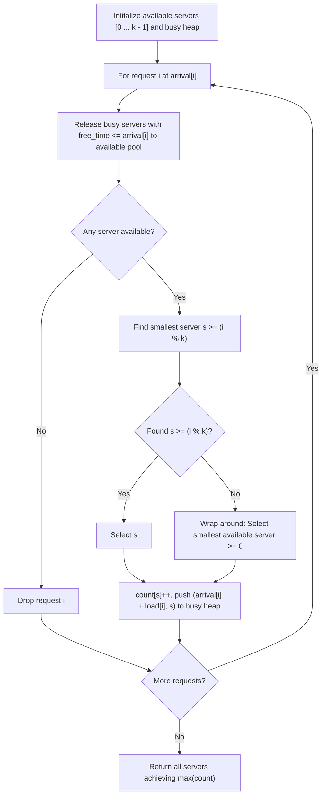

# 1606. Find Servers That Handled Most Number of Requests

## Problem Statement

You have `k` servers numbered from `0` to `k - 1` that are being used to handle an incoming stream of requests. Each server has the same computational capacity, but they cannot handle more than one request at a time. The requests are assigned to servers according to a specific algorithm:

- The $i^{\text{th}}$ (0-indexed) request arrives.
- If all servers are busy, the request is dropped (not handled at all).
- If the $(i \% k)^{\text{th}}$ server is available, handle the request using that server.
- Otherwise, search for the next available server in circular order: $((i + 1) \% k)$, $((i + 2) \% k)$, and so on.

You are given a **strictly increasing** integer array `arrival`, where `arrival[i]` represents the arrival time of the $i^{\text{th}}$ request, and another integer array `load`, where `load[i]` represents the load (amount of time) needed by the $i^{\text{th}}$ request.

Return a list containing the IDs of the **busiest server(s)**. You may return the IDs in any order.

### Example 1:

```
Input: k = 3, arrival = [1,2,3,4,5], load = [5,2,3,3,3]
Output: [1]
Explanation: 
- At time 1, server 0 handles request 0 (busy until time 6).
- At time 2, server 1 handles request 1 (busy until time 4).
- At time 3, server 2 handles request 2 (busy until time 6).
- At time 4, request 3 arrives. Server 0 and server 2 are busy, server 1 is free, so server 1 handles request 3 (busy until time 7).
- At time 5, request 4 arrives. All servers are busy, so request 4 is dropped.
Servers 0, 1, and 2 handled 1, 2, and 1 request(s) respectively. Server 1 handled the most (2 requests).
```

### Example 2:

```
Input: k = 3, arrival = [1,2,3,4], load = [1,2,1,2]
Output: [0]
Explanation: 
- The first 3 requests are handled by servers 0, 1, 2.
- At time 4, request 3 arrives (target = 3 % 3 = 0). Server 0 is free and handles request 3.
Server 0 handled 2 requests, while servers 1 and 2 handled 1 request each. Output is [0].
```

### Example 3:

```
Input: k = 3, arrival = [1,2,3], load = [10,12,11]
Output: [0,1,2]
Explanation: Each server handles 1 request, so all servers are busiest.
```

### Constraints:

- $1 \le k \le 10^5$
- $1 \le \text{arrival.length}, \text{load.length} \le 10^5$
- $\text{arrival.length} == \text{load.length}$
- $1 \le \text{arrival}[i], \text{load}[i] \le 10^9$
- `arrival` is **strictly increasing**.

---

## Approach

### 1. Naive Simulation vs Optimized Tracking
A linear circular search for each request takes $O(k)$ time in the worst case, yielding an overall $O(n \cdot k)$ complexity, which will result in **Time Limit Exceeded (TLE)** for $n, k \le 10^5$.
Instead, we must manage:
1. **Busy Servers**: Servers that will become free at some future time. A **Min-Heap** ordered by `(free_time, server_id)` allows us to efficiently release servers in $O(\log k)$ time.
2. **Available Servers with Circular Lookup**:
   - For request $i$, we prefer the smallest server ID $s \ge i \% k$.
   - If no server exists with $s \ge i \% k$, we wrap around to pick the smallest server $s \ge 0$.

### 2. C++ Strategy (`std::set` + Min-Heap)
- Maintain `std::set<int> available` containing currently idle server indices.
- When servers finish at or before `arrival[i]`, insert their IDs back into `available`.
- Use `available.lower_bound(i % k)`:
  - If found (iterator $\neq \text{end}$), assign to `*it`.
  - If not found (reached end), wrap around to `*available.begin()`.
- Erase the chosen server from `available` and push `(arrival[i] + load[i], server)` into the busy heap.

### 3. Pure Python Strategy (Dual Min-Heaps)
Python does not have a built-in balanced BST like `std::set`. While `sortedcontainers.SortedList` can be used on LeetCode, we can achieve optimal $O(n \log k)$ using **two min-heaps** without external dependencies:
- `avail_ge`: available servers with ID $\ge i \% k$.
- `avail_lt`: available servers with ID $< i \% k$.
- As `target = i % k` advances, servers in `avail_ge` that fall below `target` are transferred to `avail_lt`. When `target == 0`, all servers in `avail_lt` merge back into `avail_ge`.
- This ensures $O(\log k)$ retrieval with zero external dependencies.



---

## Code Implementation

### C++

```cpp
#include <vector>
#include <queue>
#include <set>
#include <algorithm>

using namespace std;

class Solution {
public:
    vector<int> busiestServers(int k, vector<int>& arrival, vector<int>& load) {
        int n = arrival.size();

        // Min-heap for busy servers: stores {free_time, server_id}
        using BusyPair = pair<long long, int>;
        priority_queue<BusyPair, vector<BusyPair>, greater<BusyPair>> busy;

        // Balanced BST for idle servers
        set<int> available;
        for (int i = 0; i < k; ++i) {
            available.insert(i);
        }

        vector<int> count(k, 0);

        for (int i = 0; i < n; ++i) {
            long long t = arrival[i];
            long long l = load[i];

            // 1. Free up servers that finished before or at current arrival time
            while (!busy.empty() && busy.top().first <= t) {
                available.insert(busy.top().second);
                busy.pop();
            }

            // 2. If no server is free, drop the request
            if (available.empty()) {
                continue;
            }

            // 3. Find server >= (i % k), wrapping circularly if needed
            int target = i % k;
            auto it = available.lower_bound(target);
            int server_id;
            if (it != available.end()) {
                server_id = *it;
            } else {
                server_id = *available.begin(); // Wrap around
            }

            // 4. Assign request to server
            available.erase(server_id);
            count[server_id]++;
            busy.push({t + l, server_id});
        }

        // 5. Collect all servers that handled the maximum number of requests
        int max_handled = *max_element(count.begin(), count.end());
        vector<int> result;
        for (int i = 0; i < k; ++i) {
            if (count[i] == max_handled) {
                result.push_back(i);
            }
        }

        return result;
    }
};
```

### Python3

```python
import heapq

class Solution:
    def busiestServers(self, k: int, arrival: list[int], load: list[int]) -> list[int]:
        # avail_ge: min-heap of available servers >= target
        # avail_lt: min-heap of available servers < target
        avail_ge = list(range(k))
        heapq.heapify(avail_ge)
        avail_lt = []
        
        # busy: min-heap of (free_time, server_id)
        busy = []
        count = [0] * k

        for i, (t, l) in enumerate(zip(arrival, load)):
            target = i % k

            # When target cycles back to 0, all servers in avail_lt are >= 0
            if target == 0 and avail_lt:
                avail_ge.extend(avail_lt)
                heapq.heapify(avail_ge)
                avail_lt = []

            # Release busy servers
            while busy and busy[0][0] <= t:
                _, s = heapq.heappop(busy)
                if s >= target:
                    heapq.heappush(avail_ge, s)
                else:
                    heapq.heappush(avail_lt, s)

            # Move servers < target from avail_ge to avail_lt
            while avail_ge and avail_ge[0] < target:
                heapq.heappush(avail_lt, heapq.heappop(avail_ge))

            # Pick next available server
            if avail_ge:
                server = heapq.heappop(avail_ge)
            elif avail_lt:
                server = heapq.heappop(avail_lt)
            else:
                continue

            count[server] += 1
            heapq.heappush(busy, (t + l, server))

        max_handled = max(count)
        return [i for i, c in enumerate(count) if c == max_handled]
```

---

## Complexity Analysis

- **Time Complexity**: $O(n \log k)$
  - In C++, each request involves a `lower_bound`, `erase`, and heap `push`/`pop`, all operating in $O(\log k)$.
  - In Python, each server enters and leaves the dual heaps at most twice per full modulo cycle, maintaining an amortized $O(\log k)$ per request.
  - Overall time complexity is $O(n \log k)$ where $n$ is the number of requests and $k$ is the number of servers.

- **Space Complexity**: $O(k)$
  - The heaps and set store at most $k$ servers at any time.
  - The `count` array requires $O(k)$ space.

---