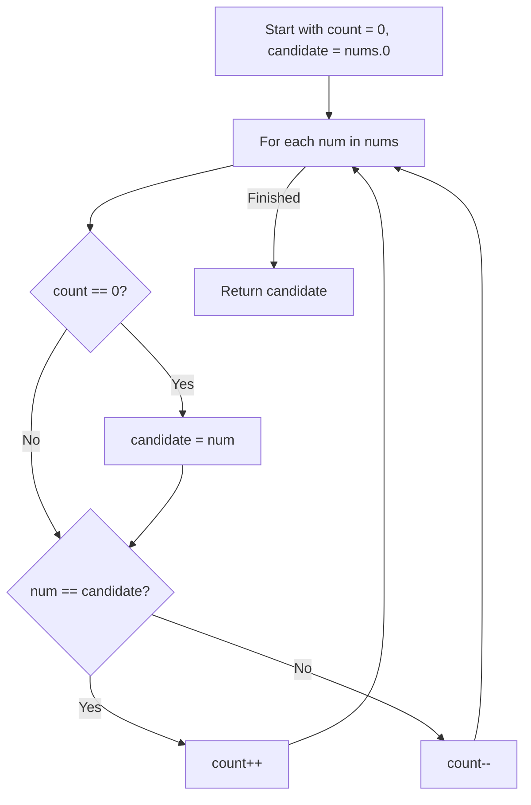

# 169. Majority Element

## Problem Statement

Given an array `nums` of size `n`, return the *majority element*.

The majority element is the element that appears more than $\lfloor n / 2 \rfloor$ times. You may assume that the majority element always exists in the array.

### Example 1:
```
Input: nums = [3,2,3]
Output: 3
```

### Example 2:
```
Input: nums = [2,2,1,1,1,2,2]
Output: 2
```

---

## Approach

The most optimal way to solve this is the **Boyer-Moore Voting Algorithm**:

1. Since the majority element appears more than $n / 2$ times, its count will exceed the sum of all other elements combined.
2. Maintain a `candidate` and a `count`:
   - Initialize `candidate = nums[0]` and `count = 0`.
   - Iterate through the elements:
     - If `count == 0`, assign `candidate = num`.
     - If `num == candidate`, increment `count++`.
     - Otherwise, decrement `count--`.
3. The remaining `candidate` at the end of the scan is guaranteed to be the majority element.



---

## Code Implementation

```cpp
#include <vector>

class Solution {
public:
    int majorityElement(std::vector<int>& nums) {
        int candidate = nums[0];
        int count = 0;
        
        for (int num : nums) {
            if (count == 0) {
                candidate = num;
            }
            count += (num == candidate) ? 1 : -1;
        }
        
        return candidate;
    }
};
```

---

## Complexity Analysis

- **Time Complexity**: $O(n)$ — Single traversal over the array of size $n$.

- **Space Complexity**: $O(1)$ — Only two scalar variables (`candidate` and `count`) are used.

---
