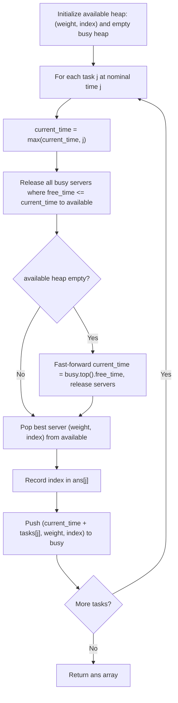

# 1882. Process Tasks Using Servers

## Problem Statement

You are given two **0-indexed** integer arrays `servers` and `tasks` of lengths `n` and `m` respectively. `servers[i]` is the **weight** of the $i^{\text{th}}$ server, and `tasks[j]` is the **time needed** to process the $j^{\text{th}}$ task in seconds.

Tasks are assigned to the servers using a **task queue**. Initially, all servers are free, and the queue is empty.

At second `j`, the $j^{\text{th}}$ task is added to the queue (starting with the $0^{\text{th}}$ task at second `0`). As long as there are free servers and the queue is not empty, the task in the front of the queue will be assigned to a free server with the **smallest weight**, and in case of a tie, it is assigned to a free server with the **smallest index**.

If there are no free servers and the queue is not empty, we wait until a server becomes free and immediately assign the next task. If multiple servers become free at the same time, then multiple tasks from the queue will be assigned in order of arrival following the weight and index priority rule.

A server that is assigned task `j` at second `t` will be free again at second `t + tasks[j]`.

Build an array `ans` of length `m`, where `ans[j]` is the index of the server the $j^{\text{th}}$ task will be assigned to.

Return the array `ans`.

### Example 1:

```
Input: servers = [3,3,2], tasks = [1,2,3,2,1,2]
Output: [2,2,0,2,1,2]
Explanation: Events proceed as follows:
- At second 0, task 0 is added and processed using server 2 until second 1.
- At second 1, server 2 becomes free. Task 1 is added and processed using server 2 until second 3.
- At second 2, task 2 is added and processed using server 0 until second 5.
- At second 3, server 2 becomes free. Task 3 is added and processed using server 2 until second 5.
- At second 4, task 4 is added and processed using server 1 until second 5.
- At second 5, all servers become free. Task 5 is added and processed using server 2 until second 7.
```

### Example 2:

```
Input: servers = [5,1,4,3,2], tasks = [2,1,2,4,5,2,1]
Output: [1,4,1,4,1,3,2]
Explanation: Events proceed as follows:
- At second 0, task 0 is added and processed using server 1 until second 2.
- At second 1, task 1 is added and processed using server 4 until second 2.
- At second 2, servers 1 and 4 become free. Task 2 is added and processed using server 1 until second 4.
- At second 3, task 3 is added and processed using server 4 until second 7.
- At second 4, server 1 becomes free. Task 4 is added and processed using server 1 until second 9.
- At second 5, task 5 is added. No free servers are available, so we wait until second 7 when server 4 becomes free. Task 5 is processed using server 4 until second 9.
- At second 6, task 6 is added. Server 3 is free (it was never used). Task 6 is processed using server 3 until second 7.
```

### Constraints:

- `servers.length == n`
- `tasks.length == m`
- $1 \le n, m \le 2 \times 10^5$
- $1 \le \text{servers}[i], \text{tasks}[j] \le 2 \times 10^5$

---

## Approach

### 1. Dual Priority Queues (Heaps)
To simulate the scheduling process in optimal time:
1. **Available Servers Heap (`available`)**:
   - A min-heap storing tuples of `(weight, index)`.
   - C++ and Python both naturally sort tuples lexicographically by `weight` first, and tie-break by `index`.
   - Provides $O(\log n)$ extraction of the highest-priority free server.
2. **Busy Servers Heap (`busy`)**:
   - A min-heap storing tuples of `(free_time, weight, index)`.
   - Tracks when currently processing servers become available.
   - Ordered by earliest `free_time`.

### 2. Event-Driven Time Advancement
For each task $j$ arriving at nominal time $j$:
1. **Advance Current Time**: $\text{current\_time} = \max(\text{current\_time}, j)$.
2. **Free Up Servers**: Pop all servers from `busy` where $\text{free\_time} \le \text{current\_time}$ and push them into `available`.
3. **Handle Server Starvation**: If `available` is empty, fast-forward `current\_time` directly to the `free_time` of the earliest available server in `busy` (`busy.top().free_time`), then pop all servers finishing at or before that new time.
4. **Assign Task**: Pop the top server `(weight, index)` from `available`, record `index` in the answer for task $j$, and push `(current_time + tasks[j], weight, index)` back into `busy`.



---

## Code Implementation

### C++

```cpp
#include <vector>
#include <queue>
#include <tuple>
#include <algorithm>

using namespace std;

class Solution {
public:
    vector<int> assignTasks(vector<int>& servers, vector<int>& tasks) {
        int n = servers.size();
        int m = tasks.size();

        // available heap: stores {weight, index}
        using Server = pair<int, int>;
        priority_queue<Server, vector<Server>, greater<Server>> available;
        for (int i = 0; i < n; ++i) {
            available.push({servers[i], i});
        }

        // busy heap: stores {free_time, weight, index}
        using BusyServer = tuple<long long, int, int>;
        priority_queue<BusyServer, vector<BusyServer>, greater<BusyServer>> busy;

        vector<int> ans(m);
        long long current_time = 0;

        for (int j = 0; j < m; ++j) {
            current_time = max(current_time, (long long)j);

            // Free up all servers that have finished by current_time
            while (!busy.empty() && get<0>(busy.top()) <= current_time) {
                auto [free_time, weight, index] = busy.top();
                busy.pop();
                available.push({weight, index});
            }

            // If no servers are available, jump time to the earliest finish time
            if (available.empty()) {
                current_time = get<0>(busy.top());
                while (!busy.empty() && get<0>(busy.top()) <= current_time) {
                    auto [free_time, weight, index] = busy.top();
                    busy.pop();
                    available.push({weight, index});
                }
            }

            // Assign the task to the best available server
            auto [weight, index] = available.top();
            available.pop();
            ans[j] = index;

            busy.push({current_time + tasks[j], weight, index});
        }

        return ans;
    }
};
```

### Python3

```python
import heapq

class Solution:
    def assignTasks(self, servers: list[int], tasks: list[int]) -> list[int]:
        # available: min-heap of (weight, index)
        available = [(w, i) for i, w in enumerate(servers)]
        heapq.heapify(available)
        
        # busy: min-heap of (free_time, weight, index)
        busy = []
        
        ans = []
        current_time = 0
        
        for j, t in enumerate(tasks):
            current_time = max(current_time, j)
            
            # Release servers that completed their tasks
            while busy and busy[0][0] <= current_time:
                _, w, i = heapq.heappop(busy)
                heapq.heappush(available, (w, i))
                
            # If all servers are busy, advance time to the earliest completion
            if not available:
                current_time = busy[0][0]
                while busy and busy[0][0] <= current_time:
                    _, w, i = heapq.heappop(busy)
                    heapq.heappush(available, (w, i))
                    
            # Pick best available server
            w, i = heapq.heappop(available)
            ans.append(i)
            heapq.heappush(busy, (current_time + t, w, i))
            
        return ans
```

---

## Complexity Analysis

- **Time Complexity**: $O((n + m) \log n)$
  - Building the initial `available` heap of $n$ servers takes $O(n)$ or $O(n \log n)$ time.
  - For each of the $m$ tasks, each server is pushed and popped from `available` and `busy` at most once per assignment.
  - Since the heap holds at most $n$ servers, each operation costs $O(\log n)$, giving $O(m \log n)$ total scheduling time.

- **Space Complexity**: $O(n + m)$
  - $O(n)$ to maintain the `available` and `busy` priority queues.
  - $O(m)$ for the output array `ans`.

---