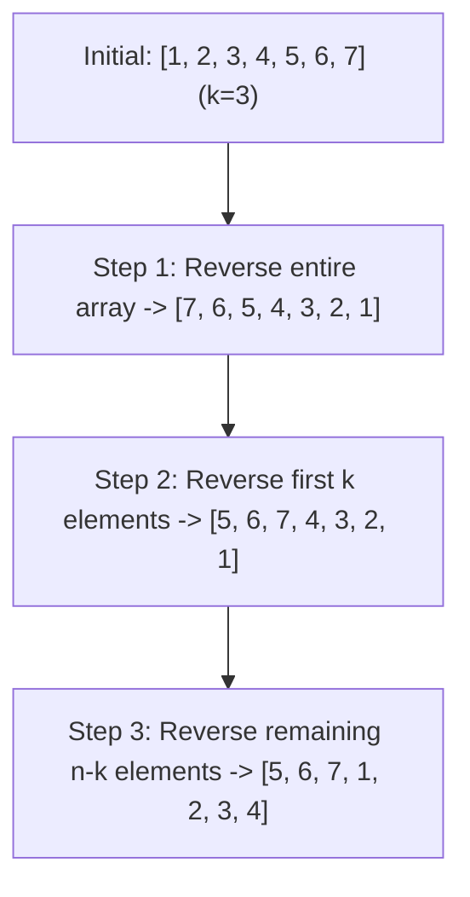

# 189. Rotate Array

## Problem Statement

Given an integer array `nums`, rotate the array to the right by `k` steps, where `k` is non-negative.

### Example 1:
```
Input: nums = [1,2,3,4,5,6,7], k = 3
Output: [5,6,7,1,2,3,4]
Explanation:
rotate 1 steps to the right: [7,1,2,3,4,5,6]
rotate 2 steps to the right: [6,7,1,2,3,4,5]
rotate 3 steps to the right: [5,6,7,1,2,3,4]
```

### Example 2:
```
Input: nums = [-1,-100,3,99], k = 2
Output: [3,99,-1,-100]
Explanation: 
rotate 1 steps to the right: [99,-1,-100,3]
rotate 2 steps to the right: [3,99,-1,-100]
```

---

## Approach

The most elegant and space-efficient solution is the **3-Step Reverse Algorithm**:

1. First normalize `k = k % n` because rotating by `n` steps returns the array to its original state.
2. Observe that rotating by `k` steps moves the last `k` elements to the front and shifts the first `n - k` elements to the back.
3. We can achieve this in-place with three reversals:
   - **Step 1:** Reverse the entire array from index `0` to `n - 1`.
   - **Step 2:** Reverse the first `k` elements from index `0` to `k - 1`.
   - **Step 3:** Reverse the remaining `n - k` elements from index `k` to `n - 1`.



---

## Code Implementation

```cpp
#include <vector>
#include <algorithm>

class Solution {
public:
    void rotate(std::vector<int>& nums, int k) {
        int n = nums.size();
        k = k % n;
        
        // 1. Reverse entire array
        std::reverse(nums.begin(), nums.end());
        // 2. Reverse first k elements
        std::reverse(nums.begin(), nums.begin() + k);
        // 3. Reverse remaining elements
        std::reverse(nums.begin() + k, nums.end());
    }
};
```

---

## Complexity Analysis

- **Time Complexity**: $O(n)$ — Each element is reversed twice across the three reverse steps, giving $O(2n) = O(n)$ time.

- **Space Complexity**: $O(1)$ — In-place rotation; no extra memory allocated.

---
