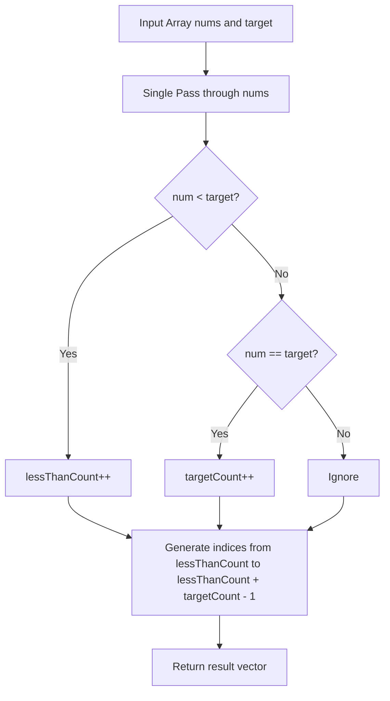

# 2089. Find Target Indices After Sorting Array

## Problem Statement

You are given a **0-indexed** integer array `nums` and a target element `target`.

A **target index** is an index `i` such that `nums[i] == target`.

Return *a list of the target indices of* `nums` *after sorting* `nums` *in **non-decreasing** order*. If there are no target indices, return an *empty* list. The returned list must be sorted in **increasing** order.

### Example 1:
```
Input: nums = [1,2,5,2,3], target = 2
Output: [1,2]
Explanation: After sorting, nums is [1,2,2,3,5].
The indices where nums[i] == 2 are 1 and 2.
```

### Example 2:
```
Input: nums = [1,2,5,2,3], target = 3
Output: [3]
Explanation: After sorting, nums is [1,2,2,3,5].
The index where nums[i] == 3 is 3.
```

### Example 3:
```
Input: nums = [1,2,5,2,3], target = 5
Output: [4]
Explanation: After sorting, nums is [1,2,2,3,5].
The index where nums[i] == 5 is 4.
```

### Constraints:
- `1 <= nums.length <= 100`
- `1 <= nums[i], target <= 100`

---

## Approach

### Intuition: Counting Elements Without Full Sorting

While we can sort `nums` in $O(n \log n)$ time and then find all occurrences of `target`, we can achieve a strictly optimal **$O(n)$** one-pass solution by observing the properties of a sorted array:

1. **Starting Index**: In any sorted array, all elements strictly smaller than `target` must appear before `target`. Hence, the first occurrence of `target` will be at index `lessThanCount` (the number of elements strictly smaller than `target`).
2. **Span / Frequency**: The number of target indices is simply the count of occurrences of `target` in `nums` (`targetCount`).
3. **Index Generation**: The target indices after sorting will simply be the consecutive sequence:
   $$[\text{lessThanCount}, \text{lessThanCount} + 1, \dots, \text{lessThanCount} + \text{targetCount} - 1]$$

This avoids mutating or sorting the original array, running in a single linear scan.



---

## Code Implementation

```cpp
#include <vector>

class Solution {
public:
    std::vector<int> targetIndices(std::vector<int>& nums, int target) {
        int lessThanCount = 0;
        int targetCount = 0;
        
        for (int num : nums) {
            if (num < target) {
                lessThanCount++;
            } else if (num == target) {
                targetCount++;
            }
        }
        
        std::vector<int> result;
        result.reserve(targetCount);
        for (int i = 0; i < targetCount; ++i) {
            result.push_back(lessThanCount + i);
        }
        
        return result;
    }
};
```

---

## Complexity Analysis

- **Time Complexity**: $O(n)$ — We perform a single linear traversal over `nums` of size $n$, followed by filling the result vector of length $k \le n$. This improves upon the $O(n \log n)$ sorting approach.
- **Space Complexity**: $O(1)$ — Auxiliary space is $O(1)$ excluding the returned output vector.

---
