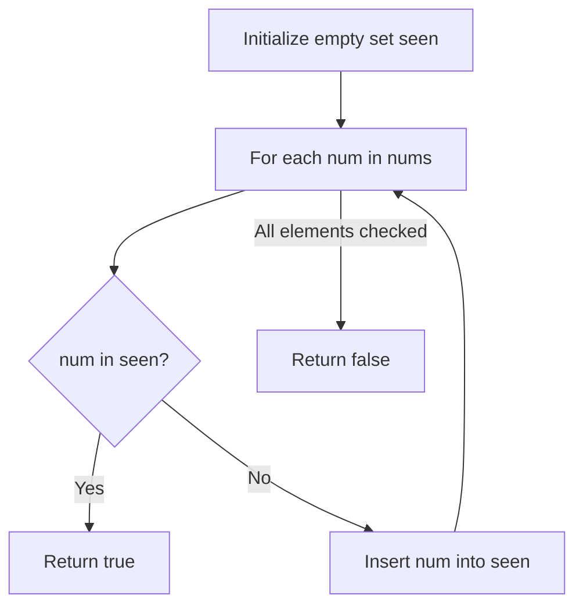

# 217. Contains Duplicate

## Problem Statement

Given an integer array `nums`, return `true` if any value appears **at least twice** in the array, and return `false` if every element is distinct.

### Example 1:
```
Input: nums = [1,2,3,1]
Output: true
Explanation: The element 1 occurs at the indices 0 and 3.
```

### Example 2:
```
Input: nums = [1,2,3,4]
Output: false
Explanation: All elements are distinct.
```

### Example 3:
```
Input: nums = [1,1,1,3,3,4,3,2,4,2]
Output: true
```

---

## Approach

We can use an **Unordered Hash Set** (`std::unordered_set<int>`):

1. Initialize an empty hash set `seen`.
2. Iterate through each element in `nums`.
3. Check if `num` is already in `seen`:
   - If it is found, return `true` immediately because a duplicate has been detected.
   - Otherwise, insert `num` into `seen`.
4. If the loop completes without finding duplicates, return `false`.



---

## Code Implementation

```cpp
#include <vector>
#include <unordered_set>

class Solution {
public:
    bool containsDuplicate(std::vector<int>& nums) {
        std::unordered_set<int> seen;
        
        for (int num : nums) {
            if (seen.find(num) != seen.end()) {
                return true;
            }
            seen.insert(num);
        }
        
        return false;
    }
};
```

---

## Complexity Analysis

- **Time Complexity**: $O(n)$ — Single pass over `nums` with $O(1)$ average hash set lookup and insertion time.

- **Space Complexity**: $O(n)$ — In the worst-case scenario where all elements are distinct, the set stores $n$ integers.

---
