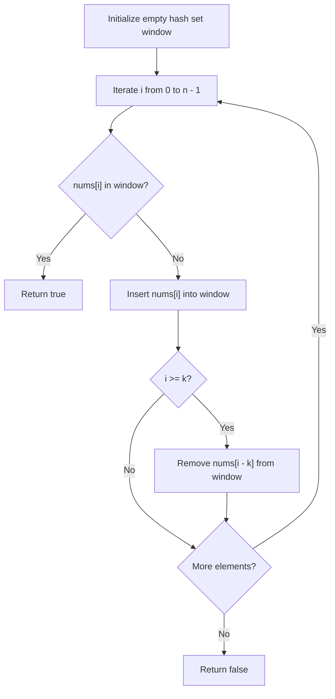

# 219. Contains Duplicate II

## Problem Statement

Given an integer array `nums` and an integer `k`, return `true` if there are two **distinct indices** `i` and `j` in the array such that `nums[i] == nums[j]` and `abs(i - j) <= k`.

### Example 1:

```
Input: nums = [1,2,3,1], k = 3
Output: true
Explanation: nums[0] == nums[3] and abs(0 - 3) = 3 <= 3.
```

### Example 2:

```
Input: nums = [1,0,1,1], k = 1
Output: true
Explanation: nums[2] == nums[3] and abs(2 - 3) = 1 <= 1.
```

### Example 3:

```
Input: nums = [1,2,3,1,2,3], k = 2
Output: false
Explanation: Although there are duplicate elements, their indices are at least 3 apart, which is greater than k = 2.
```

### Constraints:

- $1 \le \text{nums.length} \le 10^5$
- $-10^9 \le \text{nums}[i] \le 10^9$
- $0 \le k \le 10^5$

---

## Approach

### 1. Sliding Window Hash Set
We need to check whether any duplicate exists within a window of distance $k$.
- Maintain an unordered hash set `window` containing elements within the last $k$ indices:
  $$\{ \text{nums}[j] \mid \max(0, i - k) \le j < i \}$$
- For each index $i$:
  1. Check if $\text{nums}[i]$ is already present in `window`. If it is, return `true`.
  2. Insert $\text{nums}[i]$ into `window`.
  3. If $i \ge k$, erase the element that just exited the window: $\text{nums}[i - k]$.
- If the loop finishes without finding duplicates within any window of size $k$, return `false`.

### 2. Space Optimization
By maintaining only $k$ elements in the hash set at any time, the space consumption is bounded by $\min(n, k)$, avoiding the need to store all $n$ elements.



---

## Code Implementation

### C++

```cpp
#include <vector>
#include <unordered_set>

using namespace std;

class Solution {
public:
    bool containsNearbyDuplicate(vector<int>& nums, int k) {
        unordered_set<int> window;
        
        for (int i = 0; i < nums.size(); ++i) {
            if (window.count(nums[i])) {
                return true;
            }
            window.insert(nums[i]);
            
            if (i >= k) {
                window.erase(nums[i - k]);
            }
        }
        
        return false;
    }
};
```

### Python3

```python
class Solution:
    def containsNearbyDuplicate(self, nums: list[int], k: int) -> bool:
        window = set()
        
        for i, x in enumerate(nums):
            if x in window:
                return True
            window.add(x)
            
            if i >= k:
                window.remove(nums[i - k])
                
        return False
```

---

## Complexity Analysis

- **Time Complexity**: $O(n)$ — We iterate through the array once. Each hash set lookup, insertion, and deletion takes $O(1)$ average time.
- **Space Complexity**: $O(\min(n, k))$ — The hash set stores at most $\min(n, k + 1)$ elements at any given moment.

---