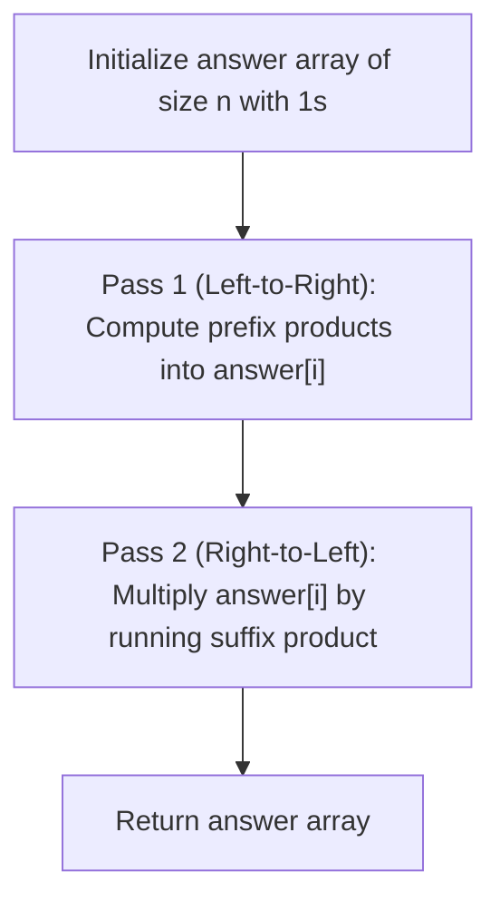

# 238. Product of Array Except Self

## Problem Statement

Given an integer array `nums`, return an array `answer` such that `answer[i]` is equal to the product of all the elements of `nums` except `nums[i]`.

The product of any prefix or suffix of `nums` is **guaranteed** to fit in a **32-bit** integer.

You must write an algorithm that runs in $O(n)$ time and without using the division operation.

### Example 1:
```
Input: nums = [1,2,3,4]
Output: [24,12,8,6]
```

### Example 2:
```
Input: nums = [-1,1,0,-3,3]
Output: [0,0,9,0,0]
```

### Constraints:
- `2 <= nums.length <= 10^5`
- `-30 <= nums[i] <= 30`
- The product of any prefix or suffix of `nums` is **guaranteed** to fit in a **32-bit** integer.

**Follow-up:** Can you solve the problem in $O(1)$ extra space complexity? (The output array does not count as extra space for space complexity analysis.)

---

## Approach

A naive approach would calculate the total product of the array and divide by each element `nums[i]`, but division is explicitly forbidden (and fails when elements are `0`).

Instead, the product of all elements except `nums[i]` is:
$$\text{answer}[i] = (\text{product of all elements to the left of } i) \times (\text{product of all elements to the right of } i)$$

To achieve $O(1)$ auxiliary space:
1. **Left Pass (Prefix Products):**
   - Initialize the `answer` array of size `n` with `1`.
   - Maintain a running `prefix` product starting at `1`.
   - At each index `i`, set `answer[i] = prefix`, then update `prefix *= nums[i]`.
2. **Right Pass (Suffix Products):**
   - Maintain a running `suffix` product starting at `1`.
   - Traverse the array backwards from `n - 1` down to `0`.
   - Multiply `answer[i] *= suffix`, then update `suffix *= nums[i]`.



---

## Code Implementation

```cpp
#include <vector>

class Solution {
public:
    std::vector<int> productExceptSelf(std::vector<int>& nums) {
        int n = nums.size();
        std::vector<int> answer(n, 1);
        
        // Pass 1: Compute prefix products directly in answer
        int prefix = 1;
        for (int i = 0; i < n; i++) {
            answer[i] = prefix;
            prefix *= nums[i];
        }
        
        // Pass 2: Multiply by suffix products on the fly
        int suffix = 1;
        for (int i = n - 1; i >= 0; i--) {
            answer[i] *= suffix;
            suffix *= nums[i];
        }
        
        return answer;
    }
};
```

---

## Complexity Analysis

- **Time Complexity**: $O(n)$ — Two sequential passes over the array of size $n$.

- **Space Complexity**: $O(1)$ — The output array `answer` does not count towards auxiliary space; only $O(1)$ extra variables (`prefix`, `suffix`) are allocated.

---
