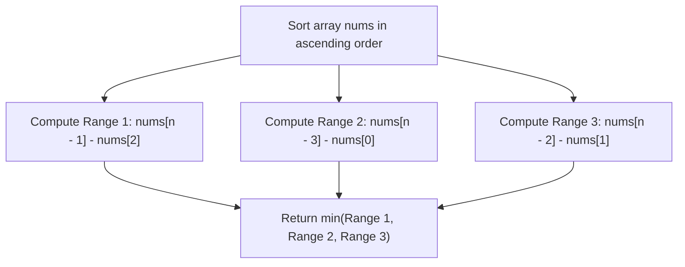

# 2567. Minimum Score by Changing Two Elements

## Problem Statement

You are given an integer array `nums`.

- The **low score** of `nums` is the minimum value of $|nums[i] - nums[j]|$ over all $0 \le i < j < nums.\text{length}$.
- The **high score** of `nums` is the maximum value of $|nums[i] - nums[j]|$ over all $0 \le i < j < nums.\text{length}$.
- The **score** of `nums` is the sum of the high score and the low score.

Return the **minimum score** of `nums` after changing the value of **at most two** elements.

Note that $|x|$ denotes the absolute value of $x$.

---

### Example 1:

```
Input: nums = [1, 4, 7, 8, 5]
Output: 3
Explanation:
- Change nums[0] and nums[1] to be 6 so that nums becomes [6, 6, 7, 8, 5].
- The low score is the minimum absolute difference: |6 - 6| = 0.
- The high score is the maximum absolute difference: |8 - 5| = 3.
- The sum of high score and low score is 0 + 3 = 3.
It can be shown that 3 is the minimum score achievable.
```

### Example 2:

```
Input: nums = [1, 4, 3]
Output: 0
Explanation:
- Change nums[1] and nums[2] to be 1 so that nums becomes [1, 1, 1].
- The low score is |1 - 1| = 0.
- The high score is |1 - 1| = 0.
- The minimum score is 0 + 0 = 0.
```

---

### Constraints:

- $3 \le nums.\text{length} \le 10^5$
- $1 \le nums[i] \le 10^9$

---

## Approach

### 1. Zeroing the Low Score
- In any array of size $n \ge 3$, modifying up to two elements allows us to set at least two elements equal to each other (e.g., set two elements equal to a third untouched element).
- Consequently, there will always be at least one pair with $|nums[i] - nums[j]| = 0$, meaning:
  $$\text{low score} = 0$$
- The total score simplifies to:
  $$\text{Score} = \text{high score} + \text{low score} = \text{high score} + 0 = \max(nums) - \min(nums)$$

### 2. Extremes Reduction via Sorting
- To minimize the range $\max(nums) - \min(nums)$, our two operations must target the boundary outliers.
- Sort the array in non-decreasing order:
  $$nums[0] \le nums[1] \le \dots \le nums[n - 1]$$
- With 2 operations to eliminate extreme values, exactly three candidate configurations exist:
  1. **Remove the 2 smallest elements** (change $nums[0]$ and $nums[1]$ to $nums[2]$):
     $$\text{range}_1 = nums[n - 1] - nums[2]$$
  2. **Remove the 2 largest elements** (change $nums[n - 1]$ and $nums[n - 2]$ to $nums[n - 3]$):
     $$\text{range}_2 = nums[n - 3] - nums[0]$$
  3. **Remove 1 smallest and 1 largest element** (change $nums[0]$ to $nums[1]$ and $nums[n - 1]$ to $nums[n - 2]$):
     $$\text{range}_3 = nums[n - 2] - nums[1]$$
- The optimal answer is:
  $$\min(\text{range}_1, \text{range}_2, \text{range}_3)$$



---

## Code Implementation

### C++

```cpp
#include <vector>
#include <algorithm>

using namespace std;

class Solution {
public:
    int minimizeSum(vector<int>& nums) {
        sort(nums.begin(), nums.end());
        int n = nums.size();

        int opt1 = nums[n - 1] - nums[2]; // Change two smallest
        int opt2 = nums[n - 3] - nums[0]; // Change two largest
        int opt3 = nums[n - 2] - nums[1]; // Change one smallest and one largest

        return min({opt1, opt2, opt3});
    }
};
```

### Python3

```python
class Solution:
    def minimizeSum(self, nums: list[int]) -> int:
        nums.sort()
        n = len(nums)

        opt1 = nums[n - 1] - nums[2]  # Change two smallest
        opt2 = nums[n - 3] - nums[0]  # Change two largest
        opt3 = nums[n - 2] - nums[1]  # Change one smallest and one largest

        return min(opt1, opt2, opt3)
```

---

## Complexity Analysis

- **Time Complexity**: $O(n \log n)$ — Dominated by sorting the array of length $n$. (Can be reduced to $O(n)$ by finding the 3 smallest and 3 largest elements in a single pass without full sorting).
- **Space Complexity**: $O(1)$ auxiliary space beyond the sorting buffer.

---
