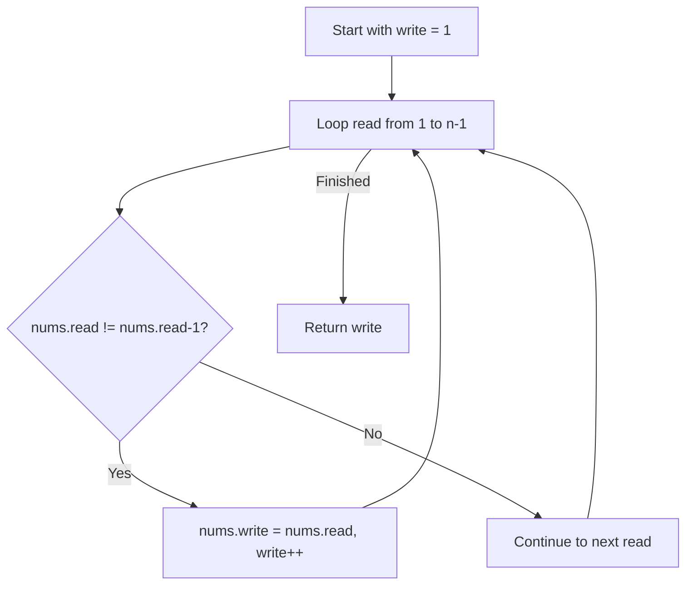

# 26. Remove Duplicates from Sorted Array

## Problem Statement

Given an integer array `nums` sorted in **non-decreasing order**, remove the duplicates in-place such that each unique element appears only **once**. The relative order of the elements should be kept the same. Then return the number of unique elements in `nums`.

Consider the number of unique elements of `nums` to be `k`. To get accepted, you need to do the following things:
- Change the array `nums` such that the first `k` elements of `nums` contain the unique elements in the order they were present in `nums` initially.
- The remaining elements of `nums` are not important as well as the size of `nums`.
- Return `k`.

### Example 1:
```
Input: nums = [1,1,2]
Output: 2, nums = [1,2,_]
Explanation: Your function should return k = 2, with the first two elements of nums being 1 and 2 respectively.
```

### Example 2:
```
Input: nums = [0,0,1,1,1,2,2,3,3,4]
Output: 5, nums = [0,1,2,3,4,_,_,_,_,_]
Explanation: Your function should return k = 5, with the first five elements of nums being 0, 1, 2, 3, and 4 respectively.
```

---

## Approach

Since the input array is already sorted, all duplicates are adjacent to each other. We can utilize a **Two Pointers** technique:

1. Maintain a `write` pointer pointing to index `1` (the first element `nums[0]` is always unique and stays in place).
2. Use a `read` pointer that iterates from index `1` to `nums.size() - 1`.
3. If `nums[read] != nums[read - 1]`, it means we encountered a new unique element. We place it at `nums[write]` and increment `write`.
4. After scanning the whole array, `write` is equal to the total count of unique elements `k`.



---

## Code Implementation

```cpp
#include <vector>

class Solution {
public:
    int removeDuplicates(std::vector<int>& nums) {
        if (nums.empty()) return 0;
        
        int write = 1;
        
        for (int read = 1; read < nums.size(); ++read) {
            if (nums[read] != nums[read - 1]) {
                nums[write] = nums[read];
                write++;
            }
        }
        
        return write;
    }
};
```

---

## Complexity Analysis

- **Time Complexity**: $O(n)$ — Single linear pass through the array of length $n$.

- **Space Complexity**: $O(1)$ — Done entirely in-place with constant extra memory.

---
