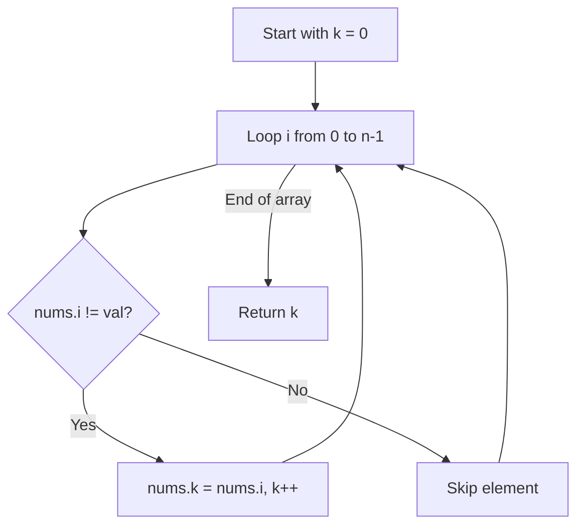

# 27. Remove Element

## Problem Statement

Given an integer array `nums` and an integer `val`, remove all occurrences of `val` in `nums` in-place. The order of the elements may be changed. Then return the number of elements in `nums` which are not equal to `val`.

Consider the number of elements in `nums` which are not equal to `val` be `k`. To get accepted, you need to do the following:
- Change the array `nums` such that the first `k` elements of `nums` contain the elements which are not equal to `val`.
- The remaining elements of `nums` are not important as well as the size of `nums`.
- Return `k`.

### Example 1:
```
Input: nums = [3,2,2,3], val = 3
Output: 2, nums = [2,2,_,_]
Explanation: Your function should return k = 2, with the first two elements of nums being 2.
```

### Example 2:
```
Input: nums = [0,1,2,2,3,0,4,2], val = 2
Output: 5, nums = [0,1,3,0,4,_,_,_]
Explanation: Your function should return k = 5, with the first five elements of nums containing 0, 0, 1, 3, and 4.
```

---

## Approach

We can use the **Two Pointers** (fast and slow pointer) technique:

1. Maintain an index `k` (slow pointer) representing the position where the next element not equal to `val` should be placed.
2. Iterate through each element `nums[i]` (fast pointer).
3. If `nums[i] != val`, assign `nums[k] = nums[i]` and increment `k`.
4. If `nums[i] == val`, simply skip it.
5. Finally, return `k`.



---

## Code Implementation

```cpp
#include <vector>

class Solution {
public:
    int removeElement(std::vector<int>& nums, int val) {
        int k = 0;
        
        for (int i = 0; i < nums.size(); ++i) {
            if (nums[i] != val) {
                nums[k] = nums[i];
                k++;
            }
        }
        
        return k;
    }
};
```

---

## Complexity Analysis

- **Time Complexity**: $O(n)$ — Traverses the array of size $n$ once.

- **Space Complexity**: $O(1)$ — Only a single variable `k` is used; in-place array modification.

---
