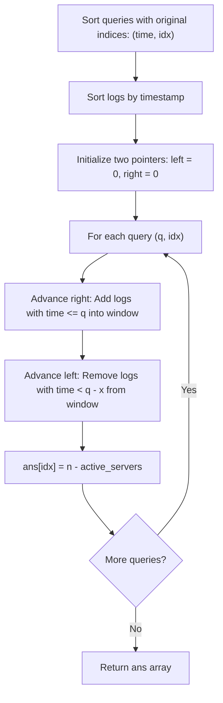

# 2747. Count Zero Request Servers

## Problem Statement

You are given an integer `n` denoting the total number of servers numbered from `1` to `n`.

You are also given a 2D integer array `logs` of length `m`, where `logs[i] = [server_id, time]` indicates that the server with id `server_id` received a request at time `time`.

You are also given an integer `x` and an integer array `queries` of length `q`.

Return an array `ans` of length `q` where `ans[i]` is the number of servers that did not receive any requests during the time interval `[queries[i] - x, queries[i]]`.

Note that the time intervals are inclusive.

### Example 1:

```
Input: n = 3, logs = [[1,3],[2,6],[1,5]], x = 5, queries = [10,11]
Output: [1,2]
Explanation: 
For queries[0]: The interval is [5, 10].
- Server 1 received 1 request (at time 5)
- Server 2 received 1 request (at time 6)
- Server 3 received 0 requests
Server 3 is the only server that did not receive any requests in [5, 10].

For queries[1]: The interval is [6, 11].
- Server 1 received 0 requests
- Server 2 received 1 request (at time 6)
- Server 3 received 0 requests
Servers 1 and 3 did not receive any requests in [6, 11].
```

### Example 2:

```
Input: n = 3, logs = [[2,4],[2,1],[1,2],[3,1]], x = 2, queries = [3,4]
Output: [0,1]
Explanation: 
For queries[0]: The interval is [1, 3].
- Server 1 received 1 request (time 2)
- Server 2 received 1 request (time 1)
- Server 3 received 1 request (time 1)
All 3 servers received requests, so 0 servers received zero requests.

For queries[1]: The interval is [2, 4].
- Server 1 received 1 request (time 2)
- Server 2 received 1 request (time 4)
- Server 3 received 0 requests
Only server 3 received zero requests.
```

### Constraints:

- $1 \le n \le 10^5$
- $1 \le \text{logs.length} \le 10^5$
- $1 \le \text{queries.length} \le 10^5$
- $\text{logs}[i].\text{length} == 2$
- $1 \le \text{logs}[i][0] \le n$
- $1 \le \text{logs}[i][1] \le 10^6$
- $1 \le x \le 10^6$
- $x < \text{queries}[i] \le 10^6$

---

## Approach

### 1. Offline Processing Strategy
An independent scan of the logs for each query would take $O(q \cdot m)$ time, which exceeds the time limit for $10^5$ logs and queries.
Since each query asks about a window $[q - x, q]$ and the queries do not alter the logs, we can process the queries **offline**:
- Pair each query with its original index: `(queries[i], i)`.
- Sort the queries in ascending order of time.
- Sort the `logs` array in ascending order of time `logs[i][1]`.

### 2. Sliding Window with Two Pointers
As the query time $q$ increases, the sliding window $[q - x, q]$ shifts monotonically forward:
- Maintain a pointer `right` to include all logs with $\text{time} \le q$. When a log for `server_id` is added, increment its frequency. If its count transitions from $0 \to 1$, increment `active_servers`.
- Maintain a pointer `left` to evict all logs with $\text{time} < q - x$. When a log for `server_id` is removed, decrement its frequency. If its count transitions from $1 \to 0$, decrement `active_servers`.
- For the current query, the number of zero-request servers is:
  $$\text{Zero-Request Servers} = n - \text{active\_servers}$$
- Store the answer at the query's original index.



---

## Code Implementation

### C++

```cpp
#include <vector>
#include <algorithm>
#include <numeric>

using namespace std;

class Solution {
public:
    vector<int> countServers(int n, vector<vector<int>>& logs, int x, vector<int>& queries) {
        int q = queries.size();
        int m = logs.size();

        // Pair queries with their original indices and sort chronologically
        vector<pair<int, int>> sorted_queries(q);
        for (int i = 0; i < q; ++i) {
            sorted_queries[i] = {queries[i], i};
        }
        sort(sorted_queries.begin(), sorted_queries.end());

        // Sort logs chronologically by timestamp
        sort(logs.begin(), logs.end(), [](const vector<int>& a, const vector<int>& b) {
            return a[1] < b[1];
        });

        vector<int> ans(q);
        vector<int> server_count(n + 1, 0);
        int active_servers = 0;
        int left = 0, right = 0;

        for (const auto& [q_time, orig_idx] : sorted_queries) {
            int window_start = q_time - x;
            int window_end = q_time;

            // Expand right boundary: include logs <= window_end
            while (right < m && logs[right][1] <= window_end) {
                int s_id = logs[right][0];
                if (server_count[s_id] == 0) {
                    active_servers++;
                }
                server_count[s_id]++;
                right++;
            }

            // Shrink left boundary: exclude logs < window_start
            while (left < m && logs[left][1] < window_start) {
                int s_id = logs[left][0];
                server_count[s_id]--;
                if (server_count[s_id] == 0) {
                    active_servers--;
                }
                left++;
            }

            ans[orig_idx] = n - active_servers;
        }

        return ans;
    }
};
```

### Python3

```python
class Solution:
    def countServers(self, n: int, logs: list[list[int]], x: int, queries: list[int]) -> list[int]:
        sorted_queries = sorted((q, i) for i, q in enumerate(queries))
        logs.sort(key=lambda item: item[1])
        
        ans = [0] * len(queries)
        server_count = [0] * (n + 1)
        active_servers = 0
        left = 0
        right = 0
        m = len(logs)
        
        for q_time, orig_idx in sorted_queries:
            window_start = q_time - x
            window_end = q_time
            
            # Expand window: add logs up to window_end
            while right < m and logs[right][1] <= window_end:
                s_id = logs[right][0]
                if server_count[s_id] == 0:
                    active_servers += 1
                server_count[s_id] += 1
                right += 1
                
            # Shrink window: remove logs older than window_start
            while left < m and logs[left][1] < window_start:
                s_id = logs[left][0]
                server_count[s_id] -= 1
                if server_count[s_id] == 0:
                    active_servers -= 1
                left += 1
                
            ans[orig_idx] = n - active_servers
            
        return ans
```

---

## Complexity Analysis

- **Time Complexity**: $O(m \log m + q \log q)$
  - Sorting `logs` takes $O(m \log m)$ where $m$ is the number of logs.
  - Sorting `queries` takes $O(q \log q)$ where $q$ is the number of queries.
  - The two-pointer sliding window traverses each log at most twice (once added by `right`, once evicted by `left`), which takes $O(m + q)$ amortized time.
  - Overall time complexity is dominated by the sorting steps: $O(m \log m + q \log q)$.

- **Space Complexity**: $O(n + q)$
  - $O(n)$ for the `server_count` frequency array.
  - $O(q)$ to store indexed queries and the result array.

---