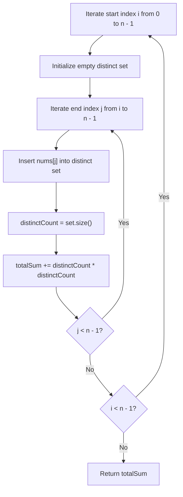

# 2913. Subarrays Distinct Element Sum of Squares I

## Problem Statement

You are given a **0-indexed** integer array `nums`.

The **distinct count** of a subarray of `nums` is the number of distinct values in the subarray.

Return the sum of the **squares** of distinct counts of all subarrays of `nums`.

A **subarray** is a contiguous non-empty sequence of elements within an array.

### Example 1:
```
Input: nums = [1, 2, 1]
Output: 15
Explanation: 
Six possible subarrays are:
- [1]: 1 distinct value -> 1^2 = 1
- [2]: 1 distinct value -> 1^2 = 1
- [1]: 1 distinct value -> 1^2 = 1
- [1, 2]: 2 distinct values -> 2^2 = 4
- [2, 1]: 2 distinct values -> 2^2 = 4
- [1, 2, 1]: 2 distinct values -> 2^2 = 4
The sum of the squares of the distinct counts in the subarrays is 1 + 1 + 1 + 4 + 4 + 4 = 15.
```

### Example 2:
```
Input: nums = [2, 2]
Output: 3
Explanation: 
Three possible subarrays are:
- [2]: 1 distinct value -> 1^2 = 1
- [2]: 1 distinct value -> 1^2 = 1
- [2, 2]: 1 distinct value -> 1^2 = 1
The sum of the squares of the distinct counts in the subarrays is 1 + 1 + 1 = 3.
```

### Constraints:
- `1 <= nums.length <= 100`
- `1 <= nums[i] <= 100`

---

## Approach

1. **Subarray Enumeration with Running Distinct Set:**
   - Every contiguous subarray `nums[i..j]` is defined by a start index $i$ and an end index $j$ where $0 \le i \le j < n$.
   - Since $n \le 100$, an $O(n^2)$ nested loop traversal easily runs well within execution limits.

2. **Iterative Set Expansion:**
   - Fix the left boundary $i$ from $0$ to $n - 1$.
   - For each fixed $i$, maintain a hash set or frequency tracker.
   - Incrementally expand the right boundary $j$ from $i$ to $n - 1$:
     - Insert `nums[j]` into the set.
     - The current size of the set represents the distinct element count for subarray `nums[i..j]`.
     - Add `size * size` to the cumulative sum.



---

## Code Implementation

```cpp
#include <vector>
#include <unordered_set>

class Solution {
public:
    int sumCounts(std::vector<int>& nums) {
        int n = nums.size();
        int totalSum = 0;
        
        for (int i = 0; i < n; ++i) {
            std::unordered_set<int> distinctElements;
            for (int j = i; j < n; ++j) {
                distinctElements.insert(nums[j]);
                int count = distinctElements.size();
                totalSum += count * count;
            }
        }
        
        return totalSum;
    }
};
```

---

## Complexity Analysis

- **Time Complexity**: $O(n^2)$ — We examine all $n(n + 1) / 2$ subarrays. Each element insertion into the hash set takes average $O(1)$ time. With $n \le 100$, total operations are $\approx 5000$, well within the standard 1-second limit.

- **Space Complexity**: $O(n)$ — Auxiliary hash set stores up to $n$ unique integers for any outer iteration.

---
