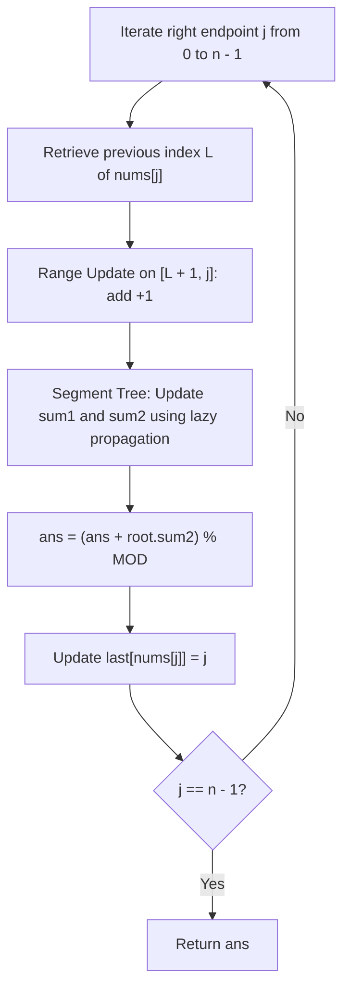

# 2916. Subarrays Distinct Element Sum of Squares II

## Problem Statement

You are given a **0-indexed** integer array `nums`.

The **distinct count** of a subarray of `nums` is the number of distinct values in the subarray.

Return the sum of the **squares** of distinct counts of all subarrays of `nums`.

Since the response may be very large, return it **modulo** $10^9 + 7$.

A **subarray** is a contiguous non-empty sequence of elements within an array.

### Example 1:
```
Input: nums = [1, 2, 1]
Output: 15
Explanation: 
Six possible subarrays are:
- [1]: 1 distinct value -> 1^2 = 1
- [2]: 1 distinct value -> 1^2 = 1
- [1]: 1 distinct value -> 1^2 = 1
- [1, 2]: 2 distinct values -> 2^2 = 4
- [2, 1]: 2 distinct values -> 2^2 = 4
- [1, 2, 1]: 2 distinct values -> 2^2 = 4
The sum of the squares of the distinct counts in the subarrays is 1 + 1 + 1 + 4 + 4 + 4 = 15.
```

### Example 2:
```
Input: nums = [2, 2]
Output: 3
Explanation: 
Three possible subarrays are:
- [2]: 1 distinct value -> 1^2 = 1
- [2]: 1 distinct value -> 1^2 = 1
- [2, 2]: 1 distinct value -> 1^2 = 1
The sum of the squares of the distinct counts in the subarrays is 1 + 1 + 1 = 3.
```

### Constraints:
- `1 <= nums.length <= 10^5`
- `1 <= nums[i] <= 10^5`

---

## Approach

1. **Subarray Endpoint Transition:**
   - Let $c_i$ be the number of distinct elements in subarray `nums[i..j]` for a fixed right endpoint $j$ and starting indices $0 \le i \le j$.
   - As the right endpoint extends from $j - 1$ to $j$, let $L$ denote the previous occurrence index of `nums[j]` ($L = -1$ if `nums[j]` hasn't appeared yet).
   - For all starting indices $i \in (L, j]$, `nums[j]` is a brand new distinct element. Thus, their distinct count increases by $1$:
     $$c_i \leftarrow c_i + 1 \quad \forall i \in [L + 1, j]$$

2. **Algebraic Expansion of Sum of Squares:**
   - When a distinct count increases from $c$ to $c + 1$, its squared contribution expands algebraically:
     $$(c + 1)^2 = c^2 + 2c + 1$$
   - Over an updated range of length $len = r - l + 1$:
     $$\Delta \sum c_i^2 = 2 \sum c_i + len$$
   - Therefore, to dynamically maintain and query $\sum c_i^2$, our data structure must concurrently track both the linear sum $\sum c_i$ and the quadratic sum $\sum c_i^2$.

3. **Segment Tree with Lazy Propagation:**
   - We maintain a Segment Tree over index range $[0, n - 1]$ representing starting indices $i$.
   - Each tree node tracks:
     - `sum1`: $\sum_{i=l}^r c_i \pmod{10^9 + 7}$
     - `sum2`: $\sum_{i=l}^r c_i^2 \pmod{10^9 + 7}$
     - `lazy`: deferred addition value applied to all $c_i$ in the subsegment.
   - For each element $j \in [0, n - 1]$:
     1. Retrieve last occurrence $L = \text{last}[nums[j]]$.
     2. Range-add $+1$ to interval $[L + 1, j]$ in the Segment Tree.
     3. Accumulate `tree[1].sum2` (the sum of squares of all subarrays ending at $j$) to the total result modulo $10^9 + 7$.
     4. Update $\text{last}[nums[j]] = j$.



---

## Code Implementation

```cpp
#include <vector>
#include <unordered_map>

class Solution {
    static constexpr int MOD = 1'000'000'007;

    struct Node {
        long long sum1 = 0;
        long long sum2 = 0;
        long long lazy = 0;
    };

    std::vector<Node> tree;

    void apply(int node, int l, int r, long long v) {
        long long len = r - l + 1;
        tree[node].sum2 = (tree[node].sum2 + (2 * v % MOD) * tree[node].sum1 + (v * v % MOD) * len) % MOD;
        tree[node].sum1 = (tree[node].sum1 + v * len) % MOD;
        tree[node].lazy = (tree[node].lazy + v) % MOD;
    }

    void push(int node, int l, int r) {
        if (tree[node].lazy != 0) {
            int mid = l + (r - l) / 2;
            apply(2 * node, l, mid, tree[node].lazy);
            apply(2 * node + 1, mid + 1, r, tree[node].lazy);
            tree[node].lazy = 0;
        }
    }

    void update(int node, int l, int r, int ql, int qr, long long v) {
        if (ql <= l && r <= qr) {
            apply(node, l, r, v);
            return;
        }
        push(node, l, r);
        int mid = l + (r - l) / 2;
        if (ql <= mid) {
            update(2 * node, l, mid, ql, qr, v);
        }
        if (qr > mid) {
            update(2 * node + 1, mid + 1, r, ql, qr, v);
        }
        tree[node].sum1 = (tree[2 * node].sum1 + tree[2 * node + 1].sum1) % MOD;
        tree[node].sum2 = (tree[2 * node].sum2 + tree[2 * node + 1].sum2) % MOD;
    }

public:
    int sumCounts(std::vector<int>& nums) {
        int n = nums.size();
        tree.assign(4 * n, Node{});

        std::unordered_map<int, int> lastOccurrence;
        long long totalSum = 0;

        for (int j = 0; j < n; ++j) {
            int prev = lastOccurrence.count(nums[j]) ? lastOccurrence[nums[j]] : -1;
            update(1, 0, n - 1, prev + 1, j, 1);
            totalSum = (totalSum + tree[1].sum2) % MOD;
            lastOccurrence[nums[j]] = j;
        }

        return static_cast<int>(totalSum);
    }
};
```

---

## Complexity Analysis

- **Time Complexity**: $O(n \log n)$ — We iterate through $n$ elements. For each endpoint $j$, updating the segment tree over interval $[L + 1, j]$ requires $O(\log n)$ operations.

- **Space Complexity**: $O(n)$ — The segment tree requires $4n$ nodes, and the hash map stores at most $n$ distinct integer positions.

---
