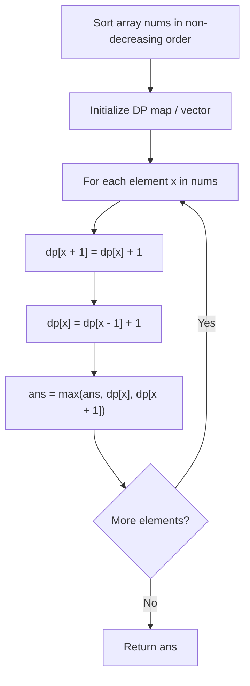

# 3041. Maximize Consecutive Elements in an Array After Modification

## Problem Statement

You are given a **0-indexed** array `nums` consisting of positive integers.

Initially, you can increase the value of any element in `nums` by **at most 1**.

After making all modifications, select the **maximum** number of elements from `nums` such that, when sorted in increasing order, they form a **consecutive sequence** of integers (e.g., `[3, 4, 5]` is consecutive, but `[3, 4, 6]` and `[1, 1, 2]` are not).

Return the **maximum number of elements** you can select.

---

### Example 1:

```
Input: nums = [2, 1, 5, 1, 1]
Output: 3
Explanation:
- We can increase the element at index 0 (2 -> 3) and index 3 (1 -> 2).
- The modified array is [3, 1, 5, 2, 1].
- We can select the subset [1, 2, 3], which forms a consecutive sequence of length 3.
It can be shown that we cannot select more than 3 consecutive elements.
```

### Example 2:

```
Input: nums = [1, 4, 7, 10]
Output: 1
Explanation:
No two elements can be made consecutive integers. The maximum length of a consecutive sequence is 1.
```

---

### Constraints:

- $1 \le nums.\text{length} \le 10^5$
- $1 \le nums[i] \le 10^6$

---

## Approach

### 1. Sorting and Order Invariance
- A consecutive sequence must be strictly increasing with step 1 ($x, x + 1, x + 2, \dots$).
- Sorting `nums` allows us to process numbers in ascending order and iteratively extend consecutive sequences from smaller values to larger values.

### 2. Dynamic Programming State Tracking
- For any integer $v$, let $dp[v] represent the maximum length of a consecutive sequence ending with value $v$.
- When inspecting an element $x \in nums$, we have two valid choices:
  1. **Promote to $x + 1$**:
     - It extends a previously formed consecutive sequence that ended at $x$.
     - $$\text{new } dp[x + 1] = dp[x] + 1$$
  2. **Keep as $x$**:
     - It extends a previously formed consecutive sequence that ended at $x - 1$.
     - $$\text{new } dp[x] = dp[x - 1] + 1$$
- **Crucial Ordering Insight**:
  - Because updating $dp[x + 1]$ requires the prior value of $dp[x]$, we must evaluate and update $dp[x + 1]$ **before** updating $dp[x]$. This ensures a single element $x$ is not reused to simultaneously extend $dp[x - 1]$ and then immediately extend $dp[x]$ within the same step.



---

## Code Implementation

### C++

```cpp
#include <vector>
#include <algorithm>
#include <unordered_map>

using namespace std;

class Solution {
public:
    int maxSelectedElements(vector<int>& nums) {
        sort(nums.begin(), nums.end());
        unordered_map<int, int> dp;
        int ans = 0;

        for (int x : nums) {
            // Update x + 1 first using the previous dp[x]
            dp[x + 1] = dp[x] + 1;
            // Update x using dp[x - 1]
            dp[x] = dp[x - 1] + 1;

            ans = max({ans, dp[x], dp[x + 1]});
        }

        return ans;
    }
};
```

### Python3

```python
class Solution:
    def maxSelectedElements(self, nums: list[int]) -> int:
        nums.sort()
        dp = {}
        ans = 0

        for x in nums:
            # Update x + 1 first using previous dp[x]
            dp[x + 1] = dp.get(x, 0) + 1
            # Update x using previous dp[x - 1]
            dp[x] = dp.get(x - 1, 0) + 1

            ans = max(ans, dp[x], dp[x + 1])

        return ans
```

---

## Complexity Analysis

- **Time Complexity**: $O(n \log n)$ — Sorting the array of length $n$ takes $O(n \log n)$. The single-pass DP loop processes each element in $O(1)$ average time via hash map lookups.
- **Space Complexity**: $O(n)$ — The hash map stores at most $2n$ states corresponding to modified and unmodified values.

---
