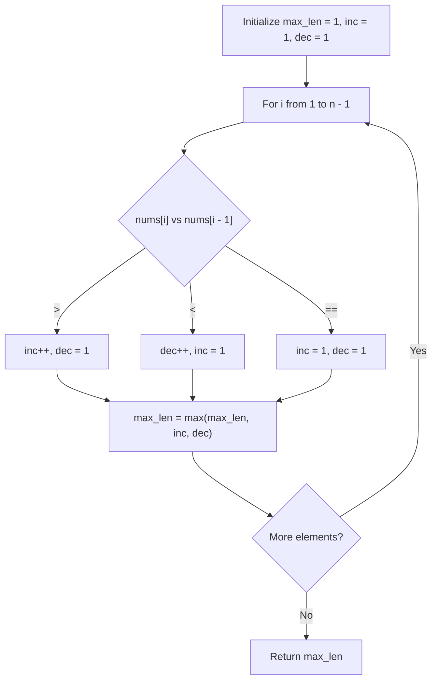

# 3105. Longest Strictly Increasing or Strictly Decreasing Subarray

## Problem Statement

You are given an array of integers `nums`. Return the length of the **longest subarray** of `nums` which is either **strictly increasing** or **strictly decreasing**.

- A **subarray** is a contiguous non-empty sequence of elements within an array.
- A subarray is **strictly increasing** if each element is strictly greater than the preceding element ($nums[i] < nums[i+1]$).
- A subarray is **strictly decreasing** if each element is strictly less than the preceding element ($nums[i] > nums[i+1]$).

### Example 1:

```
Input: nums = [1,4,3,3,2]
Output: 2
Explanation:
The strictly increasing subarrays of nums are [1], [2], [3], [3], [4], and [1,4].
The strictly decreasing subarrays of nums are [1], [2], [3], [3], [4], [4,3], and [3,2].
The longest strictly increasing or strictly decreasing subarray is of length 2.
```

### Example 2:

```
Input: nums = [3,3,3,3]
Output: 1
Explanation:
The strictly increasing subarrays of nums are [3], [3], [3], and [3].
The strictly decreasing subarrays of nums are [3], [3], [3], and [3].
The longest strictly increasing or strictly decreasing subarray is of length 1.
```

### Example 3:

```
Input: nums = [3,2,1]
Output: 3
Explanation:
The strictly increasing subarrays of nums are [3], [2], and [1].
The strictly decreasing subarrays of nums are [3], [2], [1], [3,2], [2,1], and [3,2,1].
The longest strictly increasing or strictly decreasing subarray is of length 3.
```

### Constraints:

- $1 \le \text{nums.length} \le 50$
- $1 \le \text{nums}[i] \le 50$

---

## Approach

### 1. Single-Pass State Tracking
Any single element forms a valid monotonic subarray of length $1$.
We can track the length of the currently active strictly increasing subarray (`inc`) and strictly decreasing subarray (`dec`) as we iterate from left to right:
- If $\text{nums}[i] > \text{nums}[i - 1]$:
  - The increasing sequence extends: `inc++`.
  - The decreasing sequence breaks: `dec = 1`.
- If $\text{nums}[i] < \text{nums}[i - 1]$:
  - The decreasing sequence extends: `dec++`.
  - The increasing sequence breaks: `inc = 1`.
- If $\text{nums}[i] == \text{nums}[i - 1]$:
  - Strict monotonicity is broken in both directions: `inc = 1`, `dec = 1`.

### 2. Running Maximum
At each step $i$, update $\text{max\_len} = \max(\text{max\_len}, \text{inc}, \text{dec})$.
This achieves an optimal $O(n)$ time complexity and $O(1)$ auxiliary space in a single scan.



---

## Code Implementation

### C++

```cpp
#include <vector>
#include <algorithm>

using namespace std;

class Solution {
public:
    int longestMonotonicSubarray(vector<int>& nums) {
        if (nums.empty()) return 0;

        int max_len = 1;
        int inc = 1;
        int dec = 1;

        for (int i = 1; i < nums.size(); ++i) {
            if (nums[i] > nums[i - 1]) {
                inc++;
                dec = 1;
            } else if (nums[i] < nums[i - 1]) {
                dec++;
                inc = 1;
            } else {
                inc = 1;
                dec = 1;
            }

            max_len = max({max_len, inc, dec});
        }

        return max_len;
    }
};
```

### Python3

```python
class Solution:
    def longestMonotonicSubarray(self, nums: list[int]) -> int:
        if not nums:
            return 0

        max_len = 1
        inc = 1
        dec = 1

        for i in range(1, len(nums)):
            if nums[i] > nums[i - 1]:
                inc += 1
                dec = 1
            elif nums[i] < nums[i - 1]:
                dec += 1
                inc = 1
            else:
                inc = 1
                dec = 1

            max_len = max(max_len, inc, dec)

        return max_len
```

---

## Complexity Analysis

- **Time Complexity**: $O(n)$ — Single linear pass over the array of length $n$.
- **Space Complexity**: $O(1)$ — Only a few scalar variables are maintained.

---