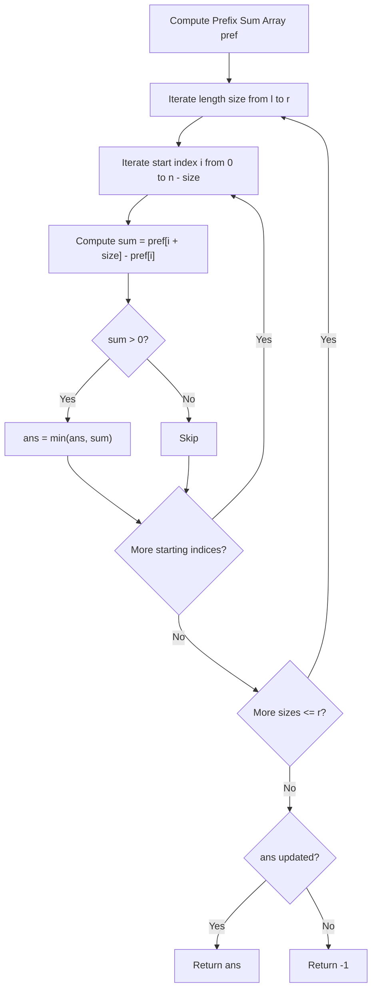

# 3364. Minimum Positive Sum Subarray

## Problem Statement

You are given an integer array `nums` and two integers `l` and `r`.

Your task is to find the **minimum sum** of a contiguous subarray such that:
1. The length of the subarray is between `l` and `r` (inclusive), i.e., $l \le \text{length} \le r$.
2. The sum of the subarray is **strictly greater than 0** (positive).

Return the minimum sum of such a subarray. If no such subarray exists, return `-1`.

### Example 1:

```
Input: nums = [3, -2, 1, 4], l = 2, r = 3
Output: 1
Explanation:
The contiguous subarrays of length between 2 and 3 with positive sum are:
- [3, -2] (length 2, sum = 1)
- [1, 4] (length 2, sum = 5)
- [3, -2, 1] (length 3, sum = 2)
- [-2, 1, 4] (length 3, sum = 3)
The minimum positive sum among these is 1.
```

### Example 2:

```
Input: nums = [-2, 2, -3, 1], l = 2, r = 3
Output: -1
Explanation:
There is no subarray of length between 2 and 3 with a sum strictly greater than 0.
```

### Example 3:

```
Input: nums = [1, 2, 3, 4], l = 2, r = 4
Output: 3
Explanation:
Subarray [1, 2] has length 2 and sum 3, which is the minimum positive sum among all valid subarrays.
```

### Constraints:

- $1 \le \text{nums.length} \le 100$
- $1 \le l \le r \le \text{nums.length}$
- $-1000 \le \text{nums}[i] \le 1000$

---

## Approach

### 1. Prefix Sum Precomputation
To compute the sum of any subarray $\text{nums}[i \dots j]$ in $O(1)$ time, we precompute a 1-indexed prefix sum array `pref`:
$$\text{pref}[k] = \sum_{t=0}^{k-1} \text{nums}[t]$$
For a subarray starting at index $i$ with length $\text{size}$, the sum is:
$$\text{Sum} = \text{pref}[i + \text{size}] - \text{pref}[i]$$

### 2. Multi-Length Sliding Window Enumeration
Given the constraint $n \le 100$:
1. Iterate over every possible subarray length $\text{size} \in [l, r]$.
2. For each fixed length, slide across the array for start indices $i \in [0, n - \text{size}]$.
3. Check if $\text{Sum} > 0$. If so, update $\text{ans} = \min(\text{ans}, \text{Sum})$.
4. If $\text{ans}$ remains unchanged after scanning all valid windows, return `-1`.



---

## Code Implementation

### C++

```cpp
#include <vector>
#include <algorithm>
#include <climits>

using namespace std;

class Solution {
public:
    int minimumSumSubarray(vector<int>& nums, int l, int r) {
        int n = nums.size();
        vector<int> pref(n + 1, 0);

        for (int i = 0; i < n; ++i) {
            pref[i + 1] = pref[i] + nums[i];
        }

        int min_sum = INT_MAX;

        for (int size = l; size <= r; ++size) {
            for (int i = 0; i <= n - size; ++i) {
                int current_sum = pref[i + size] - pref[i];
                if (current_sum > 0) {
                    min_sum = min(min_sum, current_sum);
                }
            }
        }

        return min_sum == INT_MAX ? -1 : min_sum;
    }
};
```

### Python3

```python
class Solution:
    def minimumSumSubarray(self, nums: list[int], l: int, r: int) -> int:
        n = len(nums)
        pref = [0] * (n + 1)
        for i in range(n):
            pref[i + 1] = pref[i] + nums[i]

        ans = float('inf')
        for size in range(l, r + 1):
            for i in range(n - size + 1):
                current_sum = pref[i + size] - pref[i]
                if current_sum > 0:
                    ans = min(ans, current_sum)

        return ans if ans != float('inf') else -1
```

---

## Complexity Analysis

- **Time Complexity**: $O(n \cdot (r - l + 1)) \le O(n^2)$
  - Computing the prefix sum takes $O(n)$ time.
  - Enumerating all window sizes from $l$ to $r$ across valid starting positions tests at most $O(n^2)$ subarrays, with each range sum evaluated in $O(1)$ time.
  - With $n \le 100$, this performs fewer than $5 \times 10^3$ operations, executing in under $1 \text{ ms}$.

- **Space Complexity**: $O(n)$
  - Prefix sum array of size $n + 1$ requires $O(n)$ space. (Can be reduced to $O(1)$ by maintaining a running sum window).

---