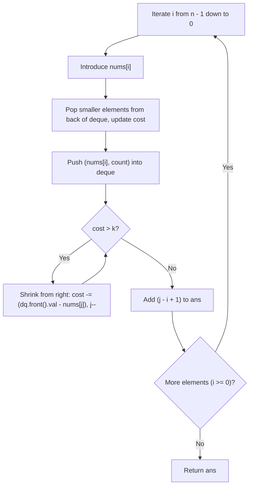

# 3420. Count Non-Decreasing Subarrays After K Operations

## Problem Statement

You are given an array of integers `nums` of size `n` and an integer `k`.

For any subarray `nums[i..j]`, you can perform at most `k` operations. In one operation, you can increase any element in the subarray by `1`.

A subarray is considered **non-decreasing** if each element in the subarray is greater than or equal to its previous element:
$$\text{nums}[m] \le \text{nums}[m+1] \quad \text{for all } i \le m < j$$

Return the **number of subarrays** that can be made non-decreasing using at most `k` operations.

A **subarray** is a contiguous non-empty sequence of elements within an array.

### Example 1:

```
Input: nums = [6,3,1,2,4,4], k = 7
Output: 17
Explanation:
There are 21 total subarrays in nums:
The following 4 subarrays require more than 7 operations to become non-decreasing:
- [6, 3, 1] requires 8 operations
- [6, 3, 1, 2] requires 12 operations
- [6, 3, 1, 2, 4] requires 14 operations
- [6, 3, 1, 2, 4, 4] requires 16 operations
The remaining 21 - 4 = 17 subarrays can be made non-decreasing with at most 7 operations.
```

### Example 2:

```
Input: nums = [6,3,1,3,6], k = 4
Output: 12
Explanation:
The subarray [3, 1, 3, 6], along with all subarrays with length 3 or less (except [6, 3, 1]), can be made non-decreasing with at most 4 operations.
In total, 12 subarrays can be made non-decreasing.
```

### Constraints:

- $1 \le \text{nums.length} \le 10^5$
- $1 \le \text{nums}[i] \le 10^9$
- $1 \le k \le 10^9$

---

## Approach

### 1. Cost Function for a Non-Decreasing Subarray
To make a subarray $\text{nums}[i \dots j]$ non-decreasing using only increment operations with minimal cost:
- The first element $\text{nums}[i]$ is left as is.
- Each subsequent element $m \in [i, j]$ must be at least as large as the running maximum of all preceding elements in the subarray:
  $$a[m] = \max_{i \le t \le m} \text{nums}[t]$$
- Thus, the minimum cost to make subarray $\text{nums}[i \dots j]$ non-decreasing is:
  $$\text{Cost}(i, j) = \sum_{m=i}^{j} \left( \max_{i \le t \le m} \text{nums}[t] - \text{nums}[m] \right)$$

### 2. Monotonicity of the Window
For a fixed left endpoint $i$, the prefix maximum is non-decreasing as $j$ increases, making $\text{Cost}(i, j)$ monotonically non-decreasing with respect to $j$:
- If $\text{Cost}(i, j) \le k$, then every sub-segment $[i, j']$ with $i \le j' \le j$ is also valid.
- If we can find the maximum valid right endpoint $j$ for each left endpoint $i$, then exactly $(j - i + 1)$ valid subarrays start at index $i$.

### 3. Right-to-Left Sliding Window with Monotonic Deque
Processing the array **from right to left** ($i = n - 1 \dots 0$) enables linear-time cost maintenance:
- Maintain a monotonic deque `dq` storing pairs of `(effective_value, count)`.
- When introducing $\text{nums}[i]$ on the left:
  - Any elements directly to its right that have an effective value $< \text{nums}[i]$ will have their prefix maximum raised to $\text{nums}[i]$.
  - Pop those smaller elements from the back of `dq`, accumulate their counts, and increase the total `cost`:
    $$\text{cost} \mathrel{+}= (\text{nums}[i] - \text{next\_val}) \times \text{next\_count}$$
  - Push `(nums[i], accumulated_count)` onto the back of `dq`.
- If `cost > k`, shrink the window from the right boundary $j$:
  - The rightmost element currently in the window has original value $\text{nums}[j]$ and effective value `dq.front().first`.
  - Subtract its contribution from `cost`: $\text{cost} \mathrel{-}= (\text{dq.front().first} - \text{nums}[j])$.
  - Decrement `dq.front().count` (or pop front if count reaches 0) and advance $j \leftarrow j - 1$.
- Once `cost <= k`, all subarrays $[i \dots j']$ for $i \le j' \le j$ are valid: add $(j - i + 1)$ to `ans`.



---

## Code Implementation

### C++

```cpp
#include <vector>
#include <deque>

using namespace std;

class Solution {
public:
    long long countNonDecreasingSubarrays(vector<int>& nums, int k) {
        long long ans = 0;
        long long cost = 0;
        
        // Deque stores {effective_value, count}
        deque<pair<int, int>> dq;
        
        int n = nums.size();
        int j = n - 1;

        for (int i = n - 1; i >= 0; --i) {
            int num = nums[i];
            int count = 1;

            // Overwrite smaller prefix maximums to the right
            while (!dq.empty() && dq.back().first < num) {
                auto [next_num, next_count] = dq.back();
                dq.pop_back();
                count += next_count;
                cost += 1LL * (num - next_num) * next_count;
            }

            dq.push_back({num, count});

            // Shrink window from the right boundary j when cost exceeds k
            while (cost > k) {
                auto& [right_num, right_count] = dq.front();
                cost -= (right_num - nums[j]);
                j--;

                if (right_count > 1) {
                    right_count--;
                } else {
                    dq.pop_front();
                }
            }

            // All subarrays nums[i...t] for i <= t <= j are valid
            ans += (j - i + 1);
        }

        return ans;
    }
};
```

### Python3

```python
from collections import deque

class Solution:
    def countNonDecreasingSubarrays(self, nums: list[int], k: int) -> int:
        ans = 0
        cost = 0
        dq = deque()  # stores [effective_value, count]
        
        j = len(nums) - 1
        for i in range(len(nums) - 1, -1, -1):
            num = nums[i]
            count = 1
            
            # Maintain monotonic deque: pop smaller effective values
            while dq and dq[-1][0] < num:
                next_num, next_count = dq.pop()
                count += next_count
                cost += (num - next_num) * next_count
                
            dq.append([num, count])
            
            # Shrink window from the right when cost exceeds k
            while cost > k:
                right_num, right_count = dq[0]
                cost -= (right_num - nums[j])
                j -= 1
                
                if right_count > 1:
                    dq[0][1] -= 1
                else:
                    dq.popleft()
                    
            # All subarrays starting at i and ending between i and j are valid
            ans += (j - i + 1)
            
        return ans
```

---

## Complexity Analysis

- **Time Complexity**: $O(n)$
  - Each element is pushed and popped from `dq` at most once.
  - The right boundary $j$ only decrements, advancing at most $n$ times across the entire algorithm.
  - Amortized total time is strictly linear $O(n)$.

- **Space Complexity**: $O(n)$
  - The monotonic deque stores at most $n$ pairs in the worst case (when elements are strictly increasing from right to left).

---