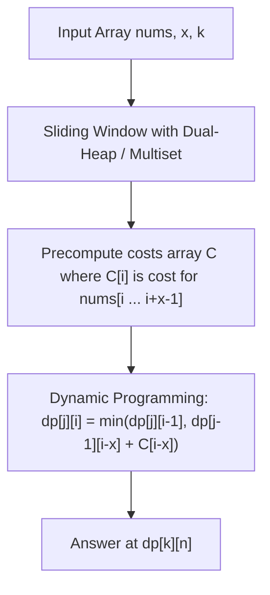

# 3505. Minimum Operations to Make Elements Within K Subarrays Equal

## Problem Statement

You are given an integer array `nums` and two integers `x` and `k`.

In one operation, you can increase or decrease any element of `nums` by `1`.

Return the **minimum total number of operations** needed to have at least `k` **non-overlapping subarrays** of size exactly `x` such that all elements within each of those subarrays are equal.

### Example 1:

```
Input: nums = [5,-2,1,3,7,3,6,4,-1], x = 3, k = 2
Output: 8
Explanation:
- Use 3 operations to add 3 to nums[1] and 2 operations to subtract 2 from nums[3]. The resulting array is [5, 1, 1, 1, 7, 3, 6, 4, -1].
- Use 1 operation to add 1 to nums[5] and 2 operations to subtract 2 from nums[6]. The resulting array is [5, 1, 1, 1, 7, 4, 4, 4, -1].
Now, all elements within each subarray [1, 1, 1] (from indices 1 to 3) and [4, 4, 4] (from indices 5 to 7) are equal.
Since 8 total operations were used, 8 is the output.
```

### Example 2:

```
Input: nums = [9,-2,-2,-2,1,5], x = 2, k = 2
Output: 3
Explanation:
- Use 3 operations to subtract 3 from nums[4]. The resulting array is [9, -2, -2, -2, -2, 5].
Now, all elements within each subarray [-2, -2] (from indices 1 to 2) and [-2, -2] (from indices 3 to 4) are equal.
Since 3 total operations were used, 3 is the output.
```

### Constraints:

- $2 \le \text{nums.length} \le 10^5$
- $-10^6 \le \text{nums}[i] \le 10^6$
- $2 \le x \le \text{nums.length}$
- $1 \le k \le 15$
- $2 \le k \times x \le \text{nums.length}$

---

## Approach

The problem naturally decomposes into two sequential sub-problems:
1. **Window Cost Calculation**: Compute the minimum operations to make all elements within any window of size $x$ equal.
2. **Interval Selection DP**: Choose $k$ non-overlapping windows of length $x$ to minimize the total sum of their costs.

### 1. Median Minimization Property ($L_1$ Norm)
For any window of length $x$, we want to choose a target integer $m$ that minimizes:
$$\sum_{j=0}^{x-1} |v_j - m|$$
By a well-known property of the $L_1$ norm, this sum of absolute deviations is minimized when $m$ is the **median** of the window.
- When $x$ is partitioned into a lower half $L$ (size $\lceil x / 2 \rceil$, sum $S_L$) and an upper half $R$ (size $\lfloor x / 2 \rfloor$, sum $S_R$):
  $$\text{Cost} = \sum_{v \in R} (v - m) + \sum_{u \in L} (m - u) = S_R - S_L + (|L| - |R|) \cdot m$$
- If $x$ is odd: $|L| - |R| = 1 \implies \text{Cost} = S_R - S_L + m$.
- If $x$ is even: $|L| - |R| = 0 \implies \text{Cost} = S_R - S_L$.

### 2. Efficient Sliding Window Median
As the window slides across `nums`, an element exits and a new element enters.
- In **C++**, we maintain two multisets (`left` and `right`) tracking the smaller $\lceil x / 2 \rceil$ elements and larger $\lfloor x / 2 \rfloor$ elements along with their prefix sums $S_L$ and $S_R$. Inserting and deleting elements takes $O(\log x)$ time per step.
- In **Python**, we maintain two heaps with lazy deletion (`delayed` dictionary) and rebalance invariants to achieve $O(\log x)$ amortized operations per window transition.

### 3. Dynamic Programming for Non-Overlapping Subarrays
Once we have precomputed $C[i]$ (the cost of the window starting at index $i$ and ending at $i + x - 1$):
- Let $dp[j][i]$ be the minimum operations to choose $j$ non-overlapping subarrays from the prefix $0 \dots i - 1$.
- At index $i$ ($j \cdot x \le i \le n$), we have two transitions:
  1. **Skip index $i - 1$**: $dp[j][i] = dp[j][i - 1]$
  2. **End a window at index $i - 1$**: Subarray spans $[i - x, i - 1]$ with cost $C[i - x]$, so the prior $j - 1$ subarrays must end at or before $i - x$:
     $$dp[j][i] = \min(dp[j][i - 1], dp[j - 1][i - x] + C[i - x])$$
- Since $k \le 15$, this 2D DP takes only $O(k \cdot n)$ time and $O(n)$ space using rolling vectors.



---

## Code Implementation

### C++

```cpp
#include <vector>
#include <set>
#include <algorithm>

using namespace std;

class Solution {
public:
    long long minOperations(vector<int>& nums, int x, int k) {
        int n = nums.size();
        int k_left = (x + 1) / 2;
        multiset<long long> left, right;
        long long left_sum = 0, right_sum = 0;

        auto balance = [&]() {
            while (left.size() > k_left) {
                auto it = prev(left.end());
                long long val = *it;
                left_sum -= val;
                left.erase(it);
                right.insert(val);
                right_sum += val;
            }
            while (left.size() < k_left && !right.empty()) {
                auto it = right.begin();
                long long val = *it;
                right_sum -= val;
                right.erase(it);
                left.insert(val);
                left_sum += val;
            }
        };

        auto add = [&](long long val) {
            if (left.empty() || val <= *left.rbegin()) {
                left.insert(val);
                left_sum += val;
            } else {
                right.insert(val);
                right_sum += val;
            }
            balance();
        };

        auto remove = [&](long long val) {
            auto it = left.find(val);
            if (it != left.end()) {
                left_sum -= val;
                left.erase(it);
            } else {
                it = right.find(val);
                right_sum -= val;
                right.erase(it);
            }
            balance();
        };

        auto get_cost = [&]() -> long long {
            long long median = *left.rbegin();
            long long cost = right_sum - left_sum;
            if (x % 2 == 1) {
                cost += median;
            }
            return cost;
        };

        // Initialize first x - 1 elements
        for (int i = 0; i < x - 1; ++i) {
            add(nums[i]);
        }

        // Slide window of length x
        vector<long long> costs;
        costs.reserve(n - x + 1);
        for (int i = x - 1; i < n; ++i) {
            add(nums[i]);
            costs.push_back(get_cost());
            remove(nums[i - x + 1]);
        }

        // DP: dp[j][i] stores min operations for j non-overlapping windows in nums[0...i-1]
        const long long INF = 1e18;
        vector<long long> dp(n + 1, 0);

        for (int j = 1; j <= k; ++j) {
            vector<long long> next_dp(n + 1, INF);
            for (int i = j * x; i <= n; ++i) {
                next_dp[i] = min(next_dp[i - 1], dp[i - x] + costs[i - x]);
            }
            dp = std::move(next_dp);
        }

        return dp[n];
    }
};
```

### Python3

```python
import heapq
from collections import defaultdict

class SlidingMedian:
    def __init__(self, k: int):
        self.k = k
        self.target_left = (k + 1) // 2
        self.target_right = k // 2
        self.left = []       # max-heap (-val)
        self.right = []      # min-heap (val)
        self.delayed = defaultdict(int)
        self.left_size = 0
        self.right_size = 0
        self.left_sum = 0
        self.right_sum = 0

    def _prune(self, heap: list, is_left: bool) -> None:
        while heap:
            val = -heap[0] if is_left else heap[0]
            if self.delayed[val] > 0:
                self.delayed[val] -= 1
                heapq.heappop(heap)
            else:
                break

    def _balance(self) -> None:
        self._prune(self.left, True)
        self._prune(self.right, False)

        while self.left_size > self.target_left:
            val = -heapq.heappop(self.left)
            self.left_sum -= val
            self.left_size -= 1
            heapq.heappush(self.right, val)
            self.right_sum += val
            self.right_size += 1
            self._prune(self.left, True)

        while self.left_size < self.target_left and self.right_size > 0:
            val = heapq.heappop(self.right)
            self.right_sum -= val
            self.right_size -= 1
            heapq.heappush(self.left, -val)
            self.left_sum += val
            self.left_size += 1
            self._prune(self.right, False)

        self._prune(self.left, True)
        self._prune(self.right, False)
        if self.left and self.right and -self.left[0] > self.right[0]:
            val_l = -heapq.heappop(self.left)
            val_r = heapq.heappop(self.right)
            self.left_sum += val_r - val_l
            self.right_sum += val_l - val_r
            heapq.heappush(self.left, -val_r)
            heapq.heappush(self.right, val_l)
            self._prune(self.left, True)
            self._prune(self.right, False)

    def add(self, val: int) -> None:
        self._prune(self.left, True)
        if not self.left or val <= -self.left[0]:
            heapq.heappush(self.left, -val)
            self.left_sum += val
            self.left_size += 1
        else:
            heapq.heappush(self.right, val)
            self.right_sum += val
            self.right_size += 1
        self._balance()

    def remove(self, val: int) -> None:
        self._prune(self.left, True)
        if self.left and val <= -self.left[0]:
            self.left_size -= 1
            self.left_sum -= val
        else:
            self.right_size -= 1
            self.right_sum -= val
        self.delayed[val] += 1
        self._balance()

    def get_cost(self) -> int:
        self._prune(self.left, True)
        median = -self.left[0]
        cost = self.right_sum - self.left_sum
        if self.k % 2 == 1:
            cost += median
        return cost


class Solution:
    def minOperations(self, nums: list[int], x: int, k: int) -> int:
        n = len(nums)
        sm = SlidingMedian(x)
        
        for i in range(x - 1):
            sm.add(nums[i])
            
        costs = []
        for i in range(x - 1, n):
            sm.add(nums[i])
            costs.append(sm.get_cost())
            sm.remove(nums[i - x + 1])
            
        INF = float('inf')
        dp = [0] * (n + 1)
        
        for j in range(1, k + 1):
            next_dp = [INF] * (n + 1)
            for i in range(j * x, n + 1):
                next_dp[i] = min(next_dp[i - 1], dp[i - x] + costs[i - x])
            dp = next_dp
            
        return dp[n]
```

---

## Complexity Analysis

- **Time Complexity**:
  - **Sliding Window**: $O(n \log x)$ to compute the median costs for all $n - x + 1$ windows.
  - **Dynamic Programming**: $O(k \cdot n)$ to compute the optimal non-overlapping interval selection.
  - **Total Time Complexity**: $O(n \log x + k \cdot n)$ — with $n \le 10^5$, $k \le 15$, and $x \le n$, the total operations are $\approx 3 \times 10^6$, executing comfortably within the time limit.

- **Space Complexity**:
  - $O(x)$ for the sliding window dual multiset / heaps.
  - $O(n)$ to store the window costs and $O(n)$ for the rolling DP state vectors.
  - **Total Space Complexity**: $O(n)$.

---