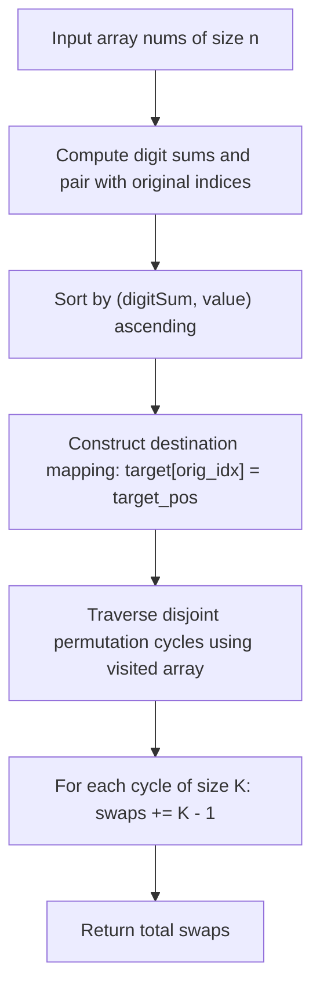

# 3551. Minimum Swaps to Sort by Digit Sum

## Problem Statement

You are given an array of distinct positive integers `nums`.

You need to sort the array in increasing order based on the following rules:
1. **Primary Key:** The sum of the digits of each number.
2. **Secondary Key (Tie-breaker):** If two numbers have the same digit sum, the smaller numerical value appears first.

Your goal is to return the **minimum number of swaps** required to rearrange `nums` into this sorted order.

A **swap** allows you to exchange values at any two distinct positions in the array.

### Example 1:
```
Input: nums = [37, 100]
Output: 1
Explanation: 
- For 37: 3 + 7 = 10
- For 100: 1 + 0 + 0 = 1
Sorting by digit sum puts 100 before 37: target array = [100, 37].
To transform [37, 100] into [100, 37], exactly 1 swap is needed.
```

### Example 2:
```
Input: nums = [22, 14, 33, 7]
Output: 0
Explanation: 
- For 22: 2 + 2 = 4
- For 14: 1 + 4 = 5
- For 33: 3 + 3 = 6
- For 7: 7
Digit sums are [4, 5, 6, 7], which is already in strictly increasing order.
Zero swaps are required.
```

### Constraints:
- `1 <= nums.length <= 10^5`
- `1 <= nums[i] <= 10^9`
- `nums` consists of distinct positive integers.

---

## Approach

1. **Custom Sorting & Destination Mapping:**
   - Pair each number with its original index and compute its digit sum.
   - Sort the pairs primarily by `digit_sum` ascending, using numerical value `val` as the tie-breaker.
   - For every element from the sorted sequence, determine its target destination index `target[orig_idx] = target_pos`.

2. **Permutation Cycle Decomposition:**
   - Viewing indices as nodes and transitions $i \to \text{target}[i]$ as directed edges decomposes the array rearrangement into disjoint cycles.
   - Any permutation cycle of length $K$ can be resolved into its correct configuration using exactly **$K - 1$ swaps**.
   - By tracking visited elements with a boolean array, we traverse each disjoint cycle, count its length $K$, and accumulate $\sum (K - 1)$ to find the global minimum swaps.



---

## Code Implementation

```cpp
#include <vector>
#include <algorithm>

class Solution {
    int getDigitSum(int n) {
        int sum = 0;
        while (n > 0) {
            sum += n % 10;
            n /= 10;
        }
        return sum;
    }

public:
    int minSwaps(std::vector<int>& nums) {
        int n = nums.size();
        
        struct Item {
            int digitSum;
            int val;
            int origIdx;
        };
        
        std::vector<Item> items(n);
        for (int i = 0; i < n; ++i) {
            items[i] = {getDigitSum(nums[i]), nums[i], i};
        }
        
        // Sort based on primary digitSum and secondary numerical value
        std::sort(items.begin(), items.end(), [](const Item& a, const Item& b) {
            if (a.digitSum != b.digitSum) {
                return a.digitSum < b.digitSum;
            }
            return a.val < b.val;
        });
        
        // Map where the element at original index i should land
        std::vector<int> targetIdx(n);
        for (int i = 0; i < n; ++i) {
            targetIdx[items[i].origIdx] = i;
        }
        
        // Detect disjoint permutation cycles
        std::vector<bool> visited(n, false);
        int totalSwaps = 0;
        
        for (int i = 0; i < n; ++i) {
            if (!visited[i] && targetIdx[i] != i) {
                int cycleLength = 0;
                int curr = i;
                while (!visited[curr]) {
                    visited[curr] = true;
                    curr = targetIdx[curr];
                    cycleLength++;
                }
                if (cycleLength > 1) {
                    totalSwaps += (cycleLength - 1);
                }
            }
        }
        
        return totalSwaps;
    }
};
```

---

## Complexity Analysis

- **Time Complexity**: $O(n \log n)$ — Calculating digit sums requires $O(n \log_{10}(\max(\text{nums})))$ which is $O(n)$ since numbers are $\le 10^9$. Sorting takes $O(n \log n)$, and cycle traversal visits each index at most once in $O(n)$. Overall time is dominated by $O(n \log n)$.

- **Space Complexity**: $O(n)$ — Auxiliary vectors for storing item tuples, target indices, and the boolean `visited` tracking array.

---
