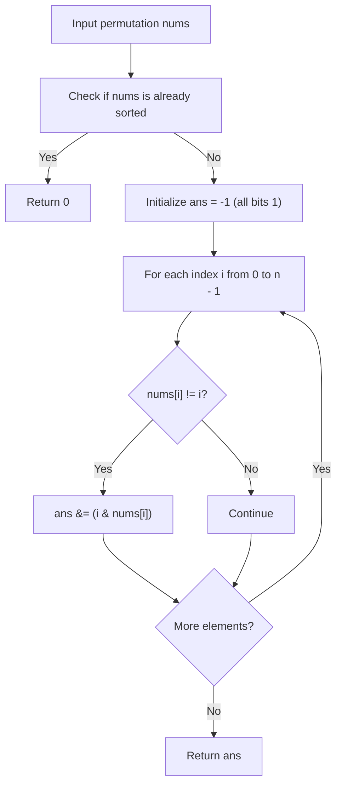

# 3644. Maximum K to Sort a Permutation

## Problem Statement

You are given an integer array `nums` of length `n`, where `nums` is a permutation of the numbers in the range `[0, n - 1]`.

You may swap elements at indices `i` and `j` **only if**:
$$\text{nums}[i] \ \& \ \text{nums}[j] == k$$
where `&` denotes the bitwise AND operation and `k` is a non-negative integer. You can perform this swap operation any number of times.

Return the **maximum possible value of `k`** such that you can sort the array `nums` in non-decreasing order using valid swaps. If the array is already sorted, return `0`.

---

### Example 1:
```
Input: nums = [0, 3, 2, 1]
Output: 1
Explanation:
- Choose k = 1.
- We can swap elements nums[1] = 3 and nums[3] = 1 because 3 & 1 == 1 (equal to k).
- Performing this swap yields [0, 1, 2, 3], which is sorted.
- The maximum value of k is 1.
```

### Example 2:
```
Input: nums = [0, 1, 3, 2]
Output: 2
Explanation:
- Choose k = 2.
- Swap elements nums[2] = 3 and nums[3] = 2 because 3 & 2 == 2 (equal to k).
- Performing this swap yields [0, 1, 2, 3], which is sorted.
- The maximum value of k is 2.
```

---

### Constraints:
- `1 <= n == nums.length <= 10^5`
- `0 <= nums[i] <= n - 1`
- `nums` is a permutation of integers from `0` to `n - 1`.

---

## Approach

### 1. Identifying Misplaced Elements
In a 0-indexed sorted permutation of integers from `0` to `n - 1`, each element `i` must reside at index `i`.
- If `nums[i] == i` for all indices $i$, the array is already sorted. According to the problem specification, we return `0`.
- If an element is out of place (`nums[i] != i`), it must be involved in swap operations to reach its destination index `nums[i]`.

### 2. Bitwise AND Invariant on Connected Components
The swap condition `nums[i] & nums[j] == k` establishes an undirected graph where edges represent allowable swaps. To completely sort the permutation, all misplaced elements must be able to navigate to their correct positions:
- For two numbers $u$ and $v$ to satisfy $u \ \& \ v == k$, **every bit set in $k$ must also be set in both $u$ and $v$**. That is, $k$ is a submask of both values:
  $$(u \ \& \ k) == k \quad \text{and} \quad (v \ \& \ k) == k$$
- For an element `nums[i]` currently located at index $i$ with destination `nums[i]`, any chain of swaps involving this element and position $i$ requires that all participating elements share the set bits of $k$.
- In particular, $k$ must be a submask of both the current index $i$ and its current value `nums[i]` (as well as its destination).
- Consequently, for every misplaced position $i$ (`nums[i] != i`), $k$ must satisfy:
  $$k \subseteq (i \ \& \ \text{nums}[i])$$

### 3. Maximum $k$ via Cumulative Bitwise AND
To find the maximum possible $k$, we take the bitwise AND across all constraints $(i \ \& \ \text{nums}[i])$ for all indices where `nums[i] != i`:
$$k = \bigwedge_{i: \, \text{nums}[i] \neq i} (i \ \& \ \text{nums}[i])$$

This gives the maximal bitmask shared by all misplaced positions and values in $O(n)$ time.



---

## Code Implementation

```cpp
#include <vector>
#include <algorithm>

class Solution {
public:
    int sortPermutation(std::vector<int>& nums) {
        int n = nums.size();
        int ans = -1;
        bool needSort = false;

        for (int i = 0; i < n; ++i) {
            if (nums[i] != i) {
                needSort = true;
                int constraint = i & nums[i];
                if (ans == -1) {
                    ans = constraint;
                } else {
                    ans &= constraint;
                }
            }
        }

        // If the array was already sorted, return 0
        if (!needSort) {
            return 0;
        }

        return (ans == -1) ? 0 : ans;
    }
};
```

---

## Complexity Analysis

- **Time Complexity**: $O(n)$ — We perform a single linear traversal over the array of size $n$, computing bitwise ANDs in $O(1)$ per misplaced element.
- **Space Complexity**: $O(1)$ — Only a constant amount of auxiliary memory is used for tracking variables.

---
