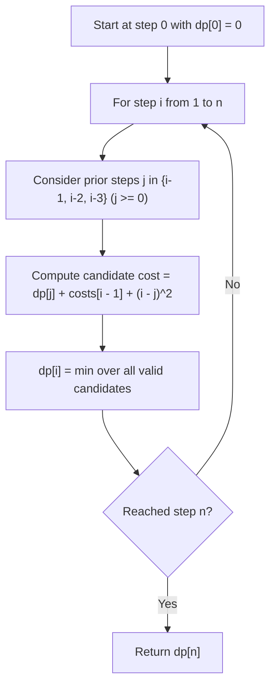

# 3693. Climbing Stairs II

## Problem Statement

You are climbing a staircase with $n + 1$ steps, numbered from $0$ to $n$. You are given a **1-indexed** integer array `costs` of length $n$, where `costs[i]` is the cost of step $i$.

You start from step `0` with a total cost of `0`. From step $i$, you can jump only to step $i + 1$, $i + 2$, or $i + 3$. The cost of jumping from step $i$ to step $j$ is defined as:
$$\text{costs}[j] + (j - i)^2$$

Return the **minimum total cost** to reach step $n$.

### Example 1:

```
Input: n = 4, costs = [1, 2, 3, 4]
Output: 13
Explanation: 
One optimal path is 0 -> 1 -> 2 -> 4:
- Jump 0 -> 1: costs[1] + (1 - 0)^2 = 1 + 1^2 = 2
- Jump 1 -> 2: costs[2] + (2 - 1)^2 = 2 + 1^2 = 3
- Jump 2 -> 4: costs[4] + (4 - 2)^2 = 4 + 2^2 = 8
Total cost = 2 + 3 + 8 = 13.
```

### Example 2:

```
Input: n = 4, costs = [5, 1, 6, 2]
Output: 11
Explanation: 
One optimal path is 0 -> 2 -> 4:
- Jump 0 -> 2: costs[2] + (2 - 0)^2 = 1 + 2^2 = 5
- Jump 2 -> 4: costs[4] + (4 - 2)^2 = 2 + 2^2 = 6
Total cost = 5 + 6 = 11.
```

### Example 3:

```
Input: n = 3, costs = [9, 8, 3]
Output: 12
Explanation: 
The optimal path is 0 -> 3:
- Jump 0 -> 3: costs[3] + (3 - 0)^2 = 3 + 3^2 = 12.
```

### Constraints:

- $1 \le n == \text{costs.length} \le 10^5$
- $1 \le \text{costs}[i] \le 10^4$

---

## Approach

### 1. Dynamic Programming State & Transition
To reach step $i$ ($1 \le i \le n$), we could only have arrived from step $j \in \{i - 1, i - 2, i - 3\}$ (provided $j \ge 0$).
- Let $dp[i]$ represent the minimum total cost to reach step $i$.
- **Base Case**:
  $$dp[0] = 0$$
- **Recurrence Relation**:
  $$dp[i] = \min_{\max(0, i - 3) \le j < i} \left( dp[j] + \text{costs}[i - 1] + (i - j)^2 \right)$$
  *(Note: `costs` is 1-indexed in the problem description, so step $i$ uses `costs[i - 1]` in 0-indexed arrays).*

### 2. Space Optimization ($O(1)$ Extra Space)
Since computing $dp[i]$ only requires values from the previous 3 states ($dp[i - 1], dp[i - 2], dp[i - 3]$), we do not need to retain the entire history of $n$ steps.
- We can use a rolling buffer of size 4 (`dp[i % 4]`).
- This reduces the auxiliary space complexity from $O(n)$ to $O(1)$.



---

## Code Implementation

### C++

```cpp
#include <vector>
#include <algorithm>
#include <climits>

using namespace std;

class Solution {
public:
    int climbStairs(int n, vector<int>& costs) {
        // Space-optimized rolling DP of size 4
        vector<int> dp(4, INT_MAX / 2);
        dp[0] = 0;

        for (int i = 1; i <= n; ++i) {
            int step_cost = costs[i - 1];
            int best = INT_MAX / 2;

            for (int d = 1; d <= 3 && i - d >= 0; ++d) {
                int j = i - d;
                best = min(best, dp[j % 4] + step_cost + d * d);
            }

            dp[i % 4] = best;
        }

        return dp[n % 4];
    }
};
```

### Python3

```python
class Solution:
    def climbStairs(self, n: int, costs: list[int]) -> int:
        # Space-optimized rolling DP of size 4
        dp = [float('inf')] * 4
        dp[0] = 0

        for i in range(1, n + 1):
            step_cost = costs[i - 1]
            best = float('inf')

            for d in range(1, min(4, i + 1)):
                j = i - d
                cost = dp[j % 4] + step_cost + d * d
                if cost < best:
                    best = cost

            dp[i % 4] = best

        return dp[n % 4]
```

---

## Complexity Analysis

- **Time Complexity**: $O(n)$ — We iterate through each of the $n$ steps once. At each step, we evaluate at most 3 previous steps in $O(1)$ constant operations.
- **Space Complexity**: $O(1)$ auxiliary space — Only a fixed-size rolling array of size 4 is used.

---