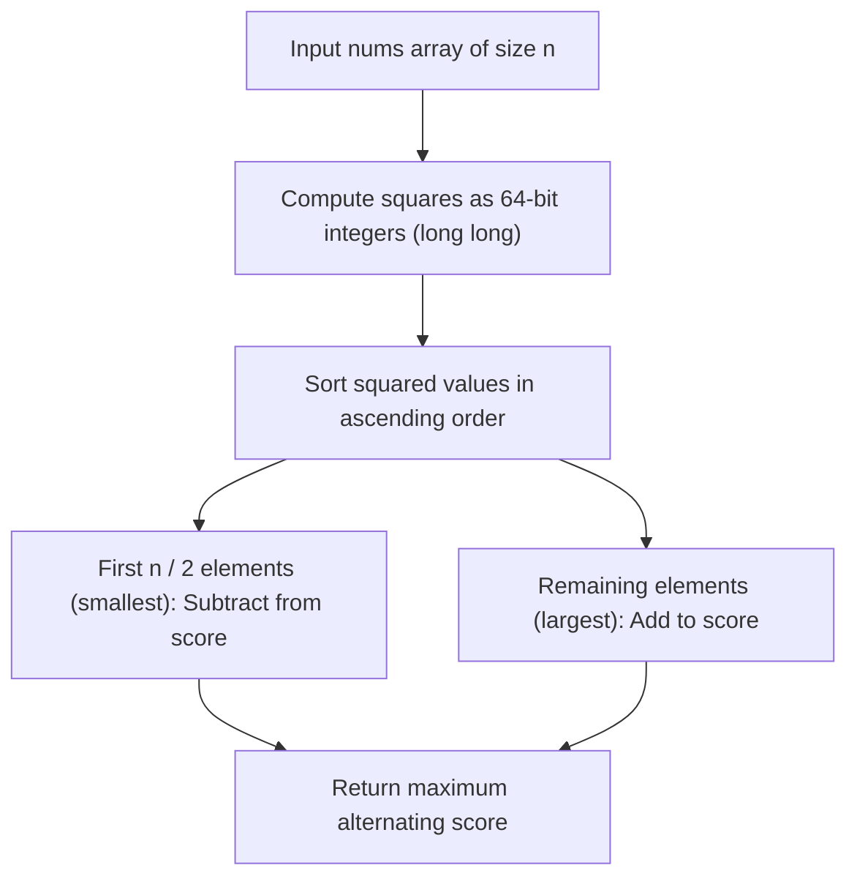

# 3727. Maximum Alternating Sum of Squares

## Problem Statement

You are given an integer array `nums`. You may rearrange the elements in any order.

The **alternating score** of an array `arr` is defined as:
$$\text{score} = arr[0]^2 - arr[1]^2 + arr[2]^2 - arr[3]^2 + \dots$$

Return an integer denoting the **maximum possible alternating score** of `nums` after rearranging its elements.

### Example 1:
```
Input: nums = [1, 2, 3]
Output: 12
Explanation: 
A possible rearrangement for nums is [2, 1, 3], which gives the maximum alternating score among all possible rearrangements.
The alternating score is calculated as: score = 2^2 - 1^2 + 3^2 = 4 - 1 + 9 = 12.
```

### Example 2:
```
Input: nums = [1, -1, 2, -2, 3, -3]
Output: 16
Explanation: 
A possible rearrangement for nums is [-3, -1, -2, 1, 3, 2].
The alternating score is calculated as: score = (-3)^2 - (-1)^2 + (-2)^2 - 1^2 + 3^2 - 2^2 = 9 - 1 + 4 - 1 + 9 - 4 = 16.
```

### Constraints:
- `1 <= nums.length <= 10^5`
- `-4 * 10^4 <= nums[i] <= 4 * 10^4`

---

## Approach

1. **Even vs. Odd Index Contributions:** In any array `arr` of size $n$, elements at even indices ($0, 2, 4, \dots$) have their squares added ($+$), while elements at odd indices ($1, 3, 5, \dots$) have their squares subtracted ($-$).
2. Across an array of length $n$, there are:
   - $\lfloor n / 2 \rfloor$ odd (subtracted) positions.
   - $\lceil n / 2 \rceil = n - \lfloor n / 2 \rfloor$ even (added) positions.
3. Since $(-x)^2 = x^2$, the sign of each number does not affect the square; only the absolute magnitude matters.
4. **Greedy Strategy:** To maximize the final alternating sum ($\sum \text{positive squares} - \sum \text{negative squares}$), we greedily allocate:
   - The smallest $\lfloor n / 2 \rfloor$ squared magnitudes to the odd positions (subtracted).
   - The largest $\lceil n / 2 \rceil$ squared magnitudes to the even positions (added).
5. Precompute each squared value as a 64-bit integer (`long long`) to prevent overflow (since values up to $4 \times 10^4$ produce squares up to $1.6 \times 10^9$, and their cumulative sum across $10^5$ items can reach $\sim 1.6 \times 10^{14}$).
6. Sort the squares in non-decreasing order and accumulate the total score accordingly.



---

## Code Implementation

```cpp
#include <vector>
#include <algorithm>

class Solution {
public:
    long long maximumAlternatingSumOfSquares(std::vector<int>& nums) {
        int n = nums.size();
        std::vector<long long> squares(n);
        
        for (int i = 0; i < n; i++) {
            long long val = nums[i];
            squares[i] = val * val;
        }
        
        std::sort(squares.begin(), squares.end());
        
        long long maxScore = 0;
        int mid = n / 2;
        
        for (int i = 0; i < n; i++) {
            if (i < mid) {
                maxScore -= squares[i];
            } else {
                maxScore += squares[i];
            }
        }
        
        return maxScore;
    }
};
```

---

## Complexity Analysis

- **Time Complexity**: $O(n \log n)$ — Precomputing the squares takes $O(n)$, sorting the array takes $O(n \log n)$, and the final sum traversal takes $O(n)$.

- **Space Complexity**: $O(n)$ — Auxiliary array of size $n$ allocated to store squared values using `long long` to prevent arithmetic overflow.

---
