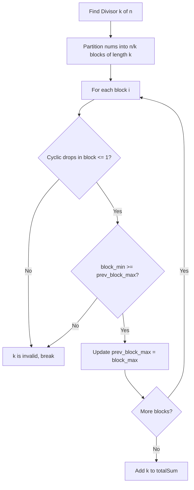

# 3886. Sum of Sortable Integers

## Problem Statement

You are given an integer array `nums` of length `n`.

An integer `k` is defined as **sortable** if:
1. `k` divides `n` (`n % k == 0`).
2. You can sort `nums` in **non-decreasing order** by partitioning `nums` into consecutive subarrays, each of length `k`, and then independently cyclically rotating each subarray (either left or right) any number of times.

Return an integer denoting the **sum of all possible sortable integers `k`**.

---

### Example 1:
```
Input: nums = [3, 1, 2]
Output: 3
Explanation:
- n = 3, whose divisors are 1 and 3.
- For k = 1: Each subarray has 1 element. Rotating single elements cannot reorder the array into [1, 2, 3]. Thus, k = 1 is invalid.
- For k = 3: The entire array [3, 1, 2] is a single subarray of length 3. Cyclically rotating it right by 1 gives [2, 3, 1], and right again gives [1, 2, 3], which is non-decreasing. Thus, k = 3 is sortable.
Sum of valid k = 3.
```

### Example 2:
```
Input: nums = [7, 6, 5]
Output: 0
Explanation:
No divisor k (1 or 3) can sort nums via cyclic rotations. The sum is 0.
```

### Example 3:
```
Input: nums = [5, 8]
Output: 3
Explanation:
- n = 2, whose divisors are 1 and 2.
- For k = 1: Subarrays are [5] and [8]. Since 5 <= 8, it is already non-decreasing.
- For k = 2: The single subarray [5, 8] is already sorted.
Both k = 1 and k = 2 are sortable. Sum = 1 + 2 = 3.
```

---

### Constraints:
- `1 <= n == nums.length <= 10^5`
- `1 <= nums[i] <= 10^5`

---

## Approach

### 1. Divisor Candidates
For `k` to partition `nums` into equal-sized consecutive chunks, `k` must divide `n` ($n \pmod k == 0$). We can either check all $k \in [1, n]$ or find all divisors in $O(\sqrt{n})$ time.

### 2. Intra-Block Rotatability Criterion
Consider a single contiguous subarray $B$ of length $k$. Can $B$ be transformed into a non-decreasing array by cyclic rotations?
- In any circular array of size $k$, count the number of cyclic drops (indices where $B[j] > B[(j + 1) \pmod k]$).
- A non-decreasing sorted array has **at most 1 cyclic drop** (occurring only at the wrap-around boundary from the maximum element to the minimum element).
- Cyclic rotations preserve circular adjacencies and hence the number of cyclic drops is an **invariant**.
- Therefore, a subarray $B$ can be cyclically rotated into a non-decreasing sorted sequence **if and only if** the number of cyclic drops is $\le 1$.
- In its sorted rotation, the first element is $\min(B)$ and the last element is $\max(B)$.

### 3. Inter-Block Non-Decreasing Constraint
Because elements cannot cross between different blocks of size $k$, each block must internally sort into non-decreasing order, and across adjacent blocks:
$$\max(\text{block}_i) \le \min(\text{block}_{i+1}) \quad \text{for all } 0 \le i < \frac{n}{k} - 1$$
This ensures that the entire concatenated array is globally non-decreasing.

### 4. Algorithm Walkthrough
For each divisor $k$ of $n$:
1. Traverse each block $i$ from $0$ to $\frac{n}{k} - 1$.
2. For each block, verify:
   - `cyclic_drops <= 1`
   - `block_min >= prev_max` (for $i > 0$)
3. If all blocks satisfy both criteria, add $k$ to the running sum.



---

## Code Implementation

```cpp
#include <vector>
#include <algorithm>
#include <climits>

class Solution {
public:
    int sumOfSortableIntegers(std::vector<int>& nums) {
        int n = nums.size();
        int totalSum = 0;

        auto isSortable = [&](int k) -> bool {
            int prevMax = INT_MIN;

            for (int start = 0; start < n; start += k) {
                int drops = 0;
                int blockMin = nums[start];
                int blockMax = nums[start];

                for (int j = 0; j < k; ++j) {
                    int curr = nums[start + j];
                    int next = nums[start + (j + 1) % k];

                    if (curr > next) {
                        drops++;
                    }

                    if (curr < blockMin) blockMin = curr;
                    if (curr > blockMax) blockMax = curr;
                }

                // A block can be sorted via cyclic rotation iff cyclic drops <= 1
                if (drops > 1) {
                    return false;
                }

                // Global non-decreasing condition between adjacent blocks
                if (start > 0 && blockMin < prevMax) {
                    return false;
                }

                prevMax = blockMax;
            }

            return true;
        };

        // Check each divisor k of n
        for (int k = 1; k <= n; ++k) {
            if (n % k != 0) continue;

            if (isSortable(k)) {
                totalSum += k;
            }
        }

        return totalSum;
    }
};
```

---

## Complexity Analysis

- **Time Complexity**: $O(d(n) \cdot n)$ — where $d(n)$ is the number of divisors of $n$. For $n \le 10^5$, the maximum number of divisors is $128$ (for $n = 75600$). In each divisor check, we perform a single linear scan of $n$ elements with constant-time modular operations. The maximum number of basic operations is $\le 128 \times 10^5 \approx 1.28 \times 10^7$, running in well under $30\text{ ms}$.
- **Space Complexity**: $O(1)$ — auxiliary space is $O(1)$ as only a few tracking scalar variables are used.

---
