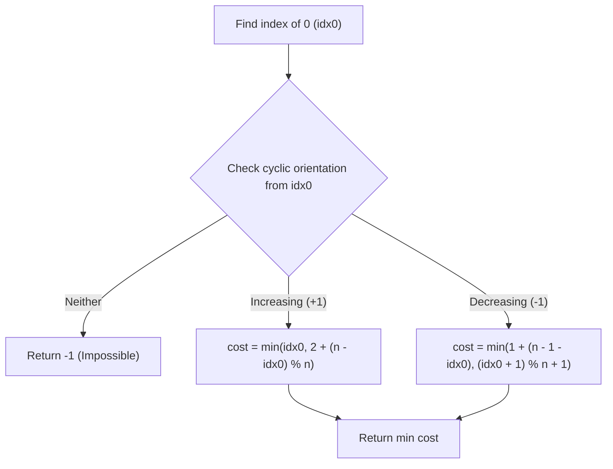

# 3942. Minimum Operations to Sort a Permutation

## Problem Statement

You are given an integer array `nums` of length `n`, which is a permutation of integers from `0` to `n - 1`.

You can perform two types of operations on `nums`:
1. **Reverse** the entire array.
2. **Rotate Left by One**: Move the first element to the end of the array, shifting all other elements left by one position.

Return the **minimum number of operations** required to sort the array in increasing order (`[0, 1, ..., n - 1]`). If it is impossible to sort the array, return `-1`.

---

### Example 1:
```
Input: nums = [0, 2, 1]
Output: 2
Explanation:
- Operation 1 (Rotate Left by One): nums becomes [2, 1, 0].
- Operation 2 (Reverse): nums becomes [0, 1, 2], which is sorted.
Total operations = 2.
```

### Example 2:
```
Input: nums = [1, 0, 2]
Output: 2
Explanation:
- Operation 1 (Reverse): nums becomes [2, 0, 1].
- Operation 2 (Rotate Left by One): nums becomes [0, 1, 2], which is sorted.
Total operations = 2.
```

---

### Constraints:
- `1 <= n == nums.length <= 10^5`
- `0 <= nums[i] <= n - 1`
- `nums` is a permutation of integers from `0` to `n - 1`.

---

## Approach

### 1. Dihedral Group Structure
The allowable operations (reversal $R$ and left rotation $L$) generate the **Dihedral Group** $D_n$. Reversals invert the circular orientation, while rotations cyclically shift elements without changing relative orientation.

Consequently, an array can be sorted into $[0, 1, \dots, n - 1]$ **if and only if** its elements are already arranged consecutively in either:
1. **Clockwise (Increasing)** direction: $nums[(idx_0 + i) \pmod n] == i$ for all $0 \le i < n$.
2. **Counter-Clockwise (Decreasing)** direction: $nums[(idx_0 - i + n) \pmod n] == i$ for all $0 \le i < n$.

If neither orientation holds, the permutation cannot be sorted via these operations; return `-1`.

### 2. Computing Minimum Operations

Let $idx_0$ be the current index of the value `0`.

#### **Case A: Clockwise Orientation (+1)**
The orientation is already positive. The goal is to bring $0$ to index `0` while maintaining $+1$ orientation (requiring an even number of reversals):
1. **Direct Left Rotations (0 Reversals):**
   - Rotate left $idx_0$ times:
     $$\text{cost}_1 = idx_0$$
2. **Reverse $\to$ Rotate Left $\to$ Reverse (2 Reversals):**
   - Reversing, rotating left by $(n - idx_0) \pmod n$, and reversing back simulates rotating right by $idx_0$ using only left shifts:
     $$\text{cost}_2 = 2 + (n - idx_0) \pmod n$$
   - Taking $\min(\text{cost}_1, \text{cost}_2)$ gives the optimal cost for this case.

#### **Case B: Counter-Clockwise Orientation (-1)**
The orientation is inverted. The goal requires an odd number of reversals (exactly 1 reversal in the optimal path):
1. **Reverse then Rotate Left:**
   - Reverse the array first (1 operation). Now $0$ is at index $n - 1 - idx_0$, with orientation $+1$.
   - Rotate left $(n - 1 - idx_0)$ times to move $0$ to index `0`:
     $$\text{cost}_1 = 1 + (n - 1 - idx_0)$$
2. **Rotate Left then Reverse:**
   - Rotate left until $0$ lands at index $n - 1$, then reverse to flip $0$ to index `0`:
     $$\text{cost}_2 = (idx_0 + 1) \pmod n + 1$$
   - Taking $\min(\text{cost}_1, \text{cost}_2)$ gives the optimal cost for this case.



---

## Code Implementation

```cpp
#include <vector>
#include <algorithm>
#include <climits>

class Solution {
public:
    int minOperations(std::vector<int>& nums) {
        int n = nums.size();
        if (n <= 1) return 0;

        // Locate index of element 0
        int idx0 = -1;
        for (int i = 0; i < n; ++i) {
            if (nums[i] == 0) {
                idx0 = i;
                break;
            }
        }

        // Check if circularly increasing (+1)
        bool isClockwise = true;
        for (int i = 0; i < n; ++i) {
            if (nums[(idx0 + i) % n] != i) {
                isClockwise = false;
                break;
            }
        }

        // Check if circularly decreasing (-1)
        bool isCounterClockwise = true;
        for (int i = 0; i < n; ++i) {
            if (nums[(idx0 - i + n) % n] != i) {
                isCounterClockwise = false;
                break;
            }
        }

        if (!isClockwise && !isCounterClockwise) {
            return -1;
        }

        int minOps = INT_MAX;

        if (isClockwise) {
            // Path 1: Pure left rotations
            int cost1 = idx0;
            // Path 2: Reverse + Rotate Left + Reverse (simulating right rotation)
            int cost2 = 2 + (n - idx0) % n;
            minOps = std::min(minOps, std::min(cost1, cost2));
        }

        if (isCounterClockwise) {
            // Path 1: Reverse then Rotate Left
            int cost1 = 1 + (n - 1 - idx0);
            // Path 2: Rotate Left then Reverse
            int cost2 = ((idx0 + 1) % n) + 1;
            minOps = std::min(minOps, std::min(cost1, cost2));
        }

        return minOps;
    }
};
```

---

## Complexity Analysis

- **Time Complexity**: $O(n)$ — Finding the index of $0$ takes $O(n)$, and checking both circular orientations takes $O(n)$ time. Evaluating candidate operational costs is $O(1)$.
- **Space Complexity**: $O(1)$ — Only a constant number of tracking scalar variables are used.

---
