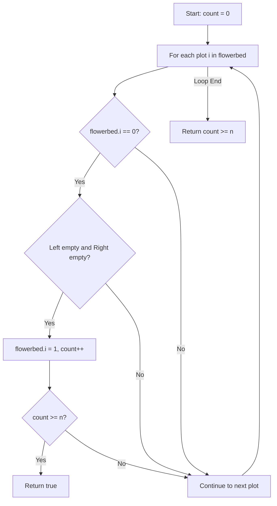

# 605. Can Place Flowers

## Problem Statement

You have a long flowerbed in which some of the plots are planted, and some are not. However, flowers cannot be planted in **adjacent** plots.

Given an integer array `flowerbed` containing `0`'s and `1`'s, where `0` means empty and `1` means not empty, and an integer `n`, return `true` if `n` new flowers can be planted in the `flowerbed` without violating the no-adjacent-flowers rule and `false` otherwise.

### Example 1:
```
Input: flowerbed = [1,0,0,0,1], n = 1
Output: true
```

### Example 2:
```
Input: flowerbed = [1,0,0,0,1], n = 2
Output: false
```

---

## Approach

We can solve this greedily by inspecting each plot sequentially:

1. A flower can be planted at index `i` if:
   - The current plot is empty: `flowerbed[i] == 0`.
   - The left neighbor is empty or it is the left boundary: `i == 0 || flowerbed[i - 1] == 0`.
   - The right neighbor is empty or it is the right boundary: `i == size - 1 || flowerbed[i + 1] == 0`.
2. When all three conditions hold, plant a flower at index `i` (`flowerbed[i] = 1`) and increment our planted flower count.
3. If at any point the count reaches or exceeds `n`, return `true` early.
4. After checking all plots, return `count >= n`.



---

## Code Implementation

```cpp
#include <vector>

class Solution {
public:
    bool canPlaceFlowers(std::vector<int>& flowerbed, int n) {
        int count = 0;
        int sz = flowerbed.size();
        
        for (int i = 0; i < sz; ++i) {
            if (flowerbed[i] == 0) {
                bool emptyLeft = (i == 0) || (flowerbed[i - 1] == 0);
                bool emptyRight = (i == sz - 1) || (flowerbed[i + 1] == 0);
                
                if (emptyLeft && emptyRight) {
                    flowerbed[i] = 1;
                    count++;
                    if (count >= n) {
                        return true;
                    }
                }
            }
        }
        
        return count >= n;
    }
};
```

---

## Complexity Analysis

- **Time Complexity**: $O(n)$ — Single pass through the flowerbed array of size $n$.

- **Space Complexity**: $O(1)$ — In-place array modification with no additional memory allocation.

---
