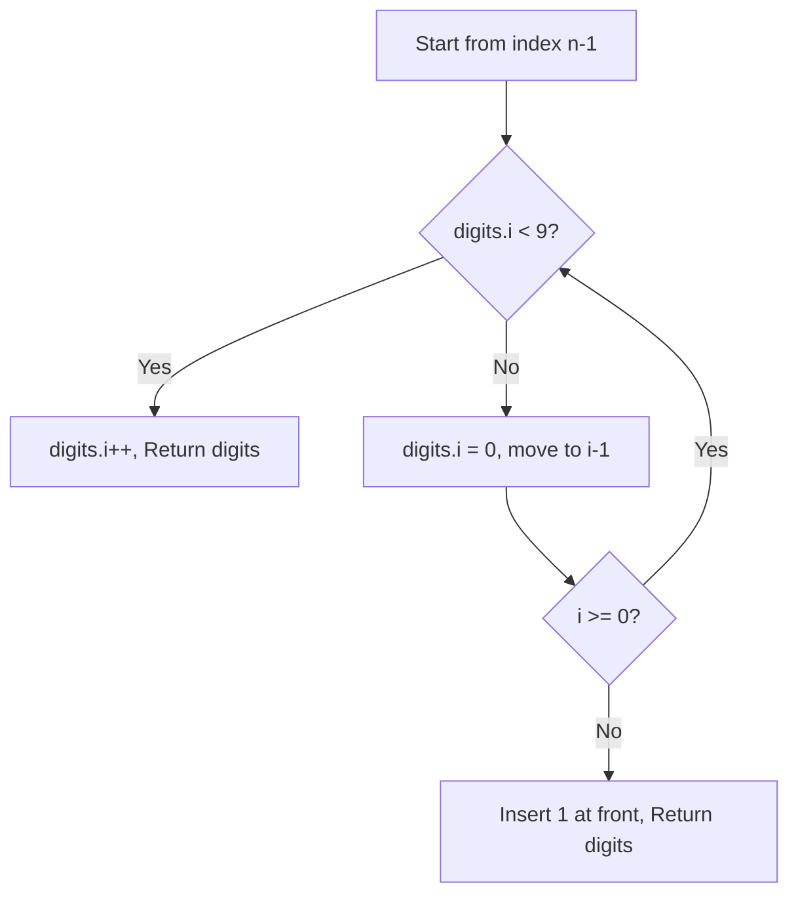

# 66. Plus One

## Problem Statement

You are given a **large integer** represented as an integer array `digits`, where each `digits[i]` is the $i^{\text{th}}$ digit of the integer. The digits are ordered from most significant to least significant in left-to-right order. The large integer does not contain any leading `0`'s.

Increment the large integer by one and return the resulting array of digits.

### Example 1:
```
Input: digits = [1,2,3]
Output: [1,2,4]
Explanation: The array represents the integer 123.
Incrementing by one gives 123 + 1 = 124.
Thus, the result should be [1,2,4].
```

### Example 2:
```
Input: digits = [4,3,2,1]
Output: [4,3,2,2]
Explanation: The array represents the integer 4321.
Incrementing by one gives 4321 + 1 = 4322.
Thus, the result should be [4,3,2,2].
```

### Example 3:
```
Input: digits = [9]
Output: [1,0]
Explanation: The array represents the integer 9.
Incrementing by one gives 9 + 1 = 10.
Thus, the result should be [1,0].
```

---

## Approach

1. Iterate backwards through the array from the least significant digit (`digits[n - 1]`) to index `0`.
2. For each digit:
   - If `digits[i] < 9`, simply increment it by 1 and return the vector immediately (no carry will propagate further).
   - If `digits[i] == 9`, set `digits[i] = 0` and allow the carry to propagate leftward.
3. If the loop finishes and all digits were `9` (e.g. `[9, 9, 9]`), the array is now `[0, 0, 0]`. Prepend `1` to the beginning of the vector to get `[1, 0, 0, 0]`.



---

## Code Implementation

```cpp
#include <vector>

class Solution {
public:
    std::vector<int> plusOne(std::vector<int>& digits) {
        int n = digits.size();
        
        for (int i = n - 1; i >= 0; --i) {
            if (digits[i] < 9) {
                digits[i]++;
                return digits;
            }
            digits[i] = 0;
        }
        
        digits.insert(digits.begin(), 1);
        return digits;
    }
};
```

---

## Complexity Analysis

- **Time Complexity**: $O(n)$ — In the worst case (all 9s), we iterate through all $n$ digits once. In the best case, it terminates in $O(1)$ on the first step.

- **Space Complexity**: $O(1)$ — The operation is done in-place, using $O(1)$ extra memory (or $O(n)$ if prepending a new leading digit).

---
