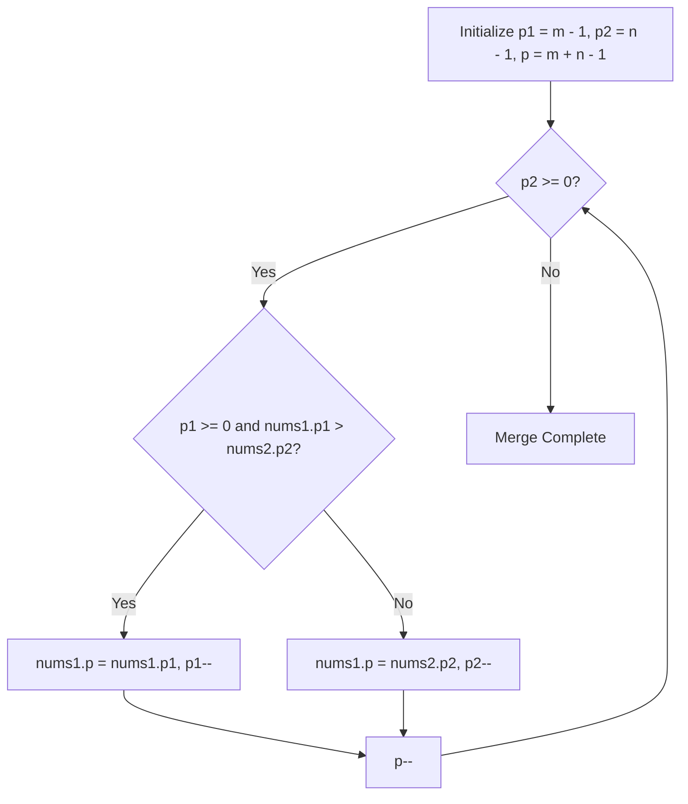

# 88. Merge Sorted Array

## Problem Statement

You are given two integer arrays `nums1` and `nums2`, sorted in **non-decreasing order**, and two integers `m` and `n`, representing the number of elements in `nums1` and `nums2` respectively.

Merge `nums1` and `nums2` into a single array sorted in **non-decreasing order**.

The final sorted array should not be returned by the function, but instead be stored inside the array `nums1`. To accommodate this, `nums1` has a length of `m + n`, where the first `m` elements denote the elements that should be merged, and the last `n` elements are set to `0` and should be ignored. `nums2` has a length of `n`.

### Example 1:
```
Input: nums1 = [1,2,3,0,0,0], m = 3, nums2 = [2,5,6], n = 3
Output: [1,2,2,3,5,6]
Explanation: The arrays we are merging are [1,2,3] and [2,5,6].
The result of the merge is [1,2,2,3,5,6] with the underlined elements coming from nums1.
```

### Example 2:
```
Input: nums1 = [1], m = 1, nums2 = [], n = 0
Output: [1]
Explanation: The arrays we are merging are [1] and [].
The result of the merge is [1].
```

### Example 3:
```
Input: nums1 = [0], m = 0, nums2 = [1], n = 1
Output: [1]
Explanation: The arrays we are merging are [] and [1].
The result of the merge is [1].
```

---

## Approach

Merging from the start would require shifting elements in `nums1` or allocating extra memory. Instead, we can merge from **back to front** using three pointers:

1. `p1 = m - 1`: points to the last valid element of `nums1`.
2. `p2 = n - 1`: points to the last element of `nums2`.
3. `p = m + n - 1`: points to the last available position in `nums1`.
4. While `p2 >= 0`:
   - If `p1 >= 0` and `nums1[p1] > nums2[p2]`, place `nums1[p1]` at `nums1[p]` and decrement `p1`.
   - Otherwise, place `nums2[p2]` at `nums1[p]` and decrement `p2`.
   - Decrement `p`.
5. When `p2 < 0`, all elements of `nums2` are merged, and elements remaining in `nums1` are already in their correct sorted positions.



---

## Code Implementation

```cpp
#include <vector>

class Solution {
public:
    void merge(std::vector<int>& nums1, int m, std::vector<int>& nums2, int n) {
        int p1 = m - 1;
        int p2 = n - 1;
        int p = m + n - 1;
        
        while (p2 >= 0) {
            if (p1 >= 0 && nums1[p1] > nums2[p2]) {
                nums1[p] = nums1[p1];
                p1--;
            } else {
                nums1[p] = nums2[p2];
                p2--;
            }
            p--;
        }
    }
};
```

---

## Complexity Analysis

- **Time Complexity**: $O(m + n)$ — Each iteration places one element into its final spot; we iterate at most $m + n$ times.

- **Space Complexity**: $O(1)$ — Merging is performed directly in-place inside `nums1`.

---
