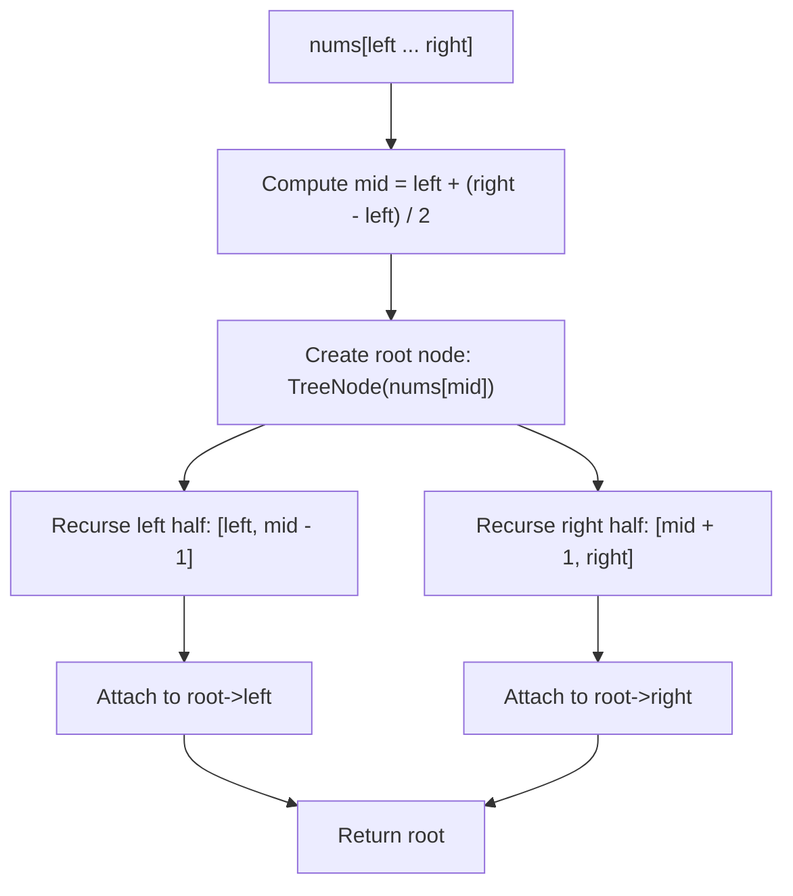

# 108. Convert Sorted Array to Binary Search Tree

## Problem Statement

Given an integer array `nums` where the elements are sorted in **ascending order**, convert it to a **height-balanced** binary search tree.

A **height-balanced** binary tree is a binary tree in which the depth of the two subtrees of every node never differs by more than one.

### Example 1:

```
Input: nums = [-10,-3,0,5,9]
Output: [0,-3,9,-10,null,5]
Explanation: [0,-10,5,null,-3,null,9] is also accepted:
      0                     0
     / \                   / \
   -3   9   or           -10   5
   /   /                   \    \
 -10  5                    -3    9
Both are height-balanced BSTs.
```

### Example 2:

```
Input: nums = [1,3]
Output: [3,1]
Explanation: [1,null,3] and [3,1] are both height-balanced BSTs.
    3         1
   /     or    \
  1             3
```

### Constraints:

- $1 \le \text{nums.length} \le 10^4$
- $-10^4 \le \text{nums}[i] \le 10^4$
- `nums` is sorted in a **strictly increasing** order.

---

## Approach

### 1. BST In-Order Property & Height Balance
- An **in-order traversal** of any valid Binary Search Tree produces values in strictly ascending order.
- To guarantee that the tree is **height-balanced** (the depths of left and right subtrees differ by at most $1$), the number of nodes in the left subtree and right subtree must be as close as possible.
- Consequently, for any contiguous segment `nums[left ... right]`, the optimal choice for the root is the **midpoint**:
  $$\text{mid} = \text{left} + \frac{\text{right} - \text{left}}{2}$$

### 2. Recursive Divide and Conquer (Binary Search Midpoint Partitioning)
1. **Base Case**: If $\text{left} > \text{right}$, the current range is empty, so return `nullptr` (or `None`).
2. **Root Construction**: Select $\text{mid} = \text{left} + (\text{right} - \text{left}) / 2$, and construct `TreeNode(nums[mid])`.
3. **Left Subtree**: Recursively construct the left child from range `[left, mid - 1]`.
4. **Right Subtree**: Recursively construct the right child from range `[mid + 1, right]`.
5. **Return Root**: Return the newly created subtree root node.



---

## Code Implementation

### C++

```cpp
/**
 * Definition for a binary tree node.
 * struct TreeNode {
 *     int val;
 *     TreeNode *left;
 *     TreeNode *right;
 *     TreeNode() : val(0), left(nullptr), right(nullptr) {}
 *     TreeNode(int x) : val(x), left(nullptr), right(nullptr) {}
 *     TreeNode(int x, TreeNode *left, TreeNode *right) : val(x), left(left), right(right) {}
 * };
 */
#include <vector>

using namespace std;

class Solution {
private:
    TreeNode* buildBST(const vector<int>& nums, int left, int right) {
        if (left > right) {
            return nullptr;
        }

        int mid = left + (right - left) / 2;
        TreeNode* root = new TreeNode(nums[mid]);

        root->left = buildBST(nums, left, mid - 1);
        root->right = buildBST(nums, mid + 1, right);

        return root;
    }

public:
    TreeNode* sortedArrayToBST(vector<int>& nums) {
        return buildBST(nums, 0, nums.size() - 1);
    }
};
```

### Python3

```python
from typing import Optional

# Definition for a binary tree node.
# class TreeNode:
#     def __init__(self, val=0, left=None, right=None):
#         self.val = val
#         self.left = left
#         self.right = right

class Solution:
    def sortedArrayToBST(self, nums: list[int]) -> Optional[TreeNode]:
        def build(left: int, right: int) -> Optional[TreeNode]:
            if left > right:
                return None

            mid = (left + right) // 2
            root = TreeNode(nums[mid])

            root.left = build(left, mid - 1)
            root.right = build(mid + 1, right)

            return root

        return build(0, len(nums) - 1)
```

---

## Complexity Analysis

- **Time Complexity**: $O(n)$ — Each of the $n$ elements in `nums` is visited exactly once to create a corresponding `TreeNode`.
- **Space Complexity**: $O(\log n)$ auxiliary recursion stack space — Because the tree is height-balanced, the recursion depth is bounded by $\lceil \log_2 n \rceil$. (Excluding the $O(n)$ space required to hold the returned tree).

---