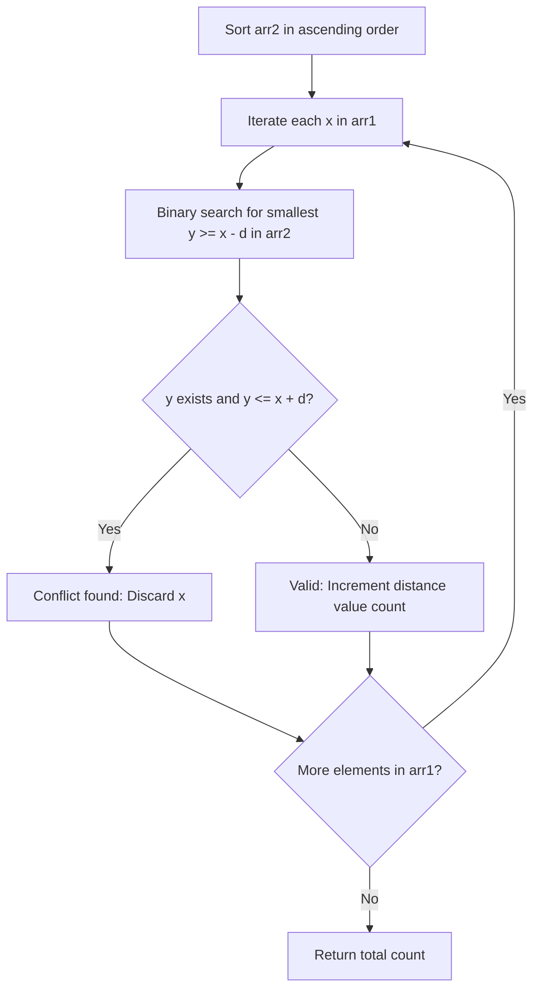

# 1385. Find the Distance Value Between Two Arrays

## Problem Statement

Given two integer arrays `arr1` and `arr2`, and an integer `d`, return the *distance value* between the two arrays.

The distance value is defined as the number of elements `arr1[i]` such that there is not any element `arr2[j]` where `|arr1[i] - arr2[j]| <= d`.

### Example 1:

```
Input: arr1 = [4,5,8], arr2 = [10,9,1,8], d = 2
Output: 2
Explanation: 
For arr1[0]=4 we have: 
|4-10|=6 > d=2 
|4-9|=5 > d=2 
|4-1|=3 > d=2 
|4-8|=4 > d=2 
For arr1[1]=5 we have: 
|5-10|=5 > d=2 
|5-9|=4 > d=2 
|5-1|=4 > d=2 
|5-8|=3 > d=2
For arr1[2]=8 we have:
|8-10|=2 <= d=2
|8-9|=1 <= d=2
|8-1|=7 > d=2
|8-8|=0 <= d=2
Only arr1[0]=4 and arr1[1]=5 satisfy the condition, so distance value is 2.
```

### Example 2:

```
Input: arr1 = [1,4,2,3], arr2 = [-4,-3,6,10,20,30], d = 3
Output: 2
```

### Example 3:

```
Input: arr1 = [2,1,100,3], arr2 = [-5,-2,10,-3,7], d = 6
Output: 1
```

### Constraints:

- $1 \le \text{arr1.length}, \text{arr2.length} \le 500$
- $-1000 \le \text{arr1}[i], \text{arr2}[j] \le 1000$
- $0 \le d \le 100$

---

## Approach

### 1. Mathematical Reformulation
The condition that $|x - y| \le d$ for some $y \in \text{arr2}$ is equivalent to:
$$x - d \le y \le x + d$$
Thus, for a given $x \in \text{arr1}$, it is **invalid** if there is at least one element $y \in \text{arr2}$ that falls inside the closed interval $[x - d, x + d]$.

### 2. Binary Search Optimization
Instead of a brute-force $O(n \cdot m)$ comparison:
1. Sort `arr2` in ascending order in $O(m \log m)$ time.
2. For each element $x \in \text{arr1}$, use binary search (`std::lower_bound` in C++ / `bisect_left` in Python) to locate the smallest element in `arr2` such that $y \ge x - d$.
3. If such an element exists and satisfies $y \le x + d$, then a conflict exists, so $x$ is not counted.
4. If no such element lies in $[x - d, x + d]$, then no element in `arr2` is within distance $d$ of $x$, and we increment our valid counter.



---

## Code Implementation

### C++

```cpp
#include <vector>
#include <algorithm>
#include <cmath>

using namespace std;

class Solution {
public:
    int findTheDistanceValue(vector<int>& arr1, vector<int>& arr2, int d) {
        sort(arr2.begin(), arr2.end());
        int count = 0;

        for (int x : arr1) {
            // Find the first element in arr2 >= x - d
            auto it = lower_bound(arr2.begin(), arr2.end(), x - d);
            
            // Check if this element falls within [x - d, x + d]
            if (it != arr2.end() && *it <= x + d) {
                continue;
            }
            count++;
        }

        return count;
    }
};
```

### Python3

```python
from bisect import bisect_left

class Solution:
    def findTheDistanceValue(self, arr1: list[int], arr2: list[int], d: int) -> int:
        arr2.sort()
        count = 0
        m = len(arr2)
        
        for x in arr1:
            idx = bisect_left(arr2, x - d)
            if idx < m and arr2[idx] <= x + d:
                continue
            count += 1
            
        return count
```

---

## Complexity Analysis

- **Time Complexity**: $O(m \log m + n \log m)$ where $n = |\text{arr1}|$ and $m = |\text{arr2}|$.
  - Sorting `arr2` takes $O(m \log m)$.
  - For each of the $n$ elements in `arr1`, binary search takes $O(\log m)$.
  - Substantially faster than the $O(n \cdot m)$ brute-force check.

- **Space Complexity**: $O(1)$ auxiliary space beyond the sorting space stack.

---