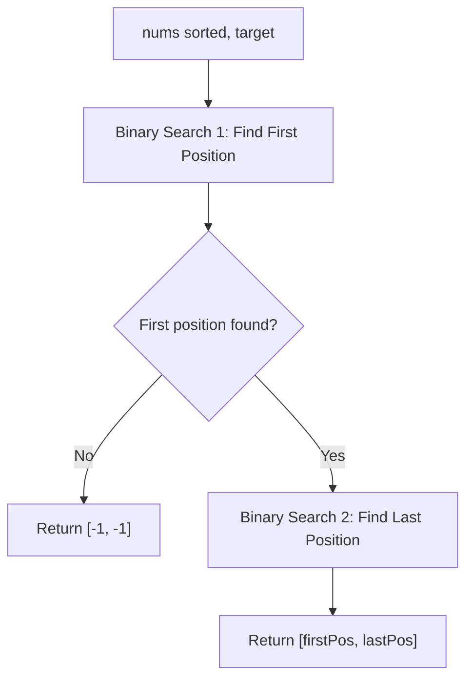

# 34. Find First and Last Position of Element in Sorted Array

## Problem Statement

Given an array of integers `nums` sorted in non-decreasing order, find the starting and ending position of a given `target` value.

If `target` is not found in the array, return `[-1, -1]`.

You must write an algorithm with $O(\log n)$ runtime complexity.

### Example 1:
```
Input: nums = [5,7,7,8,8,10], target = 8
Output: [3,4]
```

### Example 2:
```
Input: nums = [5,7,7,8,8,10], target = 6
Output: [-1,-1]
```

### Example 3:
```
Input: nums = [], target = 0
Output: [-1,-1]
```

### Constraints:
- $0 \le \text{nums.length} \le 10^5$
- $-10^9 \le \text{nums}[i] \le 10^9$
- `nums` is a non-decreasing array.
- $-10^9 \le \text{target} \le 10^9$

---

## Approach

Since the array is sorted and the required runtime is $O(\log n)$, we can execute two independent binary searches:

1. **Find First Occurrence (Lower Boundary):**
   - Perform binary search over `[0, n - 1]`.
   - When $\text{nums}[\text{mid}] == \text{target}$, record $\text{mid}$ as a candidate starting index and search leftward ($\text{right} = \text{mid} - 1$) to find earlier occurrences.
   - If $\text{nums}[\text{mid}] < \text{target}$, move right ($\text{left} = \text{mid} + 1$).
   - If $\text{nums}[\text{mid}] > \text{target}$, move left ($\text{right} = \text{mid} - 1$).

2. **Early Exit Optimization:**
   - If the first occurrence index remains $-1$, `target` does not exist in `nums`. We can immediately return `[-1, -1]` without running the second search.

3. **Find Last Occurrence (Upper Boundary):**
   - Perform binary search over `[firstIdx, n - 1]`.
   - When $\text{nums}[\text{mid}] == \text{target}$, record $\text{mid}$ as a candidate ending index and search rightward ($\text{left} = \text{mid} + 1$) to find later occurrences.
   - If $\text{nums}[\text{mid}] > \text{target}$, move left ($\text{right} = \text{mid} - 1$).
   - If $\text{nums}[\text{mid}] < \text{target}$, move right ($\text{left} = \text{mid} + 1$).



---

## Code Implementation

### C++

```cpp
class Solution {
private:
    int findBound(const vector<int>& nums, int target, bool isFirst) {
        int left = 0, right = nums.size() - 1;
        int bound = -1;

        while (left <= right) {
            int mid = left + (right - left) / 2;

            if (nums[mid] == target) {
                bound = mid;
                if (isFirst) {
                    right = mid - 1; // Look for earlier occurrences
                } else {
                    left = mid + 1;  // Look for later occurrences
                }
            } else if (nums[mid] < target) {
                left = mid + 1;
            } else {
                right = mid - 1;
            }
        }

        return bound;
    }

public:
    vector<int> searchRange(vector<int>& nums, int target) {
        int firstPos = findBound(nums, target, true);
        if (firstPos == -1) {
            return {-1, -1};
        }
        int lastPos = findBound(nums, target, false);
        return {firstPos, lastPos};
    }
};
```

### Python3

```python
class Solution:
    def searchRange(self, nums: list[int], target: int) -> list[int]:
        def find_bound(is_first: bool) -> int:
            left, right = 0, len(nums) - 1
            bound = -1

            while left <= right:
                mid = left + (right - left) // 2
                if nums[mid] == target:
                    bound = mid
                    if is_first:
                        right = mid - 1
                    else:
                        left = mid + 1
                elif nums[mid] < target:
                    left = mid + 1
                else:
                    right = mid - 1

            return bound

        first_pos = find_bound(True)
        if first_pos == -1:
            return [-1, -1]
        last_pos = find_bound(False)

        return [first_pos, last_pos]
```

---

## Complexity Analysis

- **Time Complexity**: $O(\log n)$ — Two binary searches on an array of length $n$, each halving the search space per iteration ($\approx 2 \log_2 n$).
- **Space Complexity**: $O(1)$ — Only a constant amount of additional memory for pointers (`left`, `right`, `mid`, `bound`).

---
