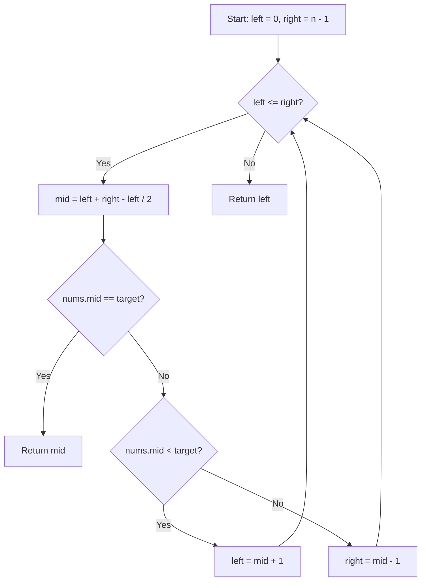

# 35. Search Insert Position

## Problem Statement

Given a sorted array of distinct integers and a target value, return the index if the target is found. If not, return the index where it would be if it were inserted in order.

You must write an algorithm with $O(\log n)$ runtime complexity.

### Example 1:
```
Input: nums = [1,3,5,6], target = 5
Output: 2
```

### Example 2:
```
Input: nums = [1,3,5,6], target = 2
Output: 1
```

### Example 3:
```
Input: nums = [1,3,5,6], target = 7
Output: 4
```

---

## Approach

Since the array is sorted and distinct, we can apply **Binary Search**:

1. Initialize `left = 0` and `right = nums.size() - 1`.
2. While `left <= right`:
   - Calculate `mid = left + (right - left) / 2` (avoiding integer overflow).
   - If `nums[mid] == target`, target is found; return `mid`.
   - If `nums[mid] < target`, target must reside in the right half, so set `left = mid + 1`.
   - If `nums[mid] > target`, target must reside in the left half, so set `right = mid - 1`.
3. If target is not found in the array, `left` will naturally point to the exact index where the target belongs. Return `left`.



---

## Code Implementation

```cpp
#include <vector>

class Solution {
public:
    int searchInsert(std::vector<int>& nums, int target) {
        int left = 0;
        int right = nums.size() - 1;
        
        while (left <= right) {
            int mid = left + (right - left) / 2;
            
            if (nums[mid] == target) {
                return mid;
            } else if (nums[mid] < target) {
                left = mid + 1;
            } else {
                right = mid - 1;
            }
        }
        
        return left;
    }
};
```

---

## Complexity Analysis

- **Time Complexity**: $O(\log n)$ — The binary search divides the search space in half with every iteration.

- **Space Complexity**: $O(1)$ — Iterative implementation uses constant extra space.

---
