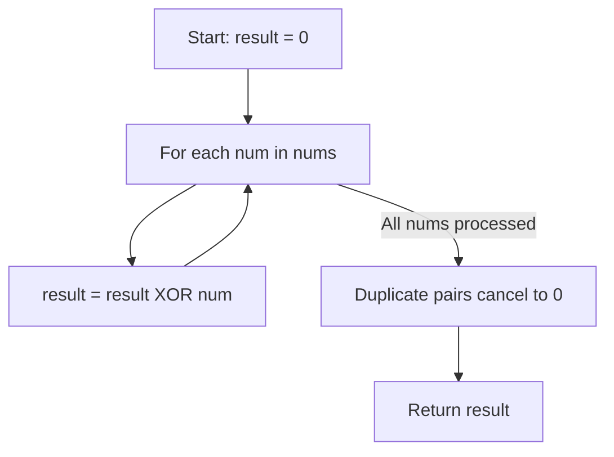

# 136. Single Number

## Problem Statement

Given a **non-empty** array of integers `nums`, every element appears twice except for one. Find that single one.

You must implement a solution with a linear runtime complexity and use only constant extra space.

### Example 1:
```
Input: nums = [2,2,1]
Output: 1
```

### Example 2:
```
Input: nums = [4,1,2,1,2]
Output: 4
```

### Example 3:
```
Input: nums = [1]
Output: 1
```

---

## Approach

We can take advantage of the algebraic properties of the **Bitwise XOR (`^`) operator**:

1. **Identity Element**: $a \oplus 0 = a$
2. **Self-Inverse**: $a \oplus a = 0$
3. **Commutative & Associative**: The order of operations does not matter ($a \oplus b \oplus a = (a \oplus a) \oplus b = 0 \oplus b = b$).

If we XOR all numbers in the array together:
- Every number that appears twice will XOR with itself and become `0`.
- The only number that appears once will XOR with `0` and retain its value.



---

## Code Implementation

```cpp
#include <vector>

class Solution {
public:
    int singleNumber(std::vector<int>& nums) {
        int result = 0;
        
        for (int num : nums) {
            result ^= num;
        }
        
        return result;
    }
};
```

---

## Complexity Analysis

- **Time Complexity**: $O(n)$ — Single pass through the array of length $n$.

- **Space Complexity**: $O(1)$ — Only a single variable `result` is used.

---
