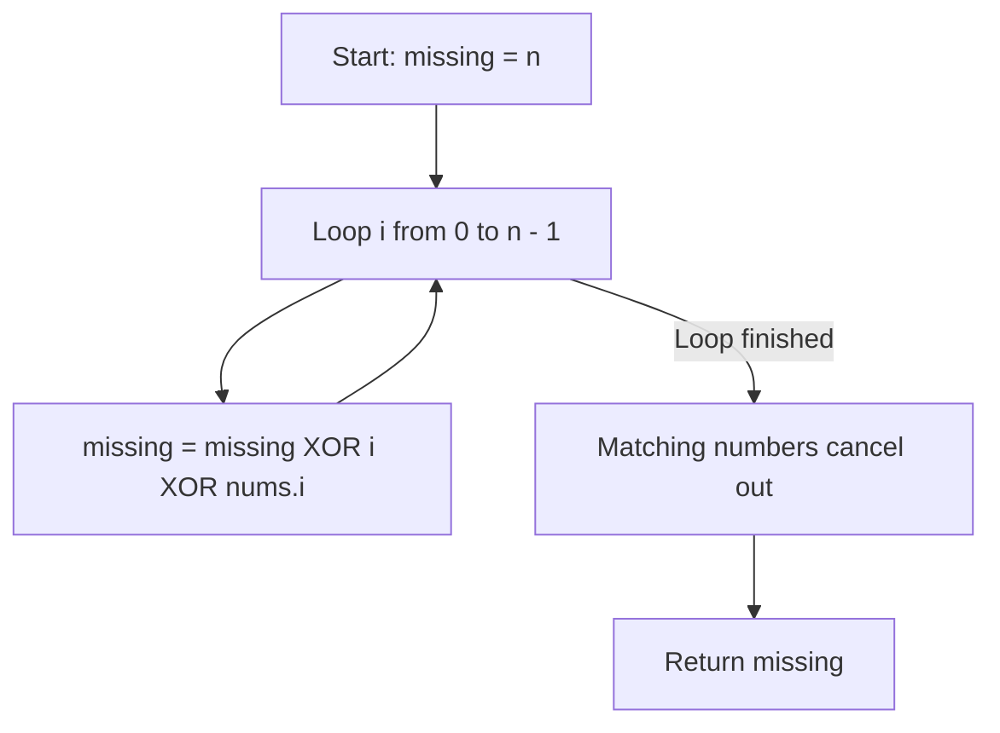

# 268. Missing Number

## Problem Statement

Given an array `nums` containing `n` distinct numbers in the range `[0, n]`, return the only number in the range that is missing from the array.

### Example 1:
```
Input: nums = [3,0,1]
Output: 2
Explanation: n = 3 since there are 3 numbers, so all numbers are in the range [0,3]. 2 is the missing number in the range since it does not appear in nums.
```

### Example 2:
```
Input: nums = [0,1]
Output: 2
Explanation: n = 2 since there are 2 numbers, so all numbers are in the range [0,2]. 2 is the missing number in the range since it does not appear in nums.
```

### Example 3:
```
Input: nums = [9,6,4,2,3,5,7,0,1]
Output: 8
Explanation: n = 9 since there are 9 numbers, so all numbers are in the range [0,9]. 8 is the missing number in the range since it does not appear in nums.
```

---

## Approach

While we could use Gauss's formula $\frac{n(n + 1)}{2} - \sum \text{nums}$, this can risk 32-bit integer overflow for extremely large arrays. 

A safer and optimal approach uses **Bitwise XOR (`^`)**:

1. Initialize `missing = n`.
2. For each index `i` from `0` to `n - 1`:
   - Compute `missing ^= i ^ nums[i]`.
3. Every number present in the range $[0, n - 1]$ will match with its corresponding index `i` and cancel out ($x \oplus x = 0$).
4. The single number that is missing has no matching pair and will remain in `missing`.



---

## Code Implementation

```cpp
#include <vector>

class Solution {
public:
    int missingNumber(std::vector<int>& nums) {
        int n = nums.size();
        int missing = n;
        
        for (int i = 0; i < n; ++i) {
            missing ^= i ^ nums[i];
        }
        
        return missing;
    }
};
```

---

## Complexity Analysis

- **Time Complexity**: $O(n)$ — Single pass through the input array.

- **Space Complexity**: $O(1)$ — Only a single integer variable `missing` is used.

---
