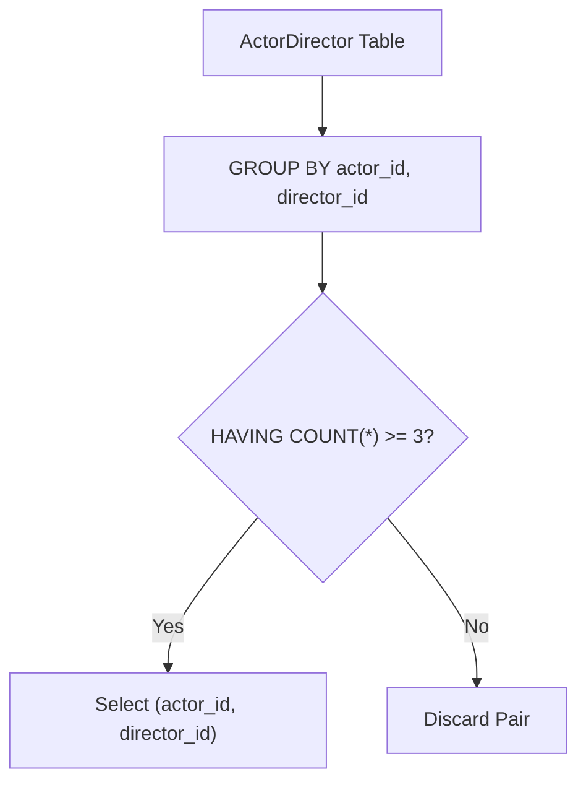

# 1050. Actors and Directors Who Cooperated At Least Three Times

## Problem Statement

Table: `ActorDirector`
```
+-------------+---------+
| Column Name | Type    |
+-------------+---------+
| actor_id    | int     |
| director_id | int     |
| timestamp   | int     |
+-------------+---------+
timestamp is the primary key (column with unique values) for this table.
Each row of this table contains information about the collaborations between an actor and a director at a specific timestamp.
```

Write a solution to find all the pairs `(actor_id, director_id)` where the actor has cooperated with the director **at least three times**.

Return the result table in **any order**.

The result format is in the following example.

### Example 1:
```
Input: 
ActorDirector table:
+-------------+-------------+-------------+
| actor_id    | director_id | timestamp   |
+-------------+-------------+-------------+
| 1           | 1           | 0           |
| 1           | 1           | 1           |
| 1           | 1           | 2           |
| 1           | 2           | 3           |
| 1           | 2           | 4           |
| 2           | 1           | 5           |
| 2           | 1           | 6           |
+-------------+-------------+-------------+
Output: 
+-------------+-------------+
| actor_id    | director_id |
+-------------+-------------+
| 1           | 1           |
+-------------+-------------+
Explanation: The only pair that cooperated at least 3 times is (1, 1) (at timestamps 0, 1, and 2).
```

---

## Approach

1. **Composite Grouping:**
   - Group records by both `actor_id` and `director_id` (`GROUP BY actor_id, director_id`) to aggregate all cooperation timestamps between each unique actor-director pair.

2. **Filter by Minimum Frequency:**
   - Use the `HAVING` clause to filter only pairs with an occurrence count of 3 or more:
     ```sql
     HAVING COUNT(*) >= 3
     ```



---

## Code Implementation

```sql
SELECT 
    actor_id,
    director_id
FROM ActorDirector
GROUP BY actor_id, director_id
HAVING COUNT(*) >= 3;
```

---

## Complexity Analysis

- **Time Complexity**: $O(N)$ — where $N$ is the total number of rows in the `ActorDirector` table. The table is scanned once and hash-aggregated by composite key `(actor_id, director_id)`.

- **Space Complexity**: $O(P)$ — where $P$ is the number of distinct actor-director pairs stored in intermediate aggregation memory.

---
