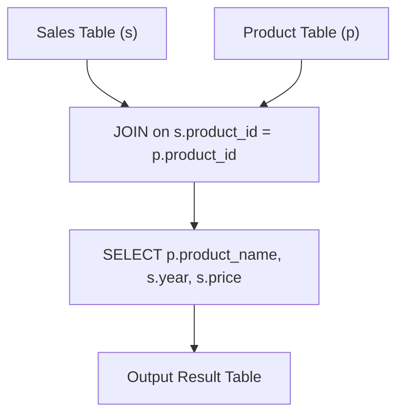

# 1068. Product Sales Analysis I

## Problem Statement

Table: `Sales`
```
+-------------+-------+
| Column Name | Type  |
+-------------+-------+
| sale_id     | int   |
| product_id  | int   |
| year        | int   |
| quantity    | int   |
| price       | int   |
+-------------+-------+
(sale_id, year) is the primary key (combination of columns with unique values) of this table.
product_id is a foreign key (reference column) to Product table.
Each row of this table shows a sale on the product product_id in a certain year.
Note that price is per unit.
```

Table: `Product`
```
+--------------+---------+
| Column Name  | Type    |
+--------------+---------+
| product_id   | int     |
| product_name | varchar |
+--------------+---------+
product_id is the primary key (column with unique values) of this table.
Each row of this table indicates the product name of each product.
```

Write a solution to report the `product_name`, `year`, and `price` for each `sale_id` in the `Sales` table.

Return the resulting table in **any order**.

The result format is in the following example.

### Example 1:
```
Input: 
Sales table:
+---------+------------+------+----------+-------+
| sale_id | product_id | year | quantity | price |
+---------+------------+------+----------+-------+ 
| 1       | 100        | 2008 | 10       | 5000  |
| 2       | 100        | 2009 | 12       | 5000  |
| 7       | 200        | 2011 | 15       | 9000  |
+---------+------------+------+----------+-------+
Product table:
+------------+--------------+
| product_id | product_name |
+------------+--------------+
| 100        | Nokia        |
| 200        | Apple        |
| 300        | Samsung      |
+------------+--------------+
Output: 
+--------------+-------+-------+
| product_name | year  | price |
+--------------+-------+-------+
| Nokia        | 2008  | 5000  |
| Nokia        | 2009  | 5000  |
| Apple        | 2011  | 9000  |
+--------------+-------+-------+
Explanation: 
From sale_id = 1, we can conclude that Nokia was sold for 5000 in 2008.
From sale_id = 2, we can conclude that Nokia was sold for 5000 in 2009.
From sale_id = 7, we can conclude that Apple was sold for 9000 in 2011.
```

---

## Approach

1. **Relational Join:**
   - The `Sales` table stores transactions with their `product_id`, `year`, and `price`.
   - The `Product` table maps each `product_id` to its descriptive `product_name`.
   - Since `product_id` in `Sales` is a foreign key referencing `Product`, an `INNER JOIN` (or `JOIN`) on `Sales.product_id = Product.product_id` matches every transaction with its corresponding product name.

2. **Column Projection:**
   - Select `Product.product_name`, `Sales.year`, and `Sales.price`.



---

## Code Implementation

```sql
SELECT 
    p.product_name,
    s.year,
    s.price
FROM Sales s
JOIN Product p ON s.product_id = p.product_id;
```

---

## Complexity Analysis

- **Time Complexity**: $O(S + P)$ — where $S$ is the number of rows in `Sales` and $P$ is the number of rows in `Product`. The query performs an indexed hash/merge join using primary key `product_id`.

- **Space Complexity**: $O(S)$ — Intermediate memory allocated to return the joined result set of size $S$.

---
