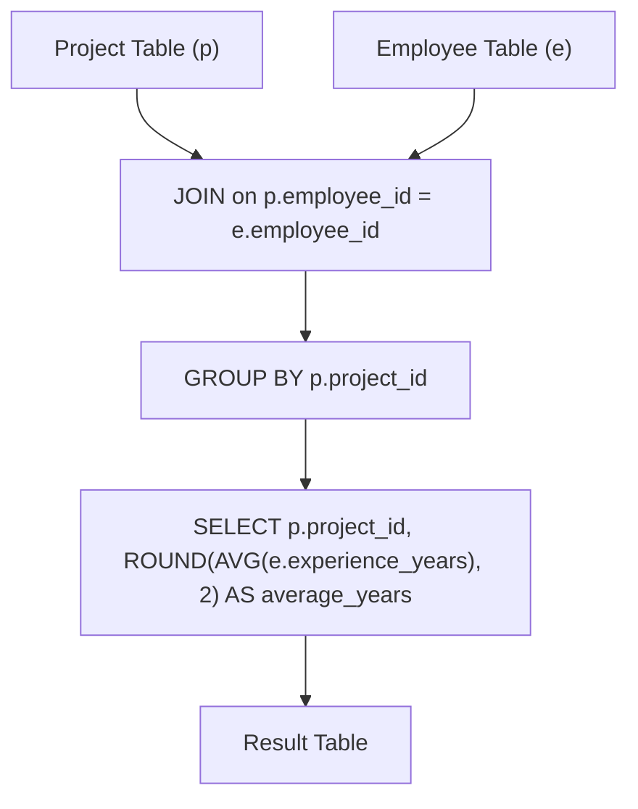

# 1075. Project Employees I

## Problem Statement

Table: `Project`
```
+-------------+---------+
| Column Name | Type    |
+-------------+---------+
| project_id  | int     |
| employee_id | int     |
+-------------+---------+
(project_id, employee_id) is the primary key of this table.
employee_id is a foreign key to Employee table.
Each row of this table indicates that the employee with employee_id is working on the project with project_id.
```

Table: `Employee`
```
+------------------+---------+
| Column Name      | Type    |
+------------------+---------+
| employee_id      | int     |
| name             | varchar |
| experience_years | int     |
+------------------+---------+
employee_id is the primary key of this table. It's guaranteed that experience_years is not NULL.
Each row of this table contains information about one employee.
```

Write a solution to report the **average experience years** of all the employees for each project, **rounded to 2 digits**.

Return the result table in **any order**.

The result format is in the following example.

### Example 1:
```
Input: 
Project table:
+-------------+-------------+
| project_id  | employee_id |
+-------------+-------------+
| 1           | 1           |
| 1           | 2           |
| 1           | 3           |
| 2           | 1           |
| 2           | 4           |
+-------------+-------------+
Employee table:
+-------------+--------+------------------+
| employee_id | name   | experience_years |
+-------------+--------+------------------+
| 1           | Khaled | 3                |
| 2           | Ali    | 2                |
| 3           | John   | 1                |
| 4           | Doe    | 2                |
+-------------+--------+------------------+
Output: 
+-------------+---------------+
| project_id  | average_years |
+-------------+---------------+
| 1           | 2.00          |
| 2           | 2.50          |
+-------------+---------------+
Explanation: 
The average experience years for the first project is (3 + 2 + 1) / 3 = 2.00.
For the second project, the average experience years is (3 + 2) / 2 = 2.50.
```

---

## Approach

1. **Table Association:**
   - Connect the `Project` table with the `Employee` table by joining on the common primary/foreign key `employee_id`.

2. **Per-Project Aggregation:**
   - Group the combined dataset by `project_id`.
   - Calculate the average of `experience_years` for each project group using the `AVG()` function.
   - Use `ROUND(..., 2)` to format the final average to two decimal places as required.



---

## Code Implementation

```sql
SELECT 
    p.project_id,
    ROUND(AVG(e.experience_years), 2) AS average_years
FROM Project p
JOIN Employee e ON p.employee_id = e.employee_id
GROUP BY p.project_id;
```

---

## Complexity Analysis

- **Time Complexity**: $O(P + E)$ — where $P$ is the number of rows in `Project` and $E$ is the number of rows in `Employee`. The join and aggregation execute in linear time using primary key hash lookups.

- **Space Complexity**: $O(K)$ — where $K$ is the number of distinct projects held in intermediate aggregation memory.

---
