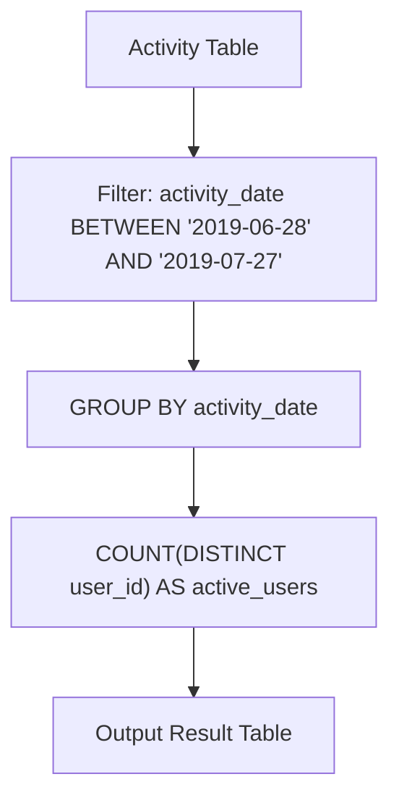

# 1141. User Activity for the Past 30 Days I

## Problem Statement

Table: `Activity`
```
+---------------+---------+
| Column Name   | Type    |
+---------------+---------+
| user_id       | int     |
| session_id    | int     |
| activity_date | date    |
| activity_type | enum    |
+---------------+---------+
This table may have duplicate rows.
The activity_type column is an ENUM (category) of type ('open_session', 'end_session', 'scroll_down', 'send_message').
The table shows user activity for a social media website. 
Note that each session belongs to exactly one user.
```

Write a solution to find the **daily active user count** for a period of **30 days ending `2019-07-27` inclusively**. A user was active on someday if they made at least one activity on that day.

Return the result table in **any order**.

The result format is in the following example.

### Example 1:
```
Input: 
Activity table:
+---------+------------+---------------+---------------+
| user_id | session_id | activity_date | activity_type |
+---------+------------+---------------+---------------+
| 1       | 1          | 2019-07-20    | open_session  |
| 1       | 1          | 2019-07-20    | scroll_down   |
| 1       | 1          | 2019-07-20    | end_session   |
| 2       | 4          | 2019-07-20    | open_session  |
| 2       | 4          | 2019-07-21    | send_message  |
| 2       | 4          | 2019-07-21    | end_session   |
| 3       | 2          | 2019-07-21    | open_session  |
| 3       | 2          | 2019-07-21    | send_message  |
| 3       | 2          | 2019-07-21    | end_session   |
| 4       | 3          | 2019-06-25    | open_session  |
| 4       | 3          | 2019-06-25    | end_session   |
+---------+------------+---------------+---------------+
Output: 
+------------+--------------+
| day        | active_users |
+------------+--------------+ 
| 2019-07-20 | 2            |
| 2019-07-21 | 2            |
+------------+--------------+ 
Explanation: Note that we do not care about days with zero active users.
- On 2019-07-20: user 1 and user 2 were active -> 2 active users.
- On 2019-07-21: user 2 and user 3 were active -> 2 active users.
- 2019-06-25 falls outside the 30-day window ending on 2019-07-27.
```

---

## Approach

1. **Date Window Identification:**
   - The period comprises 30 consecutive days up to and including `2019-07-27`.
   - The start date is computed as `2019-07-27` minus 29 days: `2019-06-28`.
   - Filter records using `WHERE activity_date BETWEEN '2019-06-28' AND '2019-07-27'`.

2. **Distinct User Deduplication:**
   - Multiple actions or sessions performed by the same user on the same date produce duplicate rows in `Activity`.
   - Use `COUNT(DISTINCT user_id)` to tally each active user exactly once per day.
   - Group records by `activity_date`.



---

## Code Implementation

```sql
SELECT 
    activity_date AS day,
    COUNT(DISTINCT user_id) AS active_users
FROM Activity
WHERE activity_date BETWEEN '2019-06-28' AND '2019-07-27'
GROUP BY activity_date;
```

---

## Complexity Analysis

- **Time Complexity**: $O(N)$ — where $N$ is the number of rows in the `Activity` table. The date filtering and hash-based grouping with distinct user set counting execute in a single linear pass.

- **Space Complexity**: $O(D \cdot U)$ — where $D \le 30$ is the number of distinct days in the window and $U$ is the number of unique users tracked per day.

---
