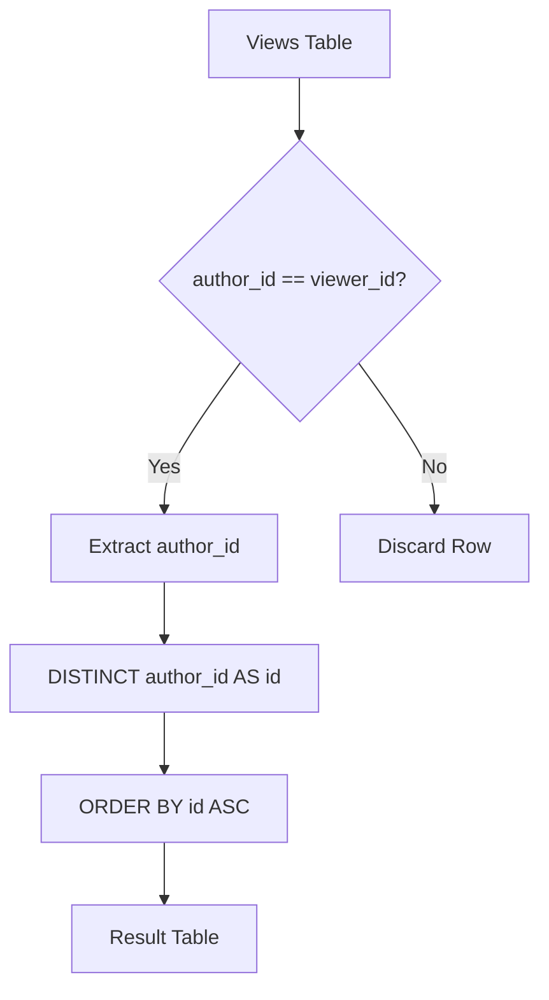

# 1148. Article Views I

## Problem Statement

Table: `Views`
```
+---------------+---------+
| Column Name   | Type    |
+---------------+---------+
| article_id    | int     |
| author_id     | int     |
| viewer_id     | int     |
| view_date     | date    |
+---------------+---------+
There is no primary key (column with unique values) for this table, the table may have duplicate rows.
Each row of this table indicates that some viewer viewed an article (written by some author) on some date. 
Note that equal author_id and viewer_id indicate the same person.
```

Write a solution to find all the authors that viewed at least one of their own articles.

Return the result table sorted by `id` in **ascending order**.

The result format is in the following example.

### Example 1:
```
Input: 
Views table:
+------------+-----------+-----------+------------+
| article_id | author_id | viewer_id | view_date  |
+------------+-----------+-----------+------------+
| 1          | 3         | 5         | 2019-08-01 |
| 1          | 3         | 6         | 2019-08-02 |
| 2          | 7         | 7         | 2019-08-01 |
| 2          | 7         | 6         | 2019-08-02 |
| 4          | 7         | 1         | 2019-07-22 |
| 3          | 4         | 4         | 2019-07-21 |
| 3          | 4         | 4         | 2019-07-21 |
+------------+-----------+-----------+------------+
Output: 
+------+
| id   |
+------+
| 4    |
| 7    |
+------+
Explanation: 
- Author 4 viewed article 3 on 2019-07-21 (author_id = viewer_id = 4).
- Author 7 viewed article 2 on 2019-08-01 (author_id = viewer_id = 7).
- Both author IDs are returned in ascending order.
```

---

## Approach

1. **Self-View Filtering:**
   - An author viewing their own article is represented by the predicate `author_id = viewer_id`.

2. **Deduplication & Sorting:**
   - Because an author may view multiple articles (or the same article multiple times), duplicate self-view rows can occur.
   - Use `DISTINCT` on `author_id` to ensure each author ID appears only once in the final output.
   - Alias `author_id` as `id` and order by `id ASC`.



---

## Code Implementation

```sql
SELECT DISTINCT 
    author_id AS id
FROM Views
WHERE author_id = viewer_id
ORDER BY id ASC;
```

---

## Complexity Analysis

- **Time Complexity**: $O(N \log N)$ — where $N$ is the number of rows in the `Views` table. Scanning rows and filtering takes $O(N)$ time, while sorting distinct IDs for output takes $O(K \log K)$ where $K \le N$.

- **Space Complexity**: $O(K)$ — Memory required to deduplicate unique author IDs and produce the sorted output set.

---
