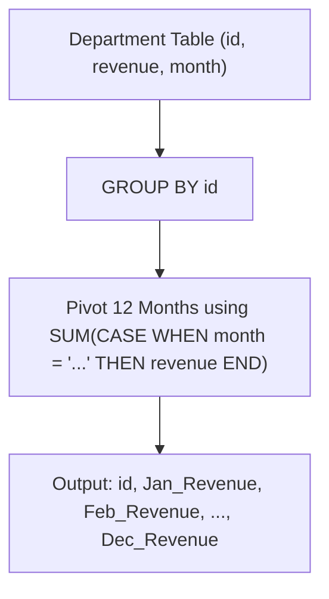

# 1179. Reformat Department Table

## Problem Statement

Table: `Department`
```
+-------------+---------+
| Column Name | Type    |
+-------------+---------+
| id          | int     |
| revenue     | int     |
| month       | varchar |
+-------------+---------+
In SQL, (id, month) is the primary key of this table.
The table has information about the revenue of each department per month.
The month has values in ["Jan","Feb","Mar","Apr","May","Jun","Jul","Aug","Sep","Oct","Nov","Dec"].
```

Write a solution to reformat the table such that there is a department id column and a revenue column for each month.

Return the result table in **any order**.

The result format is in the following example.

### Example 1:
```
Input: 
Department table:
+------+---------+-------+
| id   | revenue | month |
+------+---------+-------+
| 1    | 8000    | Jan   |
| 2    | 9000    | Jan   |
| 3    | 10000   | Feb   |
| 1    | 7000    | Feb   |
| 1    | 6000    | Mar   |
+------+---------+-------+
Output: 
+------+-------------+-------------+-------------+-----+-------------+
| id   | Jan_Revenue | Feb_Revenue | Mar_Revenue | ... | Dec_Revenue |
+------+-------------+-------------+-------------+-----+-------------+
| 1    | 8000        | 7000        | 6000        | ... | null        |
| 2    | 9000        | null        | null        | ... | null        |
| 3    | null        | 10000       | null        | ... | null        |
+------+-------------+-------------+-------------+-----+-------------+
Explanation: The revenue from 1 to 12 months for each department is reformatted and arranged into columns.
```

---

## Approach

1. **Pivoting via Conditional Aggregation:**
   - In relational databases without dedicated dynamic pivot syntax, pivoting rows to columns is canonically performed using conditional aggregation: combining `SUM()` or `MAX()` with `CASE WHEN` constructs.
   - For each month $M \in \{\text{Jan}, \text{Feb}, \dots, \text{Dec}\}$, compute:
     $$\text{SUM}(\text{CASE WHEN month} = M \text{ THEN revenue ELSE NULL END}) \text{ AS } M\_Revenue$$
   - Since `(id, month)` is unique (primary key), for any given `id` and month $M$, there is at most one revenue value. If no row exists for that month, `SUM(NULL)` evaluates to `NULL`, matching the required output.

2. **Grouping by Department ID:**
   - Grouping by `id` aggregates all monthly records for each distinct department into a single consolidated row with 12 monthly revenue columns.



---

## Code Implementation

```sql
SELECT 
    id,
    SUM(CASE WHEN month = 'Jan' THEN revenue END) AS Jan_Revenue,
    SUM(CASE WHEN month = 'Feb' THEN revenue END) AS Feb_Revenue,
    SUM(CASE WHEN month = 'Mar' THEN revenue END) AS Mar_Revenue,
    SUM(CASE WHEN month = 'Apr' THEN revenue END) AS Apr_Revenue,
    SUM(CASE WHEN month = 'May' THEN revenue END) AS May_Revenue,
    SUM(CASE WHEN month = 'Jun' THEN revenue END) AS Jun_Revenue,
    SUM(CASE WHEN month = 'Jul' THEN revenue END) AS Jul_Revenue,
    SUM(CASE WHEN month = 'Aug' THEN revenue END) AS Aug_Revenue,
    SUM(CASE WHEN month = 'Sep' THEN revenue END) AS Sep_Revenue,
    SUM(CASE WHEN month = 'Oct' THEN revenue END) AS Oct_Revenue,
    SUM(CASE WHEN month = 'Nov' THEN revenue END) AS Nov_Revenue,
    SUM(CASE WHEN month = 'Dec' THEN revenue END) AS Dec_Revenue
FROM Department
GROUP BY id;
```

---

## Complexity Analysis

- **Time Complexity**: $O(N)$ — where $N$ is the number of rows in the `Department` table. The query performs a single pass over the table while hashing or sorting by `id` to aggregate 12 constant conditions per row.
- **Space Complexity**: $O(D)$ — where $D$ is the number of unique department IDs in the result set.

---
