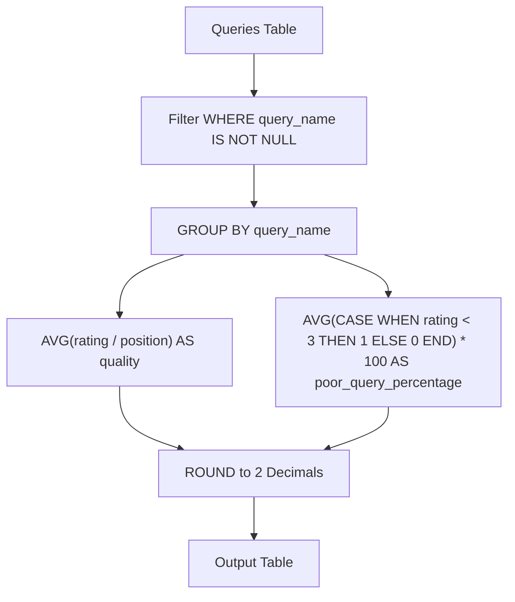

# 1211. Queries Quality and Percentage

## Problem Statement

Table: `Queries`
```
+-------------+---------+
| Column Name | Type    |
+-------------+---------+
| query_name  | varchar |
| result      | varchar |
| position    | int     |
| rating      | int     |
+-------------+---------+
This table may have duplicate rows.
This table contains information collected from the query logs of the search engine.
The position column has a value from 1 to 500.
The rating column has a value from 1 to 5. Query with rating less than 3 is a poor query.
```

We define query `quality` as:
> The average of the ratio between query rating and its position.

We also define `poor_query_percentage` as:
> The percentage of all queries for a query name with rating less than 3.

Write a solution to find each `query_name`, `quality` and `poor_query_percentage`.

Both `quality` and `poor_query_percentage` should be **rounded to 2 decimal places**.

Return the result table in **any order**.

The result format is in the following example.

### Example 1:
```
Input: 
Queries table:
+------------+-------------------+----------+--------+
| query_name | result            | position | rating |
+------------+-------------------+----------+--------+
| Dog        | Golden Retriever  | 1        | 5      |
| Dog        | German Shepherd   | 2        | 5      |
| Dog        | Mule              | 200      | 1      |
| Cat        | Shirazi           | 5        | 2      |
| Cat        | Siamese           | 3        | 3      |
| Cat        | Sphynx            | 7        | 4      |
+------------+-------------------+----------+--------+
Output: 
+------------+---------+-----------------------+
| query_name | quality | poor_query_percentage |
+------------+---------+-----------------------+
| Dog        | 2.50    | 33.33                 |
| Cat        | 0.66    | 33.33                 |
+------------+---------+-----------------------+
Explanation: 
Dog queries:
- quality = ((5 / 1) + (5 / 2) + (1 / 200)) / 3 = 7.505 / 3 = 2.50
- poor_query_percentage = (1 / 3) * 100 = 33.33

Cat queries:
- quality = ((2 / 5) + (3 / 3) + (4 / 7)) / 3 = 1.9714 / 3 = 0.66
- poor_query_percentage = (1 / 3) * 100 = 33.33
```

---

## Approach

1. **Filtering Null Query Names:**
   - The dataset may contain records where `query_name` is `NULL`. These rows should be excluded using `WHERE query_name IS NOT NULL`.

2. **Calculating Quality:**
   - For each group of rows sharing the same `query_name`, the ratio for each entry is `rating / position`.
   - The query quality is the average of these ratios:
     $$\text{quality} = \text{ROUND}(\text{AVG}(\text{rating} / \text{position}), 2)$$

3. **Calculating Poor Query Percentage:**
   - A query is "poor" if `rating < 3`.
   - Using conditional aggregation `AVG(CASE WHEN rating < 3 THEN 1 ELSE 0 END) * 100` computes the proportion of poor queries multiplied by 100.
   - Round the final result to 2 decimal places using `ROUND(..., 2)`.

4. **Grouping:**
   - `GROUP BY query_name` aggregates statistics for each individual query name.



---

## Code Implementation

```sql
SELECT 
    query_name,
    ROUND(AVG(rating / position), 2) AS quality,
    ROUND(AVG(CASE WHEN rating < 3 THEN 1 ELSE 0 END) * 100, 2) AS poor_query_percentage
FROM Queries
WHERE query_name IS NOT NULL
GROUP BY query_name;
```

---

## Complexity Analysis

- **Time Complexity**: $O(N)$ — where $N$ is the number of rows in the `Queries` table. A single sequential scan with hashing/grouping by `query_name` processes the aggregation in linear time.
- **Space Complexity**: $O(Q)$ — where $Q$ is the number of unique non-null `query_name` groups stored in the aggregation buffer and output table.

---
