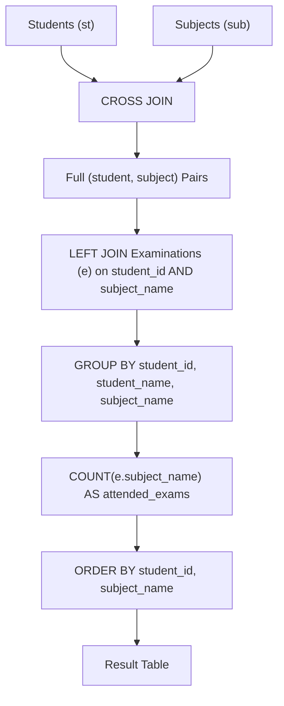

# 1280. Students and Examinations

## Problem Statement

Table: `Students`
```
+---------------+---------+
| Column Name   | Type    |
+---------------+---------+
| student_id    | int     |
| student_name  | varchar |
+---------------+---------+
student_id is the primary key (column with unique values) for this table.
Each row of this table contains the ID and the name of one student in the school.
```

Table: `Subjects`
```
+--------------+---------+
| Column Name  | Type    |
+--------------+---------+
| subject_name | varchar |
+--------------+---------+
subject_name is the primary key (column with unique values) for this table.
Each row of this table contains the name of one subject in the school.
```

Table: `Examinations`
```
+--------------+---------+
| Column Name  | Type    |
+--------------+---------+
| student_id   | int     |
| subject_name | varchar |
+--------------+---------+
There is no primary key (column with unique values) for this table. It may contain duplicates.
Each student from the Students table takes every course from the Subjects table.
Each row of this table indicates that a student with ID student_id attended the exam of subject_name.
```

Write a solution to find the number of times each student attended each exam.

Return the result table ordered by `student_id` and `subject_name`.

The result format is in the following example.

### Example 1:
```
Input: 
Students table:
+------------+--------------+
| student_id | student_name |
+------------+--------------+
| 1          | Alice        |
| 2          | Bob          |
| 13         | John         |
| 6          | Alex         |
+------------+--------------+
Subjects table:
+--------------+
| subject_name |
+--------------+
| Math         |
| Physics      |
| Programming  |
+--------------+
Examinations table:
+------------+--------------+
| student_id | subject_name |
+------------+--------------+
| 1          | Math         |
| 1          | Physics      |
| 1          | Programming  |
| 2          | Programming  |
| 1          | Physics      |
| 1          | Math         |
| 13         | Math         |
| 13         | Programming  |
| 13         | Physics      |
| 2          | Math         |
| 1          | Math         |
+------------+--------------+
Output: 
+------------+--------------+--------------+----------------+
| student_id | student_name | subject_name | attended_exams |
+------------+--------------+--------------+----------------+
| 1          | Alice        | Math         | 3              |
| 1          | Alice        | Physics      | 2              |
| 1          | Alice        | Programming  | 1              |
| 2          | Bob          | Math         | 1              |
| 2          | Bob          | Physics      | 0              |
| 2          | Bob          | Programming  | 1              |
| 6          | Alex         | Math         | 0              |
| 6          | Alex         | Physics      | 0              |
| 6          | Alex         | Programming  | 0              |
| 13         | John         | Math         | 1              |
| 13         | John         | Physics      | 1              |
| 13         | John         | Programming  | 1              |
+------------+--------------+--------------+----------------+
Explanation: 
- The result table should contain every student and every subject combination.
- Alice attended the Math exam 3 times, Physics 2 times, and Programming 1 time.
- Bob attended Math 1 time, Programming 1 time, and Physics 0 times.
- Alex did not attend any exam (0 times for each subject).
- John attended each exam 1 time.
```

---

## Approach

1. **Cartesian Product (`CROSS JOIN`):**
   - The problem mandates that every student be paired with every subject, regardless of whether they ever attended an exam for that subject.
   - Performing a `CROSS JOIN` between `Students` and `Subjects` generates the complete universe of `(student, subject)` pairs.

2. **Left Joining Attendance Logs (`LEFT JOIN`):**
   - Left join the generated Cartesian product with the `Examinations` table matching on both `student_id` and `subject_name`.
   - If an exam was attended multiple times, multiple rows are generated. If it was never attended, `NULL` values will be placed in the `Examinations` columns.

3. **Counting Exams Attended:**
   - Use `COUNT(e.subject_name)` (or `COUNT(e.student_id)`). Unlike `COUNT(*)`, which would count unmatched rows as 1, `COUNT(column)` ignores `NULL`s, correctly evaluating to `0` when no exam was attended.

4. **Grouping and Sorting:**
   - Group by `st.student_id, st.student_name, sub.subject_name`.
   - Order the final output by `st.student_id ASC, sub.subject_name ASC`.



---

## Code Implementation

```sql
SELECT 
    st.student_id,
    st.student_name,
    sub.subject_name,
    COUNT(e.subject_name) AS attended_exams
FROM Students st
CROSS JOIN Subjects sub
LEFT JOIN Examinations e 
    ON st.student_id = e.student_id 
    AND sub.subject_name = e.subject_name
GROUP BY 
    st.student_id, 
    st.student_name, 
    sub.subject_name
ORDER BY 
    st.student_id, 
    sub.subject_name;
```

---

## Complexity Analysis

- **Time Complexity**: $O(S \cdot U + E)$ — where $S$ is the number of students, $U$ is the number of subjects, and $E$ is the number of rows in `Examinations`. Generating the Cartesian pairs takes $O(S \cdot U)$, joining and aggregating exam attendances takes $O(E)$, and sorting takes $O((S \cdot U) \log(S \cdot U))$.
- **Space Complexity**: $O(S \cdot U)$ — intermediate memory needed to materialize the pairs and group aggregation buffers.

---
