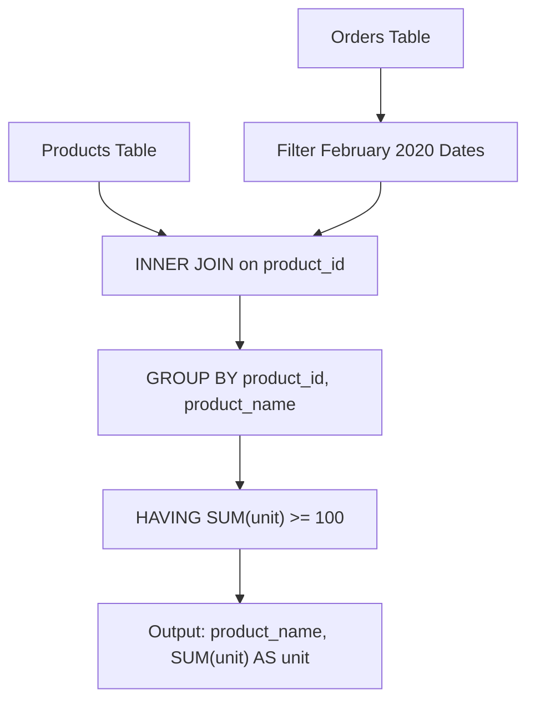

# 1327. List the Products Ordered in a Period

## Problem Statement

Table: `Products`
```
+------------------+---------+
| Column Name      | Type    |
+------------------+---------+
| product_id       | int     |
| product_name     | varchar |
| product_category | varchar |
+------------------+---------+
product_id is the primary key (column with unique values) for this table.
This table contains data about the company's products.
```

Table: `Orders`
```
+---------------+---------+
| Column Name   | Type    |
+---------------+---------+
| product_id    | int     |
| order_date    | date    |
| unit          | int     |
+---------------+---------+
This table may have duplicate rows.
product_id is a foreign key (reference column) to the Products table.
unit is the number of products ordered in order_date.
```

Write a solution to get the names of products that have at least `100` units ordered in **February 2020** and their amount.

Return the result table in **any order**.

The result format is in the following example.

### Example 1:
```
Input: 
Products table:
+-------------+-----------------------+------------------+
| product_id  | product_name          | product_category |
+-------------+-----------------------+------------------+
| 1           | Leetcode Solutions    | Book             |
| 2           | Jewels of Stringology | Book             |
| 3           | HP                    | Laptop           |
| 4           | Lenovo                | Laptop           |
| 5           | Leetcode Kit          | T-shirt          |
+-------------+-----------------------+------------------+
Orders table:
+--------------+--------------+----------+
| product_id   | order_date   | unit     |
+--------------+--------------+----------+
| 1            | 2020-02-05   | 60       |
| 1            | 2020-02-10   | 70       |
| 2            | 2020-01-18   | 30       |
| 2            | 2020-02-11   | 80       |
| 3            | 2020-02-17   | 2        |
| 3            | 2020-02-24   | 3        |
| 4            | 2020-03-01   | 20       |
| 4            | 2020-03-04   | 30       |
| 4            | 2020-03-04   | 60       |
| 5            | 2020-02-25   | 50       |
| 5            | 2020-02-27   | 50       |
+--------------+--------------+----------+
Output: 
+--------------------+---------+
| product_name       | unit    |
+--------------------+---------+
| Leetcode Solutions | 130     |
| Leetcode Kit       | 100     |
+--------------------+---------+
Explanation: 
- Product 1 was ordered in February a total of (60 + 70) = 130 units.
- Product 2 was ordered in February a total of 80 units (the order on 2020-01-18 was in January).
- Product 3 was ordered in February a total of (2 + 3) = 5 units.
- Product 4 had no orders in February 2020.
- Product 5 was ordered in February a total of (50 + 50) = 100 units.
Therefore, only products 1 and 5 meet the criterion of at least 100 units.
```

---

## Approach

1. **Date Range Filtering:**
   - Filter `Orders` to include only records placed in February 2020:
     $$ \text{order\_date} \ge \text{'2020-02-01'} \quad \text{AND} \quad \text{order\_date} \le \text{'2020-02-29'} $$
   - Alternatively, `DATE_FORMAT(order_date, '%Y-%m') = '2020-02'` or `LEFT(order_date, 7) = '2020-02'` can be used, though range comparison allows standard B-tree index utilization on `order_date`.

2. **Joining Tables:**
   - Perform an `INNER JOIN` between `Products` and `Orders` on `p.product_id = o.product_id` to attach the descriptive `product_name`.

3. **Aggregation and Threshold Filtering:**
   - `GROUP BY p.product_id, p.product_name` to aggregate total units ordered per product.
   - Use `HAVING SUM(o.unit) >= 100` to filter only products reaching the minimum threshold of 100 units.



---

## Code Implementation

```sql
SELECT 
    p.product_name,
    SUM(o.unit) AS unit
FROM Products p
JOIN Orders o 
    ON p.product_id = o.product_id
WHERE o.order_date >= '2020-02-01' 
  AND o.order_date <= '2020-02-29'
GROUP BY 
    p.product_id, 
    p.product_name
HAVING SUM(o.unit) >= 100;
```

---

## Complexity Analysis

- **Time Complexity**: $O(P + O)$ — where $P$ is the number of rows in `Products` and $O$ is the number of rows in `Orders`. Filtering and joining executes in linear time with index lookups, and grouping takes linear time with respect to the joined rows.
- **Space Complexity**: $O(K)$ — where $K$ is the number of distinct products with orders in February 2020 retained in the aggregation buffer.

---
