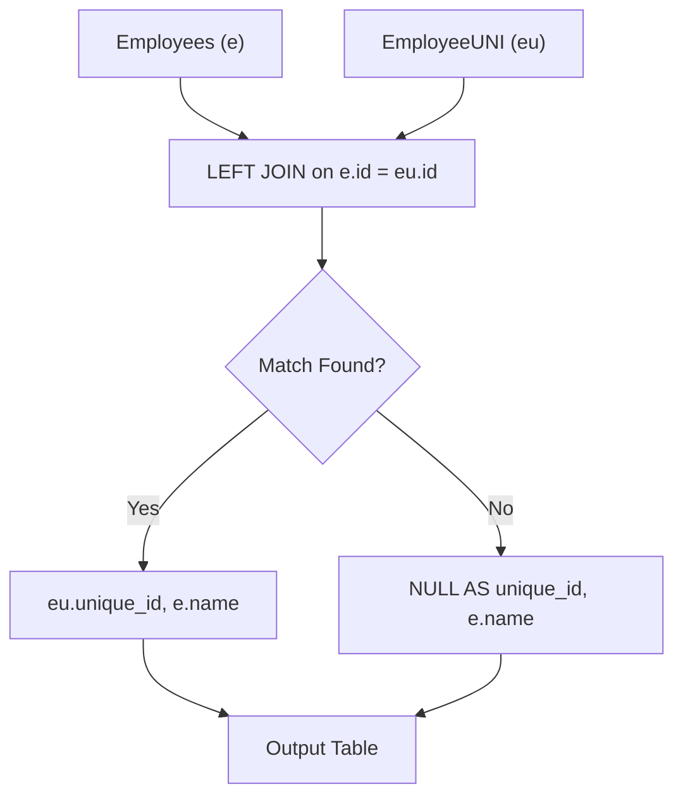

# 1378. Replace Employee ID With The Unique Identifier

## Problem Statement

Table: `Employees`
```
+---------------+---------+
| Column Name   | Type    |
+---------------+---------+
| id            | int     |
| name          | varchar |
+---------------+---------+
id is the primary key (column with unique values) for this table.
Each row of this table contains the id and the name of an employee in a company.
```

Table: `EmployeeUNI`
```
+---------------+---------+
| Column Name   | Type    |
+---------------+---------+
| id            | int     |
| unique_id     | int     |
+---------------+---------+
(id, unique_id) is the primary key (combination of columns with unique values) for this table.
Each row of this table contains the id and the corresponding unique id of an employee in the company.
```

Write a solution to show the **unique ID** of each user, If a user does not have a unique ID replace just show `null`.

Return the result table in **any order**.

The result format is in the following example.

### Example 1:
```
Input: 
Employees table:
+----+----------+
| id | name     |
+----+----------+
| 1  | Alice    |
| 7  | Bob      |
| 11 | Meir     |
| 90 | Winston  |
| 3  | Jonathan |
+----+----------+
EmployeeUNI table:
+----+-----------+
| id | unique_id |
+----+-----------+
| 3  | 1         |
| 11 | 2         |
| 90 | 3         |
+----+-----------+
Output: 
+-----------+----------+
| unique_id | name     |
+-----------+----------+
| null      | Alice    |
| null      | Bob      |
| 2         | Meir     |
| 3         | Winston  |
| 1         | Jonathan |
+-----------+----------+
Explanation: 
Alice and Bob do not have a unique ID, We will show null instead.
The unique ID of Meir is 2.
The unique ID of Winston is 3.
The unique ID of Jonathan is 1.
```

---

## Approach

1. **Retaining All Employees via `LEFT JOIN`:**
   - Every employee in `Employees` must be included in the final output, regardless of whether a matching record exists in `EmployeeUNI`.
   - Performing a `LEFT JOIN` from `Employees` (`e`) to `EmployeeUNI` (`eu`) on `e.id = eu.id` guarantees that all employee rows are preserved.

2. **Handling Missing Identifiers:**
   - If an employee does not have a corresponding identifier in `EmployeeUNI`, SQL naturally populates the joined columns (`eu.unique_id`) with `NULL`, perfectly matching the problem requirements without requiring conditional `CASE` statements or `COALESCE`.



---

## Code Implementation

```sql
SELECT 
    eu.unique_id,
    e.name
FROM Employees e
LEFT JOIN EmployeeUNI eu 
    ON e.id = eu.id;
```

---

## Complexity Analysis

- **Time Complexity**: $O(N + M)$ — where $N$ is the number of records in `Employees` and $M$ is the number of records in `EmployeeUNI`. With hash/index join on `id`, matching records executes in linear time.
- **Space Complexity**: $O(N)$ — memory required to generate and output the combined result table.

---
